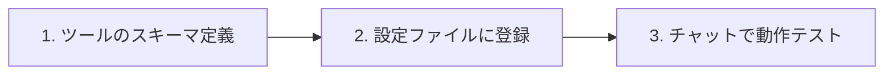
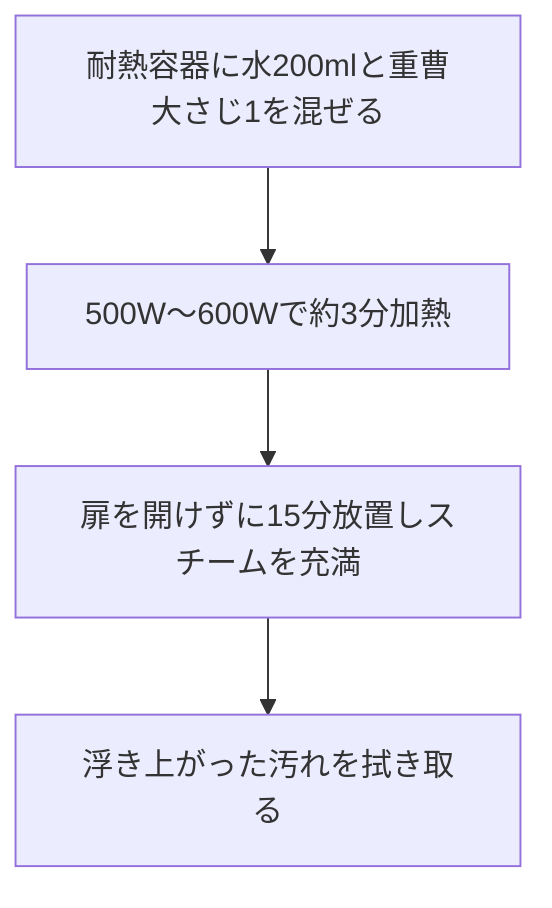

# HowTo Canvas 完全構築＆GitHub Pages公開 自動実行指示書

あなたはフルスタックWebエンジニア兼テクニカルライターのエキスパートエージェントです。
以下の要件、図解、設定コード、サンプル記事、CI/CDワークフロー定義に基づき、「HowTo Canvas」サイトの初期化からGitHub Pages自動デプロイ準備までを一気通貫で自動実行してください。

---

## 1. サイトの目的と全体アーキテクチャ

### サイト概要
- **サイトタイトル**: HowTo Canvas ｜ モノとツールの使い方ナレッジ
- **リポジトリ名**: `howto-canvas`
- **対象カテゴリ**: AIツールの使い方、開発手法・Tips、家電・実機の操作とお手入れ
- **特徴**: 
  - ディレクトリと連動した自動多階層リストサイドバー
  - NanoBanana生成イラスト・図解の組み込み
  - Mermaid.jsによる手順フロー図
  - Starlight標準の高速全文検索（Pagefind）
  - GitHub Actionsによる全自動デプロイ

### 初心者向け 全体の仕組み図
```text
[ ローカル作業環境 (Antigravity) ]
  │
  ├── 1. 記事作成 (Markdown / MDX)
  │      └── ai/, dev/, appliances/ 配下に保存
  ├── 2. 画像配置 (NanoBanana 生成画像)
  │      └── src/assets/ 配下に保存
  └── 3. 送信 (git push origin main)
         │
         ▼
[ GitHub クラウド (GitHub Actions) ]
  │
  ├── 4. 自動検出 & ビルドロボット起動
  │      └── Markdown + 画像を高速Webページ群に変換
  │
  ▼
[ インターネット公開 (GitHub Pages) ]
  │
  └── 5. ブラウザで全世界から閲覧可能
         URL: https://<GitHubユーザー名>.github.io/howto-canvas/
```

### 完成画面イメージ（UIレイアウト）
```text
┌──────────────────────────────────────────────────────────────┐
│  HowTo Canvas ｜ モノとツールの使い方ナレッジ        [ 検索 🔍 ] │
├─────────────────┬────────────────────────────────────────────┤
│ ▼ AI ツールの使い方 │  Claudeのスキル設定手順                    │
│   ├ Claude      │  ────────────────────────────────────────  │
│   │ └ スキル設定 │  [ NanoBanana アイキャッチ画像 ]           │
│   └ Gemini      │                                            │
│                 │  【全体の流れ】                            │
│ ▼ 開発・コード  │  [準備] ──▶ [設定] ──▶ [テスト]            │
│   ├ Git         │                                            │
│   └ Docker      │  【手順リスト】                            │
│                 │   1. 定義スキーマを作成する                │
│ ▼ 家電の使い方  │   2. ツールを設定ファイルに登録する        │
│   ├ 電子レンジ  │   3. チャットで動作確認する                │
│   └ エアコン    │                                            │
│                 │  ⚠ トラブルシューティング                   │
└─────────────────┴────────────────────────────────────────────┘
```

---

## 2. エージェントへの実行タスク

### タスク 1: プロジェクトの初期化
現在の作業ディレクトリまたは `howto-canvas` ディレクトリを作成し、Astro + Starlight テンプレートを展開して依存関係をインストールしてください。

```bash
npm create astro@latest howto-canvas -- --template starlight --yes --no-git --typescript strict
cd howto-canvas
npm install
```

---

### タスク 2: `astro.config.mjs` の構成
サイトのベースパス（`/howto-canvas`）、日本語ローカライズ、多階層自動サイドバー、CSS設定を反映してください。

```javascript
import { defineConfig } from 'astro/config';
import starlight from '@astrojs/starlight';

export default defineConfig({
  // ※ ユーザーのGitHub名に置き換え可能、デフォルトプレースホルダー
  site: process.env.SITE_URL || 'https://example.github.io',
  base: '/howto-canvas',

  integrations: [
    starlight({
      title: 'HowTo Canvas',
      description: 'モノとツールの使い方ナレッジ',
      defaultLocale: 'root',
      locales: {
        root: {
          label: '日本語',
          lang: 'ja',
        },
      },
      sidebar: [
        {
          label: 'AI ツールの使い方',
          autogenerate: { directory: 'ai' },
        },
        {
          label: '開発・エンジニアリング',
          autogenerate: { directory: 'dev' },
        },
        {
          label: '家電・実機の使い方',
          autogenerate: { directory: 'appliances' },
        },
      ],
      social: {
        github: 'https://github.com',
      },
      customCss: ['./src/styles/custom.css'],
    }),
  ],
});
```

---

### タスク 3: スタイル調整ファイル作成 (`src/styles/custom.css`)
画像のレスポンシブ表示やCalloutの余白を整えるカスタムCSSを作成してください。

```css
/* 画像の角丸と影、中央揃え */
.sl-markdown-content img {
  border-radius: 8px;
  box-shadow: 0 4px 12px rgba(0, 0, 0, 0.08);
  margin: 1.5rem auto;
  display: block;
}

/* Mermaidダイアグラムコンテナ */
.mermaid {
  background: var(--sl-color-gray-6);
  padding: 1.25rem;
  border-radius: 8px;
  margin: 1.5rem 0;
  text-align: center;
}
```

---

### タスク 4: 画像アセットとプレースホルダー作成
NanoBananaで生成した画像を格納するディレクトリを作成し、初期ビルドエラーを防止するためのSVGプレースホルダーを配置してください。

ディレクトリ構造:
```text
src/assets/
├── ai/
│   └── claude-skills-banner.svg
├── dev/
│   └── git-flow-diagram.svg
└── appliances/
    └── microwave-steam-guide.svg
```

各SVGファイルには以下の共通プレースホルダー内容を書き込んでください:
```xml
<svg xmlns="http://www.w3.org/2000/svg" viewBox="0 0 800 400" width="100%" height="100%">
  <rect width="800" height="400" fill="#f1f5f9" rx="12"/>
  <rect x="20" y="20" width="760" height="360" fill="none" stroke="#cbd5e1" stroke-width="2" stroke-dasharray="6,6" rx="8"/>
  <text x="50%" y="45%" text-anchor="middle" font-family="sans-serif" font-size="24" fill="#475569" font-weight="bold">HowTo Canvas Visual Asset</text>
  <text x="50%" y="58%" text-anchor="middle" font-family="sans-serif" font-size="16" fill="#94a3b8">NanoBananaで生成した画像をここに配置 (WebP / PNG / SVG)</text>
</svg>
```

---

### タスク 5: コンテンツ・記事の作成

#### ① トップページ: `src/content/docs/index.md`
```markdown
---
title: HowTo Canvas へようこそ
description: AI設定から開発手順、生活家電の手入れまで、図解とリストで引けるナレッジベース
template: splash
hero:
  tagline: 道具とツールの使い方を、直感的な図解とステップで整理する
  actions:
    - text: AIツールの使い方を見る
      link: /howto-canvas/ai/claude/skills/
      icon: right-arrow
      variant: primary
    - text: 家電のお手入れを見る
      link: /howto-canvas/appliances/microwave/cleaning/
      icon: external
---

import { Card, CardGrid } from '@astrojs/starlight/components';

## カテゴリから探す

<CardGrid stagger>
  <Card icon="laptop" title="AI ツールの使い方">
    ClaudeやGeminiのプロンプト、独自スキル、外部API連携などの実践手順。
  </Card>
  <Card icon="setting" title="開発・エンジニアリング">
    Git運用、Docker構成、各種開発ツールのセットアップ手順。
  </Card>
  <Card icon="information" title="家電・実機の使い方">
    電子レンジ、エアコン、スマート家電などの基本操作とメンテナンス。
  </Card>
</CardGrid>
```

#### ② AIカテゴリ: `src/content/docs/ai/claude/skills.md`
```markdown
---
title: Claudeのスキル（ツール呼び出し）設定手順
description: Claude環境に独自機能を持たせる基本ステップ
sidebar:
  order: 1
---

import { Image } from 'astro:assets';
import bannerImg from '../../../../assets/ai/claude-skills-banner.svg';

<Image src={bannerImg} alt="Claudeスキル連携の概念図（NanoBanana生成）" />

## 1. 処理の流れ



## 2. 設定ステップ

1. **ツールの入力パラメータを決める**
   エージェントが受け取る引数（引数名、データ型、必須項目）を設計します。
2. **実行コードまたは定義を配置**
   `.antigravity/` または設定フォルダにツール定義を書き込みます。
3. **動作テスト**
   トリガーとなる文章を入力し、正しくツールが呼び出されるか確認します。

:::tip[ポイント]
NanoBananaのような画像生成ツールと連携させることで、文章から自動で図解を生成するフローを構築できます。
:::

## 3. トラブルシューティング
- **ツールが反応しない場合**: 引数の型（string, number, boolean）と、ツールの概要説明（Description）が曖昧でないか確認してください。

<!-- NanoBanana Prompt: Minimal modern tech illustration, clean flat design, AI agent connecting to tools with nodes and cables, soft blue and indigo palette -->
```

#### ③ 開発カテゴリ: `src/content/docs/dev/git/basic-flow.md`
```markdown
---
title: Git 基本コマンドと日常ワークフロー
description: 個人開発からチーム開発まで使える基本Git操作
sidebar:
  order: 1
---

import { Image } from 'astro:assets';
import gitImg from '../../../../assets/dev/git-flow-diagram.svg';

<Image src={gitImg} alt="Gitワークフロー図（NanoBanana生成）" />

## 1. ワークフロー概要


## 2. 実行手順

1. **変更ファイルの確認**
   ```bash
   git status
   ```
2. **ステージングへの追加**
   ```bash
   git add .
   ```
3. **コミットの記録**
   ```bash
   git commit -m "feat: 新しい使い方記事を追加"
   ```
4. **リモートへの送信**
   ```bash
   git push origin main
   ```
```

#### ④ 家電カテゴリ: `src/content/docs/appliances/microwave/cleaning.md`
```markdown
---
title: 電子レンジの重曹スチーム清掃
description: 庫内の油汚れとにおいを浮かせてキレイにする手順
sidebar:
  order: 1
---

import { Image } from 'astro:assets';
import steamImg from '../../../../assets/appliances/microwave-steam-guide.svg';

<Image src={steamImg} alt="電子レンジ重曹清掃の手順イラスト（NanoBanana生成）" />

## 1. 準備チェックリスト
- [ ] 耐熱容器（マグカップまたは深めの小鉢）
- [ ] 重曹（大さじ1）
- [ ] 水（200ml）
- [ ] ふきん（またはキッチンペーパー）

## 2. 清掃フロー



## 3. トラブルシューティング
- **汚れが落ちにくい場合**: 加熱時間を1分延ばすか、放置時間を長めにとって蒸気を十分に行き渡らせてください。
- **焦げ付きがある場合**: クエン酸（大さじ1）を使った同様のスチーム清掃をお試しください。

:::caution[火傷に注意]
加熱直後の容器は非常に高温です。必ず冷めるまで待ってから取り出してください。
:::

<!-- NanoBanana Prompt: Clean home-appliance maintenance infographic illustration, microwave interior with rising steam, pastel tone, simple and educational -->
```

---

### タスク 6: エージェント運用ルール作成 (`.antigravity/rules.md`)
今後新しい記事を追加する際に、フォーマットとビジュアルの統一性を担保するためのルールファイルを作成してください。

```markdown
# HowTo Canvas 記事作成ルール (.antigravity/rules.md)

新しい使い方記事を作成する際は、必ず以下の4原則を遵守すること：

1. **NanoBanana用 プロンプト定義の義務化**
   - 記事上部に画像を挿入すること。
   - 記事末尾に、NanoBanana用生成プロンプトを `<!-- NanoBanana Prompt: ... -->` として記録すること。
2. **Mermaid図解の必須化**
   - 手順（ステップリスト）の直前には、全体の流れを表す `mermaid` コードブロックを必ず記述すること。
3. **ステップバイステップのリスト構造**
   - 手順は番号付きリスト（1., 2., 3.）を用い、太字で要点を明記すること。
4. **注意事項・トラブルシューティングの標準化**
   - 失敗しやすいポイントや危険事項は、StarlightのCallout（`:::caution` や `:::tip`）で強調すること。
```

---

### タスク 7: GitHub Actions 自動デプロイワークフロー (`.github/workflows/deploy.yml`)
`main` ブランチへのプッシュ時に自動的にサイトをビルドし、GitHub Pagesにデプロイするワークフローを作成してください。

```yaml
name: Deploy HowTo Canvas to GitHub Pages

on:
  push:
    branches: [ main ]
  workflow_dispatch:

permissions:
  contents: read
  pages: write
  id-token: write

concurrency:
  group: "pages"
  cancel-in-progress: false

jobs:
  build:
    runs-on: ubuntu-latest
    steps:
      - name: Checkout
        uses: actions/checkout@v4

      - name: Setup Node
        uses: actions/setup-node@v4
        with:
          node-version: 20
          cache: npm

      - name: Setup Pages
        id: pages
        uses: actions/configure-pages@v4

      - name: Install dependencies
        run: npm ci || npm install

      - name: Build site
        run: npm run build
        env:
          SITE_URL: ${{ steps.pages.outputs.origin }}

      - name: Upload artifact
        uses: actions/upload-pages-artifact@v3
        with:
          path: ./dist

  deploy:
    environment:
      name: github-pages
      url: ${{ steps.deployment.outputs.page_url }}
    needs: build
    runs-on: ubuntu-latest
    steps:
      - name: Deploy to GitHub Pages
        id: deployment
        uses: actions/deploy-pages@v4
```

---

## 3. ビルド検証と完了確認

1. `npm run build` を実行し、Astroのビルドがエラーなく完了（`dist/` が生成）することを確認してください。
2. 完了後、人間（ユーザー）に対して以下の最終案内を出力してください：
   - 生成したファイル構成の一覧
   - `git init`, `git add .`, `git commit`, `git remote add origin ...`, `git push -u origin main` の実行手順
   - GitHubリポジトリ設定（**Settings** > **Pages** > **Build and deployment** の **Source** を「GitHub Actions」にする）の案内