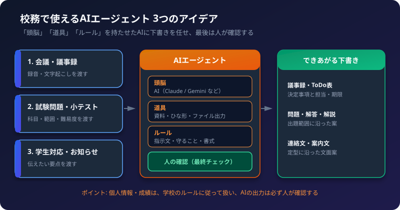
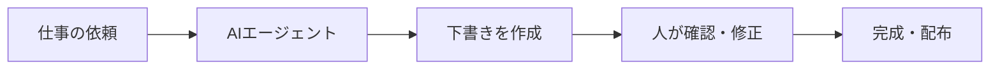

校務には、「毎回ほぼ同じ形で、時間がかかる」仕事がたくさんあります。
こうした定型業務は、AIエージェントに下書きを任せると、手間を大きく減らせます。

この記事では、AIエージェントの基本的な考え方と、校務で使える**3つの作成アイデア**を紹介します。

## 1. AIエージェントとは

ふつうのAIチャットは、「質問されたら答える」だけです。
AIエージェントは、次の3つを持たせて、**決まった仕事を任せられる**ようにしたAIです。

| 要素 | 役割 | 校務での例 |
| :--- | :--- | :--- |
| 頭脳 | 考えて文章を作る | Claude、Gemini など |
| 道具 | 資料を読む、ファイルを出力する | 過去の議事録、問題のひな形、Word・PowerPoint への出力 |
| ルール | 守ること、書式 | 「である調で」「担当者と期限を表にする」 |

大切なのは、**最後は必ず人が確認する**ことです。AIは下書き係、人は責任者と考えます。

## 2. アイデア1: 会議・議事録エージェント

**こんな悩みに:** 会議のたびに、議事録の作成に時間がかかる。

| 項目 | 内容 |
| :--- | :--- |
| 入力 | 会議の録音、または文字起こしテキスト |
| 出力 | 議事録（概要、決定事項、ToDo表、持ち越し事項） |
| 道具 | 文字起こし、議事録のひな形、ファイル出力 |

**エージェントに持たせるルール（例）**
- 「えー」「あのー」などの話し言葉は削除する
- 決定事項と、まだ決まっていない事項を分ける
- ToDoは、担当者・期限を表にする
- 推測で補わず、不明な点は「要確認」と書く

関連記事: [Claude 文字起こしテキストから議事録・報告書を作成する手順](/howto-canvas/ai/claude/meeting-minutes/)、[NotebookLM 音声ファイルから文字起こし＆議事録を作成する手順](/howto-canvas/ai/notebooklm/audio-transcription/)

## 3. アイデア2: 試験問題・小テスト作成エージェント

**こんな悩みに:** 小テストや定期試験の問題と解説を、毎回ゼロから作るのが大変。

| 項目 | 内容 |
| :--- | :--- |
| 入力 | 科目、出題範囲、難易度、問題数、形式（4択・穴埋めなど） |
| 出力 | 問題用紙、解答、解説 |
| 道具 | 授業スライドや教科書の要点、問題のひな形、Word・PowerPointへの出力 |

**エージェントに持たせるルール（例）**
- 出題範囲は、渡した資料の内容に限る
- 問題と解答・解説を、別のファイルにする
- 4択問題は、誤りの選択肢にも「なぜ違うか」を書く
- 数値や用語は、資料と照らし合わせて確認できる形にする

:::caution[試験問題は特に確認を]
AIは、もっともらしい誤りを書くことがあります。正解の確認、難易度の調整、既出問題との重複チェックは、必ず人が行ってください。
:::

## 4. アイデア3: 学生対応・お知らせ文書エージェント

**こんな悩みに:** 学生や保護者への連絡文、案内文の下書きに時間がかかる。文面の品質がばらつく。

| 項目 | 内容 |
| :--- | :--- |
| 入力 | 伝えたい要点（日時、場所、持ち物、締め切りなど） |
| 出力 | 連絡文・案内文の下書き（学生向け、保護者向けなど、相手に合わせた文面） |
| 道具 | 過去の文書、文面のひな形、表記ルール |

**エージェントに持たせるルール（例）**
- 相手（学生・保護者・企業）に合わせた敬語にする
- 日時・場所・締め切りは、箇条書きで先に示す
- 学校の表記ルール（用語、呼称）に合わせる
- 不明な情報は、空欄にして「要確認」と書く

:::tip[ひな形が品質を決める]
過去の良い文書を、ひな形として渡しておくと、文面のばらつきが減ります。
:::

## 5. 作り方の道筋（やさしい順）

| レベル | 方法 | 向いている人 |
| :--- | :--- | :--- |
| 1 | **ノーコード**: Gemini の Gem、Claude の Projects に、指示文と資料を登録する | まず試したい人 |
| 2 | **Claude Code**: スキルやMCPで、ファイルの読み書きまで自動化する | ファイル出力まで任せたい人 |
| 3 | **コード**: APIで、ツール呼び出しを組み込む | 自作のしくみにしたい人 |

最初は、レベル1がおすすめです。同じ指示文を毎回貼り付ける手間がなくなります。

関連記事:
- [Gemini 最新・便利な使い方＆裏技大全（Gem の作り方）](/howto-canvas/ai/gemini/tips-and-tricks/)
- [Claude プロンプトひな形集](/howto-canvas/ai/claude/prompt-templates/)
- [Claude Code の基本と使い方](/howto-canvas/ai/claude/claude-code/)
- [初心者向け Claude スキル（Tool Use）入門](/howto-canvas/ai/claude/skills/)
- [MCP 完全ガイド](/howto-canvas/ai/mcp/guide/)

## 6. 校務で使うときの注意

:::caution[個人情報・成績の扱い]
学生の氏名、成績、連絡先などの個人情報を、外部のAIサービスに入力してよいかは、学校の規程によって異なります。入力する前に、学校のルールを確認してください。迷うときは、氏名や学籍番号を伏せた形（例: 学生A）で使うと安全です。
:::

- AIの出力は**下書き**として扱い、配布・提出の前に、必ず人が確認する
- 日付、金額、人名、規程の内容は、原本と照らし合わせる
- 最終的な判断と責任は、人が持つ
- APIキーやパスワードは、資料やプロンプトに書かない

## 7. チェックリスト

- [ ] どの仕事を任せるか（入力と出力）を、はっきり決めたか
- [ ] 「頭脳・道具・ルール」を、それぞれ用意したか
- [ ] 個人情報・成績を扱う場合は、学校のルールを確認したか
- [ ] AIの出力を、人が確認してから使っているか
- [ ] うまくいった指示文を、保存して次回も使えるようにしたか
