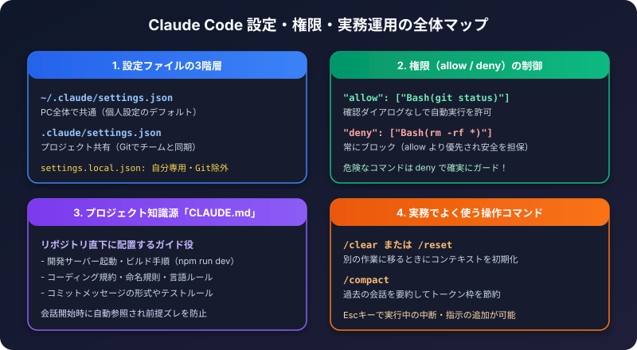

[Claude Code 入門](/howto-canvas/ai/claude/claude-code/) の補足として、使い込むうちに必要になる設定や操作を、備忘録としてまとめました。

## 1. 設定ファイルの置き場所

Claude Codeの設定は、JSONファイルで管理されます。範囲によって、置き場所が違います。

| 範囲 | ファイル | 特徴 |
| :--- | :--- | :--- |
| 自分の全プロジェクト | `~/.claude/settings.json` | 自分のPC全体に効く |
| プロジェクト（チーム共有） | `.claude/settings.json` | Gitに入れてチームで共有できる |
| プロジェクト（自分用） | `.claude/settings.local.json` | 自分だけの設定。Gitには入れない |

自分だけで使う設定は、`settings.local.json` に書き、Gitの管理から外しておくと安全です。

## 2. 権限（許可・禁止）の書き方

Claude Codeは、ファイルの編集やコマンドの実行の前に、確認を求めます。よく使う操作は、あらかじめ許可しておけます。

```json
{
  "permissions": {
    "allow": [
      "Bash(git push origin claude/*)"
    ],
    "deny": [
      "Bash(git push *--force*)"
    ]
  }
}
```

- `allow`: 確認なしで実行してよい操作
- `deny`: 常にブロックする操作。`allow` より優先されます。
- ルールは、`ツール名(パターン)` の形式で書きます。`*` は、任意の文字列に一致します。

:::caution[許可は狭く、禁止は先に考える]
`*` は、後ろに付く指定にも一致します。たとえば `git push origin claude/*` は、意図しない指定にも一致し得ます。危険な操作（強制プッシュなど）は、`deny` で明示的に止めておくと安心です。
:::

## 3. CLAUDE.md の使いどころ

プロジェクトの直下に `CLAUDE.md` を置くと、起動時に内容が読み込まれ、プロジェクト固有のルールとして扱われます。

書いておくと便利な内容は、次のとおりです。

- ビルド・テストのコマンド
- ブランチやコミットメッセージのルール
- 触ってはいけないファイル（設定ファイル、秘密情報を含むファイルなど）
- 変更前に確認してほしいこと

```markdown
# 作業ルール
- 作業は専用ブランチで行い、mainに直接コミットしない
- 変更するファイルの一覧を先に示し、承認を得てから編集する
- .env やトークンを含むファイルは読み書きしない
```

## 4. よく使う操作

| 操作 | 使い方 |
| :--- | :--- |
| 計画だけ立てさせる | `Shift + Tab` でプランモードに切り替える（または `claude --permission-mode plan`） |
| 作業を途中で止める | `Esc` キーを押す |
| 直前の会話を続ける | `claude --continue`（または `-c`） |
| 過去の会話を選んで再開する | `claude --resume`、または会話中に `/resume` |
| 会話を要約して軽くする | `/compact` |
| 会話をリセットする | `/clear` |
| 使用量を確認する | `/cost` |
| 使えるコマンドを確認する | `/help` |
| 環境の診断をする | `claude doctor` |

コマンドの種類は、バージョンによって変わります。迷ったら `/help` を確認してください。

## 5. 安全に使うコツ

- 大きな変更の前に、プランモードで計画を確認する
- 変更するファイルを、先に一覧で出してもらう
- 設定ファイルや秘密情報を含むファイルは、読まない・書かないと `CLAUDE.md` に明記する
- 作業は、専用ブランチで行う

## 6. チェックリスト

- [ ] 自分用の設定は `settings.local.json` に書いたか
- [ ] `deny` で、危険な操作を止めてあるか
- [ ] `CLAUDE.md` に、プロジェクトのルールを書いたか
- [ ] 大きな作業は、プランモードで計画を確認したか
