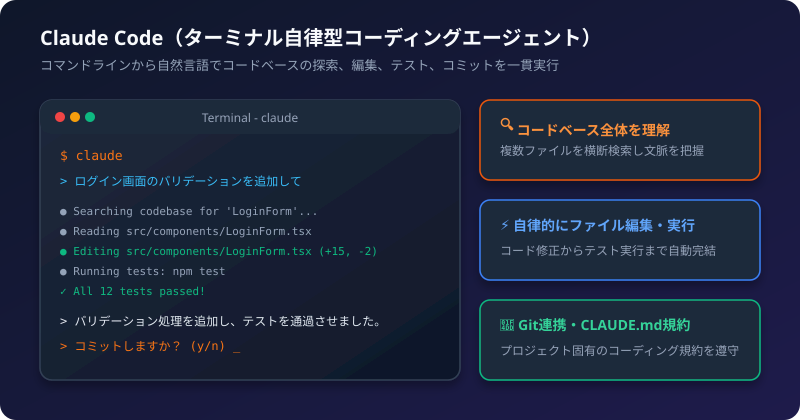
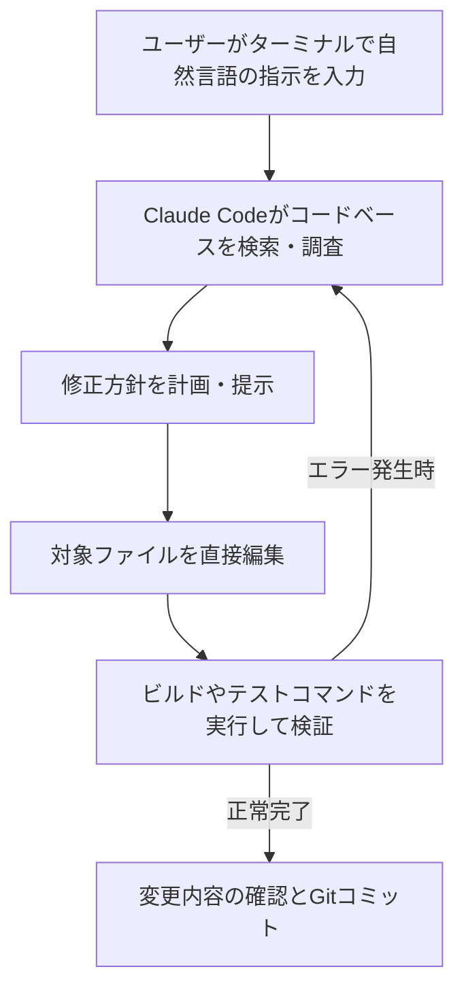

Claude Codeは、Anthropicが提供するターミナル（コマンドライン）上で動作する次世代の自律型コーディングエージェントです。

エディタとチャット画面を往復することなく、ターミナル上で「〇〇の機能を実装して」「テストを直して」と指示するだけで、コードベース全体の把握、ファイルの編集、コマンドの実行、Gitコミットまでを自動で進めてくれます。

## 1. Claude Code でできること

- プロジェクト全体の理解: 複数ファイルを横断して構造や依存関係を把握
- 自律的なコード編集: バグの特定から修正コードの書き込みまで直接実行
- テストとビルドの実行: ターミナルでテストコマンドを自ら実行し、エラーが出れば自動修正
- Git操作の自動化: 変更差分の確認、コミットメッセージの作成、ブランチ作成

## 2. 処理の流れ



## 3. インストールと初期設定

### 前提条件
- Claudeのサブスクリプション（Pro / Max / Team / Enterprise）、またはAnthropic Consoleのアカウント（API利用）があること
- npmでインストールする場合は Node.js 18以上がインストールされていること（専用インストーラを使う場合は不要）

### インストール手順

ターミナル（PowerShell、macOS Terminalなど）で以下を実行します。

```bash
# グローバルインストール
npm install -g @anthropic-ai/claude-code
```

Node.js を使わない専用インストーラも用意されています。最新のインストール手順は[公式ドキュメント](https://code.claude.com/docs/en/getting-started/installation)を確認してください。

### 初回起動と認証

作業したいプロジェクトのルートディレクトリに移動し、`claude` コマンドを実行します。

```bash
cd /path/to/your-project
claude
```

初回起動時にブラウザが開き、Anthropicアカウントの認証を求められます。認証を完了すると、すぐにプロンプト入力画面になります。

## 4. 基本的な使い方

### 対話モード（インタラクティブ）
`claude` を単体で起動すると、常駐の対話モードが立ち上がります。

```bash
$ claude
> 新しい記事用のMarkdownテンプレートを作成して
```

### ワンショット実行（1回で終了）
コマンドの引数に指示を渡すと、指示を完了した後に自動で終了します。スクリプトやCIでも活用できます。

```bash
claude "src/components配下のTypeScriptエラーをすべて修正して"
```

## 5. 便利なスラッシュコマンド

対話画面でスラッシュ（`/`）を入力すると、各種ユーティリティ機能を利用できます。

| コマンド | 説明 |
| :--- | :--- |
| `/help` | 利用可能なコマンドとショートカットの一覧を表示 |
| `/compact` | 会話履歴を要約・圧縮してコンテキストウィンドウを節約 |
| `/cost` | 現在のセッションで使用したトークン数と推定コストを表示 |
| `/clear` | 現在の会話履歴をリセットして最初からやり直す |
| `/bug` | Anthropicチームへバグ報告を送信 |
| `/exit` | Claude Codeを終了（または Ctrl + C） |

## 6. CLAUDE.md でプロジェクトのルールを教え込む

プロジェクトのルートに `CLAUDE.md` というファイルを配置しておくと、Claude Codeが起動時に必ずその内容を読み込み、プロジェクト固有のルールを厳守してくれます。

### CLAUDE.md の設定例
```markdown
# 開発ルール
- パッケージマネージャーには npm を使用してください
- テスト実行コマンド: npm test
- ビルドコマンド: npm run build
- コミットメッセージは英語で Conventional Commits に従ってください (feat:, fix:, docs:)
- コンポーネントは関数コンポーネントで作成してください
```

これを用意しておくことで、毎回「テストコマンドは〇〇で実行して」と指示する手間を省けます。

## 7. 安全性とコスト管理のポイント

- コマンド実行前の承認:
  Claude Codeがファイルを書き換える際や、シェルコマンド（rm、npm installなど）を実行する際は、事前に実行許可を求めてきます。安全性を確認しながら進められます。
- コスト確認:
  定期的に `/cost` を実行して、API消費量を確認する習慣をつけましょう。大きなリファクタリングを依頼した後は `/compact` で履歴を整理するとコストを抑えられます。

:::tip[活用のコツ]
指示を出すときは、「どのファイルをどのように変更したいか」をできるだけ具体的に伝えると、無駄なファイル探索を行わず最小限のトークンで素早く正確な結果を得られます。
:::
