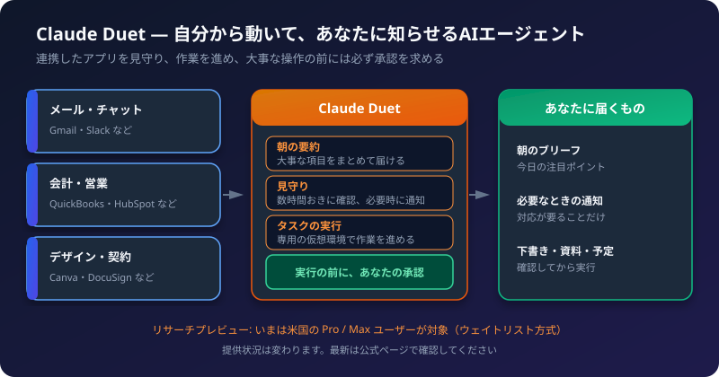
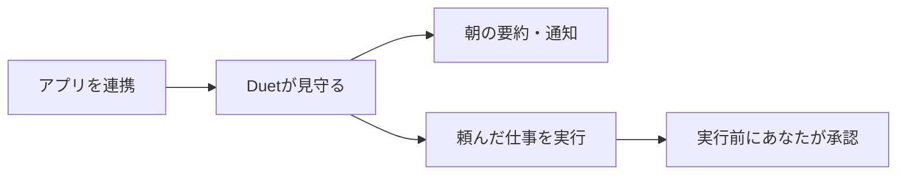
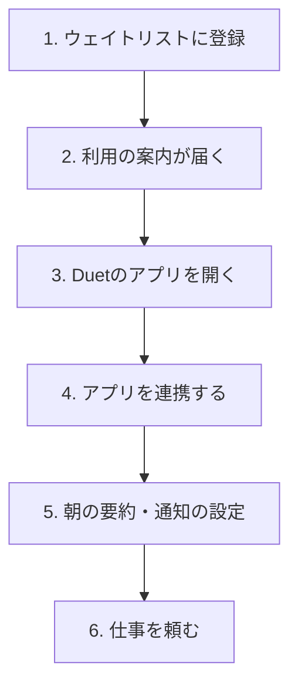

Claude Duet（クロード・デュエット）は、Anthropic が2026年10月21日に発表した、**自分から動くAIエージェントのアプリ**です。
この記事では、何ができるのか、どう使い始めるのか、安全のしくみはどうなっているのかを、やさしく説明します。

:::caution[この記事の情報について]
Claude Duet は「リサーチプレビュー」（試験提供）の段階です。提供地域、対象プラン、機能は、今後変わる可能性があります。ここに書いた内容は、Anthropic の公式ページ「[Introducing Claude Duet](https://claude.com/resources/articles/claude-duet)」に基づいています。使う前に、最新の情報を公式ページで確認してください。
:::

## 1. Claude Duet とは

ふつうのAIチャットは、**こちらが話しかけたときだけ**動きます。
Claude Duet は、次のように、**こちらが何も言わなくても動きます**。

- 連携したアプリ（メールやチャットなど）を見守る
- 大事なことがあれば、知らせてくれる
- 頼んだ仕事を、あなたが席を離れている間も進める
- 大事な操作の前には、必ず確認を求める

一言でいうと、**「見守って、動いて、確認してくれる秘書」** のようなAIです。

対象は、公式では「プロフェッショナルや小規模事業の経営者」とされています。

## 2. Claude Duet でできること

| 機能 | 内容 |
| :--- | :--- |
| **朝の要約（Morning brief）** | 連携したアプリの中から、その日の大事な項目をまとめて届けます |
| **バックグラウンドの見守り** | 数時間おきに連携アカウントを確認し、**対応が必要なときだけ**メッセージを送ります。何を、どのくらいの頻度で知らせてほしいかを設定できます |
| **タスクの実行** | 会議の日程調整のような簡単な作業から、ダッシュボード、財務や売上の予測、試作品、Webアプリの作成まで、幅広く扱います |
| **会話の継続** | 1つの続いたスレッドで、文字または音声でやり取りします。Claude のアカウントの記憶、スキル、連携アプリを引き継ぎます |
| **専用の仮想環境** | 作業は、Duet 専用のクラウド上のブラウザで行われます。**パソコンやスマホをつけたままにする必要はありません** |

## 3. 連携できるアプリ

Claude Marketplace の、6,000以上のコネクタやプラグインと連携できます。公式の例は、次のとおりです。

- メール・チャット: Gmail、Slack
- 会計・人事: QuickBooks、Gusto
- 決済・販売: Stripe、Shopify、HubSpot
- 契約・デザイン: DocuSign、Canva
- そのほか: LinkedIn

また、Stripe の Link ウォレット（仮想カード）や Shop Pay を使って、買い物の支払いを進められる、と説明されています。
今後の予定として、1Password に保存したログイン情報を使ったサイトへのサインイン（許可を得たうえで）や、Shopify のストアの画面編集が挙げられています。

連携の考え方は、[MCP 完全ガイド](/howto-canvas/ai/mcp/guide/) で説明している「AIと外部ツールをつなぐ仕組み」と同じ方向のものです。

## 4. 使い始めの流れ

公式ページには、画面ごとの細かい手順は書かれていません。ここでは、公式の説明から分かる大まかな流れを示します。

1. **ウェイトリストに登録する。** 利用は、順番に案内される方式です。登録の方法は、公式ページの案内に従ってください。
2. **Duet のアプリを開く。** iOS と Android のアプリ、または claude.ai から使えます。メインの Claude アプリとは、別のアプリです。
3. **アプリを連携する。** Gmail や Slack など、見守ってほしいアプリを接続します。**使わなくなったら、いつでも切断できます。**
4. **知らせてほしいことを設定する。** 何を、どのくらいの頻度で通知するかを決めます。
5. **仕事を頼む。** 1つのスレッドに、文字または音声で依頼します。

Duet は、Claude のアカウントの記憶・スキル・連携アプリを引き継ぐので、すでに Claude を使っている人は、設定が少なくて済みます。

## 5. 使い方の例（イメージ）

次は、公式に説明されている機能から考えた、使い方のイメージです。

| 場面 | 頼み方の例 |
| :--- | :--- |
| 朝の確認 | 「毎朝、メールと予定から、対応が必要なものだけまとめて」 |
| 日程調整 | 「来週、田中さんと30分の打ち合わせを入れる候補日を出して」 |
| 資料づくり | 「先月の売上データから、報告用の簡単なグラフと要約を作って」 |
| 見守り | 「請求書のメールが届いたら知らせて」 |

実際の画面や、できる範囲は、提供状況によって異なります。

## 6. 安全のしくみ

自分から動くAIは、便利な分、**勝手に操作されないか**が心配になります。公式ページでは、次のような対策が説明されています。

### 承認が必要な操作

| 操作 | 扱い |
| :--- | :--- |
| 情報を読む、下書きを作る | Duet が自分で行う |
| メッセージの**送信** | 実行前に内容を見せ、あなたの承認を待つ |
| **支払い** | 同上 |
| 書類への**署名** | 同上 |
| ファイルなどの**削除** | 同上 |
| 証券の売買、口座間の資金移動など | 承認しても**ブロック**される |

### そのほかの対策

- パスワードやサインインのトークンを、Duet が直接見ない形で扱う
- 自動モードの分類器が、操作を確認する
- 隠された指示（プロンプトインジェクション）への対策がある
- クレジットカード番号や公的な身分証の番号などの、機密性が高い情報は、受け付けない
- 健康や個人の資産の情報は、あなたが明示的に指示したときだけ共有する

:::tip[承認の画面は、必ず内容を読む]
承認は、最後の安全装置です。「送信先」「金額」「内容」を、毎回確認してから許可しましょう。
:::

## 7. 現在の提供状況と制限

| 項目 | 内容 |
| :--- | :--- |
| 段階 | リサーチプレビュー（試験提供） |
| 申し込み | ウェイトリスト方式 |
| 対象プラン | Pro と Max（追加料金なし。使用量は、Claude の他の機能と共通） |
| 対象地域 | **まず、米国の Pro と Max のユーザーから** |
| 使えない可能性 | Team、Enterprise のプラン（報道による） |
| 使える場所 | iOS・Android のアプリ、claude.ai |

**日本での提供時期は、公式ページに記載がありません。** 使えるかどうかは、公式ページで確認してください。

### 試験提供の段階での注意（公式の説明）
- スレッドの内容や、緊急度を、読み違えることがあります
- 旅行のチケット予約のような、個人の用事は、仕事の作業ほど得意ではありません
- Duet が使っているブラウザの画面を、まだ見せてもらえません
- いつ通知するかの判断は、調整中です
- バックグラウンドの確認も、使用量の上限に数えられます。大きな作業は、使用量を多く使います

## 8. 学校・職場で使うときの注意

- メールやチャットには、学生や同僚の個人情報が含まれます。連携してよいかは、学校・職場のルールを確認してください。
- 業務用のアカウントを連携する前に、情報システムの担当者に相談してください。
- 送信や削除の承認は、必ず内容を読んでから行ってください。
- 仕事の結果は、**下書き**として扱い、最終的な確認は人が行ってください。

## 9. 関連する記事

- [校務で使えるAIエージェントの作り方 ― 作成のアイデア3選](/howto-canvas/ai/agents/school-ai-agent-ideas/)
- [Claude プロの裏技・活用テクニック集](/howto-canvas/ai/claude/pro-tips/)
- [MCP 完全ガイド](/howto-canvas/ai/mcp/guide/)

## 10. チェックリスト

- [ ] 自分の地域とプランで、利用できるか確認したか（公式ページ）
- [ ] 連携するアプリは、学校・職場のルールで許可されているか
- [ ] 知らせてほしいことと、頻度を設定したか
- [ ] 送信・支払い・署名・削除の承認は、内容を読んでから許可しているか
- [ ] 結果は、人が最終確認しているか
