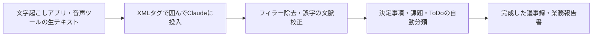

スマートフォンアプリや録音ツールの自動文字起こし機能は便利ですが、生成される生テキストには「えー」「あのー」といった話し言葉（フィラー）、誤変換、主語の省略、話のあちこちへの脱線が含まれがちです。

そのままでは社内配布できない荒削りな文字起こしテキストを、Anthropic Claudeの極めて高度な文章力と推論能力を活用して、一瞬で「役員報告やチーム共有に使える完成されたビジネスドキュメント」へ仕上げる手順を解説します。

## 1. 処理の流れ



## 2. 失敗しないClaude用プロンプトテンプレート

長文の文字起こしテキストを渡す際は、Claudeが得意とする「XMLタグ記法」を使うことで、指示の読み落としや要約の偏りを完全に防ぐことができます。

以下のテンプレートをチャット欄に貼り付け、`<transcript>` の中に文字起こしテキストを挿入して送信してください。

```markdown
以下の<instructions>に従い、<transcript>に記載された会議の文字起こしデータから、完成されたビジネス議事録を作成してください。

<instructions>
1. 目的: 会議に参加していない役員やメンバーが読んでも、背景と合意事項が100%正確に伝わる議事録を作成すること。
2. 文体: 簡潔で明瞭な「である・だ」調のビジネス文書。
3. 校正ルール:
   - 「えーっと」「そのー」などの無意味な話し言葉（フィラー）はすべて削除すること。
   - 音声認識の明らかな誤変換（例: 「ぎじろく」が「擬似禄」など）は文脈から正しい単語に直すこと。
   - 発言の脱線や雑談は除外し、本質的な議論のみを抽出すること。
4. 出力フォーマット:
   - 会議概要（日時、推定テーマ）
   - エグゼクティブサマリー（会議の全体要約を3行で）
   - 決定事項（合意に至った事実のみを箇条書き）
   - アクションプラン（ToDo・担当者・期日を表形式で整理）
   - 議論の経過（争点となったポイントと各論点の要約）
   - 保留・次回への持ち越し事項
</instructions>

<transcript>
（ここに文字起こしの生テキストをそのまま貼り付ける）
</transcript>
```

## 3. 用途別プロンプトのバリエーション

### パターンA: 取引先・社外向けの「打合せ報告書」
```markdown
<instructions>
今回の商談・クライアント打ち合わせの文字起こしから、社内共有用の「商談報告書」を作成してください。
- 顧客の現状の課題・ペイン
- 当社が提示した提案・解決策
- 顧客側の反応・懸念点
- 受注に向けたネクストアクションと見積もり期日
</instructions>

<transcript>
（ここに商談の文字起こしを貼り付ける）
</transcript>
```

### パターンB: 発言者別の詳細なディスカッション記録
```markdown
<instructions>
議論の経緯が後から追跡できるよう、誰がどのような意図で発言したのかを「トピック別発言サマリー」として論理的に整理してください。
</instructions>

<transcript>
（ここに文字起こしを貼り付ける）
</transcript>
```

## 4. プロの活用テクニック

- プロジェクト規約（Projects機能）を活用する:
  Claudeの「Projects」機能を使っている場合、自社の議事録フォーマット（Word雛形やMarkdownテンプレート）をあらかじめプロジェクトファイルとして登録しておくと、毎回フォーマットを指定しなくても会社標準の体裁で出力されます。
- Artifactsで表組みをダウンロード:
  「アクションプランのToDo表をArtifactsで出力して」と指示すれば、画面右側のウィンドウからワンクリックでコピーしたり、スプレッドシートに直接貼り付けられる形式で受け取れます。

## 5. チェックリスト

- [ ] 文字起こしテキストを `<transcript>` タグで囲んで投入したか
- [ ] 音声認識特有の誤字や専門用語が文脈通りに修正されているか
- [ ] 決定事項と未決定の持ち越し事項が明確に切り分けられているか
- [ ] アクションプラン（誰が・何を・いつまでに）が表になっているか
