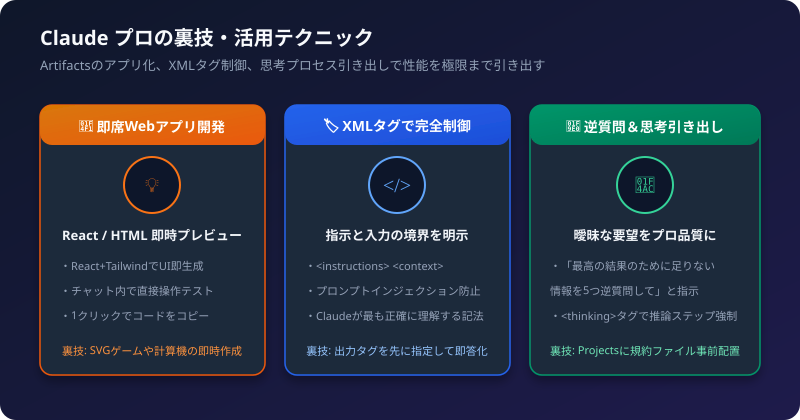
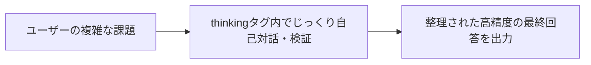

Claude（SonnetやOpus）は、自然で人間らしい文章力と極めて高度な論理推論能力を持っています。普段のチャットを1段階上の「知的生産ツール」に進化させる裏技・実践テクニックをまとめました。

## 1. 裏技1: Artifactsで即席Webツールを作る

Claudeの画面右側に別ウィンドウで表示される「Artifacts（アーティファクト）」機能は、単なるコード表示欄ではありません。React（Lucideアイコン、Tailwind CSS）やHTML/SVGをその場で動くWebアプリとしてプレビューできます。

### 活用テクニック
「Reactで動く〇〇ツールを作って」と指示するだけで、ブラウザ内でクリックして遊べるインタラクティブなアプリが数十秒で立ち上がります。

```text
指示例:
ReactとTailwind CSSを使って、今月の固定費と変動費を入力すると
リアルタイムに円グラフで内訳が表示される家計簿シミュレーターを
Artifactsで作成してください。
```

- CSVファイルを貼り付けて「インタラクティブなグラフビューアにして」と頼む
- カンバンボードやToDoリストを即席で作って画面上でタスク管理する

## 2. 裏技2: XMLタグで指示とデータを完全分離する

Claudeは、Anthropicが公式に推奨している「XMLタグ」でプロンプトを整理すると、理解精度が跳ね上がります。

### 活用テクニック
指示文、背景情報、入力データを別々のタグで囲みます。

```markdown
<instructions>
以下の<context>を踏まえて、<input_text>の要約を3箇条で作成してください。
専門用語には括弧で注釈を付けてください。
</instructions>

<context>
対象読者はITに詳しくない新入社員です。
</context>

<input_text>
（ここに要約したい長文を貼り付ける）
</input_text>
```

プロンプトと入力文の境目が明確になるため、どんなに長い文章を貼り付けても指示を混同・無視することがなくなります。

## 3. 裏技3: 「逆質問ハック」で曖昧な依頼を最高品質にする

企画案やコードを依頼する際、最初から完璧なプロンプトを書く必要はありません。Claudeに足りない情報を「逆質問」させます。

### 活用テクニック
依頼文の末尾に以下の定型文を付け加えます。

```text
最高の結果を出すために、もし私から追加で必要な情報や
前提条件があれば、作業を始める前に5つ逆質問してください。
```

これにより、Claudeは「ターゲット層」「想定予算」「使用言語やライブラリ」「納期」など、こちらが考慮し忘れていた論点を的確に質問してくれます。それに回答するだけで、最初から100点満点の成果物が得られます。

## 4. 裏技4: &lt;thinking&gt;タグで推論ステップを露出させる

複雑な数学パズル、アルゴリズムの設計、難解な法務・契約解釈を依頼する際、いきなり結論を出させると間違える確率が高くなります。



### 活用テクニック
「回答する前に、まずは `<thinking>` タグの中で検討ステップ、反例の検討、前提の確認を書き出してから最終回答を出力してください」と指示します。
モデル自身が自己検証を行ってから答えを出すため、論理的な誤りが激減します。

## 5. Claude 活用チェックリスト

- [ ] ツールやUIを作りたいときは「ReactとTailwindでArtifactsにして」と指定したか
- [ ] 長文の入力データは `<input_text>` などのXMLタグで囲んだか
- [ ] 企画や相談の際は「足りない情報を逆質問して」と投げかけたか
- [ ] 複雑な課題には `<thinking>` タグによるステップ思考を指示したか
