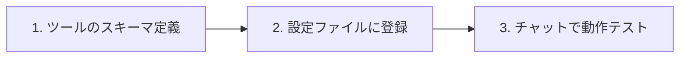

## 1. 処理の流れ

## 2. 設定ステップ

1. **ツールの入力パラメータを決める**
   エージェントが受け取る引数（引数名、データ型、必須項目）を設計します。
2. **実行コードまたは定義を配置**
   `.antigravity/` または設定フォルダにツール定義を書き込みます。
3. **動作テスト**
   トリガーとなる文章を入力し、正しくツールが呼び出されるか確認します。

:::tip[ポイント]
NanoBananaのような画像生成ツールと連携させることで、文章から自動で図解を生成するフローを構築できます。
:::

## 3. トラブルシューティング
- **ツールが反応しない場合**: 引数の型（string, number, boolean）と、ツールの概要説明（Description）が曖昧でないか確認してください。

<!-- NanoBanana Prompt: Minimal modern tech illustration, clean flat design, AI agent connecting to tools with nodes and cables, soft blue and indigo palette -->
