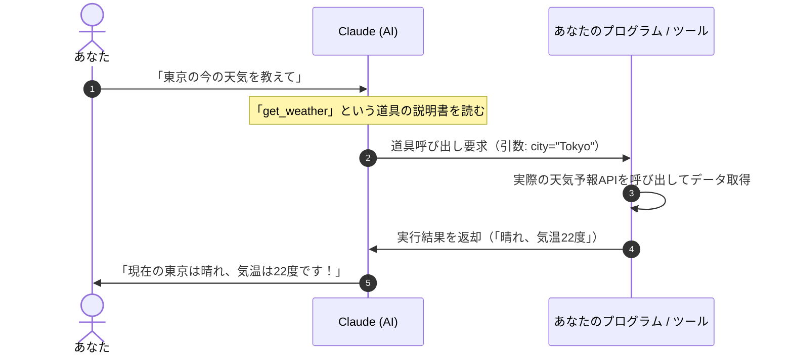

通常のAIチャットは「言葉で質問すると、言葉で答えてくれる」だけですが、Claudeに「スキル（Tool Use / ツール呼び出し）」を設定すると、AIが自分で電卓を叩いたり、データベースを検索したり、外部のWebサイトから最新情報を取ってきたりできるようになります。

AIに新しい道具（手足）を渡して自動で使ってもらう仕組みを、初心者向けにステップバイステップで解説します。

:::note[「スキル」という言葉について]
この記事で扱う「スキル」は、AIに関数（ツール）を呼び出させる Tool Use（ツール呼び出し）の仕組みを、初心者向けに言い換えたものです。Claude には別に、指示書やスクリプトをフォルダ（`SKILL.md`）にまとめ、必要なときに読み込ませる「Agent Skills」という機能があります。こちらは Tool Use とは別の仕組みです。詳しくは Anthropic の公式ドキュメントを参照してください。
:::

## 1. スキル（Tool Use）とはどんな仕組みか？

スキルとは、いわば「AIが読める道具の取扱説明書」です。

AI自身が直接インターネットにアクセスするのではなく、以下のキャッチボールで動作します。



1. 人間が「こんな道具があるよ」と説明書（スキーマ）をClaudeに渡しておく
2. ユーザーが「東京の天気を教えて」と質問する
3. Claudeが「その質問なら、get_weatherという道具にcity="Tokyo"を渡せば解決できる」と判断する
4. プログラムが道具を実行して、結果をClaudeに返す
5. Claudeが結果を人間向けの自然な日本語にまとめて回答する

## 2. 道具の説明書（JSONスキーマ）の書き方

Claudeに道具を教えるときは、「JSON Schema（ジェイソン・スキーマ）」という共通フォーマットで説明書を書きます。

### 例: 天気予報を取得するツールの定義
```json
{
  "name": "get_weather",
  "description": "指定した都市の現在の天気と気温を取得します。ユーザーが天気を尋ねたときに使用してください。",
  "input_schema": {
    "type": "object",
    "properties": {
      "city": {
        "type": "string",
        "description": "都道府県名や都市名（例: 東京都, 大阪市, 札幌市）"
      },
      "unit": {
        "type": "string",
        "enum": ["celsius", "fahrenheit"],
        "description": "温度の単位（摂氏 celsius または 華氏 fahrenheit）"
      }
    },
    "required": ["city"]
  }
}
```

### スキーマを書くときの3大ポイント
- name（道具の名前）:
  英語の小文字とアンダースコアで簡潔に名付けます（例: `search_database`, `calculate_tax`）。
- description（道具の説明）:
  ここが一番重要です。「この道具は何ができるのか」「どんな質問が来たときに使うべきか」をClaudeが理解しやすいように日本語で詳しく書きます。
- properties と required（引数と必須項目）:
  道具を動かすために必要な入力値（都市名、数値など）と、必ず渡さなければならない必須項目（required）を指定します。

## 3. 実践！設定から動作確認までの3ステップ

### ステップ1: ツールの定義を準備する
上記のJSONスキーマを作成し、APIリクエストの `tools` パラメータ、またはAntigravityやClaude Codeなどの設定ファイルに登録します。

### ステップ2: ツールを実行するハンドラー関数を用意する
Claudeから「この引数でツールを実行してほしい」と要求（tool_use）が届いたときに、実際に動くコード（JavaScriptやPython）を準備します。

```javascript
// ツールの実行処理（例）
async function executeTool(name, input) {
  if (name === "get_weather") {
    const response = await fetch(`https://api.weather.example.com?city=${input.city}`);
    return await response.json();
  }
}
```

### ステップ3: テスト質問を投げかける
チャット画面で「明日の大阪の気温はどうなりそう？」と質問し、Claudeが勝手な嘘をつかず、正しくツールを呼び出して正確な数値を答えるか確認します。

## 4. 初心者がよく遭遇するトラブルと解決策

### トラブル1: 質問してもツールを使ってくれない
- 原因: `description`（ツールの説明文）が短すぎたり、曖昧だったりします。
- 対策: 「〜の計算をするときは必ずこのツールを使用してください」のように、ツールの説明文に発動条件を具体的に書き足してください。

### トラブル2: 意図しない変な引数が渡されてエラーになる
- 原因: 引数の型（type）や取りうる選択肢（enum）が指定されていません。
- 対策: `type: "number"` や `enum: ["円", "ドル"]` のように、入力の制約をスキーマに厳格に記述します。

### トラブル3: 毎回自分でツールを作るのが大変
- 対策: オープン規格である「MCP（Model Context Protocol）」を活用すれば、世界中の開発者が公開している高品質なツール（GitHub操作、ブラウザ操作、DB接続など）を自作コードなしで即座に組み込むことができます。
