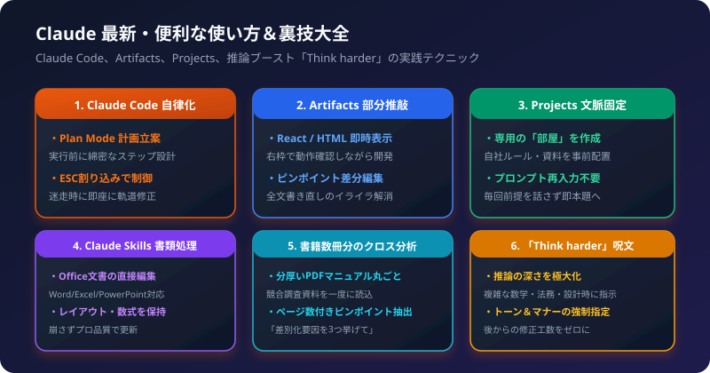

Anthropic社のAI「Claude」は、単なる文章生成チャットボットにとどまらず、自律型開発エージェントや高度な分析パートナーへと大きく進化しています。

日々の業務や開発スピードを劇的に加速させる、知っておくと圧倒的な差がつく最新テクニックと裏技を体系的にまとめました。

## 1. Claude Code の自律化ハック（Plan Mode ＆ ESC割り込み）

ターミナルで動作する自律型AIエージェント「Claude Code」を使いこなすための2大裏技です。

### Plan Mode（計画先行モード）
いきなりコードを書かせると途中で迷走しがちな大規模タスクでは、最初に計画を立てさせます。

```bash
claude --plan "ユーザー認証機能をFirebaseからSupabaseへ移行して"
```

AIがコードベースをくまなく調べた上で、「どのファイルをどの順番で書き換えるか」の綿密な計画表を作成して提示してくれます。人間がその計画を確認してから実行フェーズに入れるため、安全かつ最短で作業が完了します。

### ESCキーでの即時割り込み
Claude Codeが作業中に意図と違う方向へ進み始めたら、キーボードの `ESC` キーを押すことで、処理を安全に中断して追加の軌道修正プロンプトを差し込めます。

## 2. Artifacts の「右枠プレビュー＆ピンポイント推敲」

画面右側に表示される「Artifacts」は、単なるコード出力欄ではなく「インタラクティブな開発スタジオ」です。

### 活用テクニック
- その場で動くWebツールの作成:
  「社内用の交通費計算ツールをReactとTailwind CSSでArtifactsとして作って」と指示すると、右側の画面ですぐに数値を入力してテストできます。
- ピンポイント差分編集:
  チャットで「右側の計算ボタンの色を青にして、エラー表示を追加して」と指示するだけで、プレビュー側がリアルタイムで部分更新されます。AIが全文を最初から書き直すのを待つストレスがゼロになります。

## 3. Projects（プロジェクト機能）で「前提説明」を永久自動化

毎回チャットの冒頭で「当社の事業内容は〇〇で、トーン＆マナーは敬語で…」と前置きを入力する無駄を完全になくす機能です。

### 活用テクニック
1. 左メニューから「Projects」を作成します（例: 「自社マーケティング推進室」）。
2. プロジェクト内のナレッジ資料に以下を登録します:
   - 自社サービスのパンフレットPDFやブランドガイドライン
   - 過去の高評価メルマガ・提案書テンプレート
   - 禁止表現リスト
3. Custom Instructions（カスタム指示欄）に「あなたは当社の専属Webマーケターです」と記載します。

これだけで、そのプロジェクト内のチャットを開くだけで、会社の全事情を熟知したベテラン社員がスタンバイしている状態になります。

## 4. 書籍数冊分の超長文クロス分析ハック

Claudeは数十万トークン（書籍数冊分に匹敵する大容量データ）を一度に読み込めます。

### 活用テクニック
分厚いPDFマニュアルや競合調査資料を丸ごとアップロードし、単に「要約して」と頼むのではなく、以下のように**クロス分析**を指示します。

```text
添付した競合3社の提案書を比較し、
各社が提示している保守サポート範囲の決定的な違いを、
原本のページ番号を併記した上で比較表にまとめてください。
```

数秒で原本の該当ページからピンポイントな証拠を抜き出し、完璧な比較レポートを納品してくれます。

## 5. 推論深度ブースト「Think harder」呪文

複雑な業務ロジックの設計、難解な契約条項のチェック、数学的アルゴリズムの検討では、プロンプトに以下のマジックワードを添えます。

```text
【重要】回答を急がず、前提条件、エッジケース、反例の可能性について
慎重に深く思考（Think harder）してから、最終的な結論と論理的根拠を出力してください。
```

モデルの思考プロセス（Chain of Thought）が最大深度まで駆動し、直感に頼ったミスや見落としが劇的に減少します。

## 6. 出力トーン＆マナーの強制指定

「社内Slack用のフランクな文章で」「経営陣向けの箇条書き3点・結論ファーストで」など、出力の体裁を最初から厳格に縛ることで、納品後の手直し工数を完全にゼロにできます。
