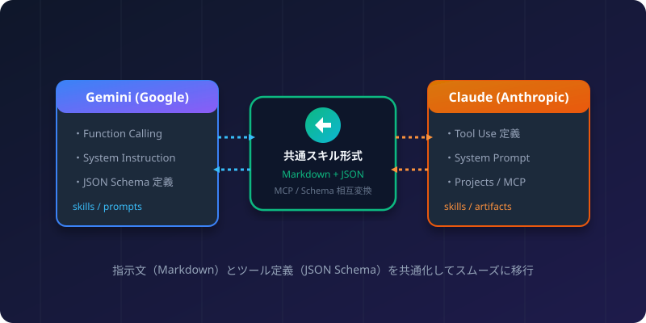
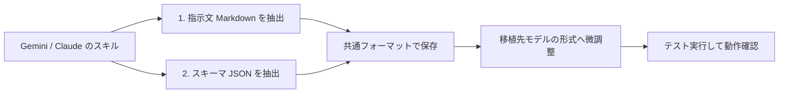

Gemini（Google）とClaude（Anthropic）はどちらも高度な指示理解と外部ツール連携機能を備えています。一方の環境で作成したスキル（カスタムプロンプトやツール呼び出し定義）をもう一方へ移植したり、共通の資産として管理・コピーする方法を解説します。

## 1. 全体の移行フロー



## 2. スキルを構成する2つの要素

AIのスキルは基本的に以下の2つで構成されています。

1. 指示文（システムプロンプト / ルール / 説明）:
   AIの振る舞い、目的、出力形式を定義する自然言語（Markdown推奨）。
2. ツール定義（Function Calling / Tool Use スキーマ）:
   外部プログラムやAPIを呼び出すための引数定義（JSON Schema形式）。

この2つを分離して管理することで、モデルの違いを最小限の修正で吸収できます。

## 3. 指示文（プロンプト）のコピー・共有手順

指示文は基本的にそのままコピー＆ペーストで共有可能です。ただし、以下の点に配慮すると精度が向上します。

### ステップ1: Markdown形式で指示書を作成
指示内容を箇条書きや見出しを使ってMarkdownで整理します。

```markdown
# 役割と目的
あなたは旅行プラン提案の専門家です。

# 出力ルール
- 費用、日程、持ち物を表形式で提示してください。
- ユーザーの希望予算を必ず考慮してください。
```

### ステップ2: 各サービスへの登録

- Gemini（Google AI Studio / Antigravity）:
  「System Instructions」欄または設定ファイルの指示欄にペーストします。
- Claude（Claude Projects / Claude Desktop）:
  Projectの「Custom Instructions」欄またはシステムプロンプトにペーストします。

## 4. ツール定義（JSON Schema）の変換ポイント

ツール呼び出しの定義は、どちらもJSON Schemaをベースにしていますが、キー名や型指定の表記にわずかな違いがあります。

### 比較表

| 項目 | Gemini (Google) | Claude (Anthropic) |
| :--- | :--- | :--- |
| スキーマ定義キー | parameters | input_schema |
| 型の指定 | UPPERCASE または lowercase (STRING, OBJECT) | lowercase (string, object) |
| 説明キー | description | description |
| 必須パラメータ | required: ["都市名"] | required: ["都市名"] |

### 変換の具体例

#### Claude用スキーマ（Tool Use）
```json
{
  "name": "get_weather",
  "description": "指定した都市の現在の天気を取得します",
  "input_schema": {
    "type": "object",
    "properties": {
      "city": {
        "type": "string",
        "description": "都市名（例: 東京, 大阪）"
      }
    },
    "required": ["city"]
  }
}
```

#### Gemini用スキーマへの変換
Claude用の `input_schema` を `parameters` にリネームするだけで、GeminiのFunction Callingとしてそのまま利用できます。

```json
{
  "name": "get_weather",
  "description": "指定した都市の現在の天気を取得します",
  "parameters": {
    "type": "object",
    "properties": {
      "city": {
        "type": "string",
        "description": "都市名（例: 東京, 大阪）"
      }
    },
    "required": ["city"]
  }
}
```

## 5. MCP（Model Context Protocol）による共通化

最もスマートな方法は、オープン標準の「MCP（Model Context Protocol）」を採用することです。

- Claude DesktopやClaude Codeは標準でMCPをサポートしています。
- Gemini環境でもMCPクライアント連携ツールを使うことで、同じMCPサーバーのツール群を共通利用できます。
- ツールコードを一度書けば、GeminiとClaudeのどちらからも同じスキルとして呼び出せます。

## 6. チェックリスト

コピー・共有作業を行う際は、次の項目を確認してください。

- [ ] 指示文にモデル固有の予約タグ（例: claudeの特殊xmlタグ）が含まれていないか
- [ ] ツール定義のキー名（parameters と input_schema）が合致しているか
- [ ] 必須引数（required）の指定漏れがないか
- [ ] 双方のチャットでテスト入力を行い、意図通りツール呼び出しが発火するか

:::tip[活用のコツ]
指示文とツール定義を単一の `SKILL.md` または設定ファイルにまとめてGitリポジトリで一元管理すると、バージョン管理と共有が非常にスムーズになります。
:::
