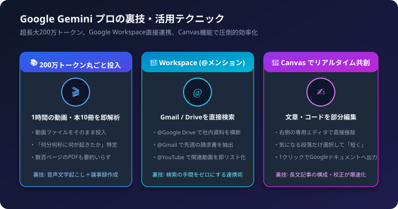
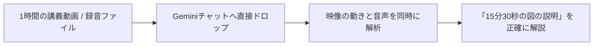

Google Geminiは、書籍何冊分もの資料を一度に読み込める「長大コンテキスト（現行の主要モデルで約100万トークン。モデルやプランによって異なります）」と、Googleの各種サービス（Drive、Gmail、Docs、YouTube）とのダイレクトな連携が最大の強みです。

仕事や研究の生産性を何倍にも引き上げる裏技・実践テクニックを解説します。

## 1. 裏技1: 1時間の動画や音声を「丸ごとドラッグ＆ドロップ」

Geminiは動画や音声ファイルを直接理解できる「マルチモーダルAI」です。文字起こしツールなどを介する必要はありません。



### 活用テクニック
会議の録音データ（mp3/m4a）やセミナー動画（mp4）をそのままGeminiに投げ、以下のように指示します。

```text
この動画の内容を時系列でタイムスタンプ付きの議事録にまとめてください。
特に「課題」と「次回の決定事項」にフォーカスしてください。
```

「動画の中で講師がホワイトボードに書いた数式」や「32分ごろに話していた競合の事例」など、ピンポイントな秒数付きで回答を引き出せます。

## 2. 裏技2: @メンションによるGoogle Workspace直接連携

チャット欄で `@` を入力すると、Googleのエクステンション機能（連携機能）が呼び出せます。

### 活用テクニック
手元のファイルをわざわざダウンロードしてアップロードする手間が一切不要になります。

| @メンション | 指示例とできること |
| :--- | :--- |
| `@Google Drive` | 「@Google Drive 先月作成した『採用計画』のスプレッドシートを探して要約して」 |
| `@Gmail` | 「@Gmail 先週届いたAWSの請求通知メールから金額を抜き出して」 |
| `@YouTube` | 「@YouTube Next.js App Routerの初心者向け解説動画を3本推薦して」 |
| `@Google Docs` | 「@Google Docs 企画書の第2章の推敲をして」 |

プライベートなメールやクラウドストレージを瞬時に検索・集計できるのはGoogleエコシステムならではの裏技です。

## 3. 裏技3: 「Canvas」機能で文章やコードを部分推敲する

Geminiの「Canvas（キャンバス）」は、右側に専用エディタを開いてAIと共同編集できる機能です。

### 活用テクニック
チャットの再生成で全文が書き換わってしまうストレスから解放されます。

1. 修正したい段落だけをマウスで範囲選択する
2. ポップアップするメニューから「短くする」「トーンをカジュアルに」「もっと詳しく」を選ぶ
3. 選択した部分だけが即座に書き換わる
4. 完成したら画面右上のボタンから1クリックで「Googleドキュメントへエクスポート」

長文のブログ記事、企画書、メルマガ原稿の執筆スピードが圧倒的に上がります。

## 4. 裏技4: 「回答の二重チェック（ダブルチェック）」ボタン

Geminiの回答の下にある「その他（︙）」メニューから「回答を再確認（Double-check response）」を選ぶと、Google検索を使って回答の内容を確認できます。表記は、画面や言語によって異なる場合があります。

### 活用テクニック
- 緑色にハイライトされた箇所: Google検索で、似た内容が見つかった記述（Geminiが回答の根拠にしたものとは限りません）
- オレンジ色にハイライトされた箇所: 検索結果と食い違いがある、または情報が見つからない記述

調査レポートを作成する際、ハルシネーション（AIの嘘）を見つける手がかりになります。ハイライトがない箇所は、確認できる情報が足りない記述です。重要な内容は、リンク先を開いて自分で確認しましょう。

## 5. Gemini 活用チェックリスト

- [ ] 会議の録音やセミナー動画をそのままドラッグ＆ドロップして要約させたか
- [ ] メールやDriveの資料検索に `@Gmail` や `@Google Drive` を使ったか
- [ ] 長文の推敲にはCanvasを起動して部分編集を活用したか
- [ ] 重要なファクトチェックに「回答を再確認」を実行し、リンク先も自分で確認したか
