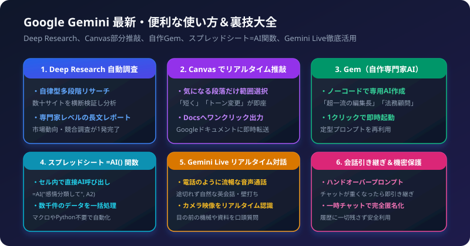

GoogleのAI「Gemini（ジェミニ）」は、単なる質問応答にとどまらず、自律型リサーチ、Google Workspaceの完全統合、リアルタイム音声・カメラ対話など、日々の業務効率を何倍にも引き上げる機能が満載です。

明日からすぐに仕事や学習に活かせる、最新の便利な使い方と知る人ぞ知る裏技テクニックを体系的にまとめました。

## 1. Deep Research で調査・競合分析を完全自動化

手作業で検索タブを何十個も開いてまとめていたリサーチ作業を、AIが自律的に多段階で検索・ファクトチェックを繰り返して長文レポート化してくれる最強機能です。

### 活用テクニック
調べたいテーマを具体的かつ包括的に指示し、Deep Researchモードを起動します。

```text
2026年における国内生成AI市場の導入動向、主要業界ごとのユースケース、
および企業が直面している課題（セキュリティ、コスト）について、
海外の最新トレンドと対比しながら網羅的な分析レポートを作成してください。
```

AIが検索計画を立て、信頼性の高い一次情報を検証しながら、プロの調査機関が作成したかのような詳細なレポートを仕上げてくれます。

## 2. Canvas（キャンバス）で部分修正・リアルタイム推敲

チャットのやり取りで「全文が書き直されてしまい、良かった部分まで消えてしまった」という不満を解消する専用編集機能です。

### 活用テクニック
1. 長文の企画書やブログ記事、コードを生成させると、画面右側に「Canvas」ウィンドウが開きます。
2. 修正したい段落やコード行だけをマウスで範囲選択します。
3. ポップアップするメニューから「もっと簡潔に」「トーンをです・ます調に」「具体例を追加」を選択します。
4. 選択部分だけが瞬時に書き換わります。
5. 完成したら右上のボタンから1クリックで「Googleドキュメントへ出力」が可能です。

## 3. 自分専用AI「Gem（ジェム）」で定型業務を型化

特定の役割や業務ルールを持った「自分専用のAIアシスタント」をノーコードで作成できる機能です。

### 活用テクニック
- 作成例「辛口Web編集長」:
  「あなたは月間100万PVメディアの編集長です。読者が途中で離脱しない構成になっているか、専門用語が多すぎないかを厳しくレビューしてください。」
- 作成例「契約書リスク検知アシスタント」:
  「NDAや業務委託契約書を読み込ませた際、当社に著しく不利な損害賠償条項や秘密保持義務を箇条書きで抽出してください。」

一度作っておけば、左メニューからGemを選ぶだけで、毎回長い前提指示を入力する手間がゼロになります。

## 4. Googleスプレッドシートの「=AI()」関数ハック

Google Workspace連携により、スプレッドシートのセル内で直接Geminiの知能を関数として呼び出せます。

### 活用テクニック
面倒なVBAマクロや複雑な正規表現を使わずに、自然言語で大量データを一括処理できます。

```excel
=AI("以下の顧客アンケートを『要望』『不満』『称賛』のいずれかに分類して", A2)
```

数千行の顧客レビューや問い合わせデータを、オートフィルでドラッグするだけで一瞬で感情分析・カテゴリ分類できます。

## 5. Gemini Live でリアルタイム英会話・アイデア壁打ち

人間と電話しているかのように、相槌を打ちながらリアルタイムで途切れなく音声会話ができる機能です。

### 活用テクニック
- スマホアプリでGemini Liveを起動し、「今から新規事業のアイデア出しをするから、私の発言に鋭いツッコミや別の視点をどんどん返して」と話しかけます。
- スマホのカメラを起動して「このエラーが出ている基板の配線、どこが間違っている？」と見せながら口頭で相談することも可能です。

## 6. 知っておくと得する小ワザ・裏技

### 会話の引き継ぎ（ハンドオーバー）プロンプト
チャットが長くなって動作が重くなったり、AIが昔の指示を忘れ始めたら、以下を入力します。

```text
ここまでの重要な決定事項、前提条件、および次にやるべきTODOを、
新しいチャットにそのまま引き継げるMarkdown形式で整理して出力してください。
```

これを出力させ、新しいチャットの最初に貼り付けることで、常にクリーンで高速なAI頭脳を維持できます。

### 一時チャットで機密データを保護
他人の個人情報や社外秘のデータを相談する際は、設定から「一時チャット」をオンにすることで、アカウントの履歴に一切残さず安全に作業を完結できます。
