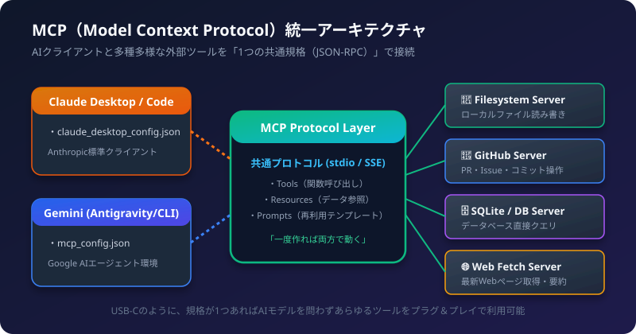
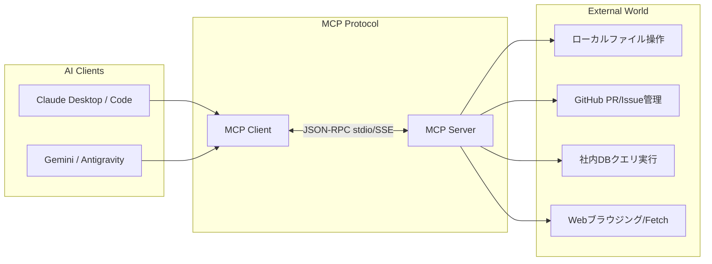

MCP（Model Context Protocol）は、AIアシスタントと外部のツール、データベース、ファイルシステム、APIを安全・シンプルに接続するための「オープン標準規格」です。

従来はClaude用、OpenAI用、Gemini用とモデルごとに別々で開発していたツール呼び出しコードを、「USB-Cポート」のように1つの共通規格に統一できます。

この記事では、MCPの仕組みから、Claude DesktopおよびGemini（Antigravity等）における初期設定ファイルの記述、ツールの接続と動作確認までの一連の流れを解説します。

## 1. MCPで実現できること



- 開発効率の最大化: 1つのMCPサーバーを作れば、GeminiでもClaudeでも同じツールが即座に使えます。
- 安全なローカル実行: APIキーや認証情報をサーバー側に集約し、AIクライアントに安全に機能だけを渡せます。
- エコシステムの活用: コミュニティが公開しているGitHub、Slack、SQLite、Puppeteerなどの公式MCPサーバーをコマンド1行で導入できます。

## 2. 初期セットアップの手順（全体像）

1. Node.js (v18+) または Python (3.10+) をPCに準備する
2. 設定ファイル（JSON）に対象のMCPサーバーを登録する
3. AIクライアントを再起動する
4. チャット上でツール呼び出しのテストを行う

## 3. Claude Desktop での初期設定

Claude DesktopアプリにMCPサーバーを接続する設定手順です。

### 設定ファイルの場所
- Windows: `%APPDATA%\Claude\claude_desktop_config.json`
  （`C:\Users\<ユーザー名>\AppData\Roaming\Claude\claude_desktop_config.json`）
- macOS: `~/Library/Application Support/Claude/claude_desktop_config.json`

### 設定例（FilesystemサーバーとFetchサーバー）

```json
{
  "mcpServers": {
    "filesystem": {
      "command": "npx",
      "args": [
        "-y",
        "@modelcontextprotocol/server-filesystem",
        "C:\\Users\\hiroc\\Desktop"
      ]
    },
    "fetch": {
      "command": "uvx",
      "args": ["mcp-server-fetch"]
    }
  }
}
```

設定を保存した後、Claude Desktopを完全に終了（タスクバーの通知領域からも終了）して再起動します。チャット入力欄の右下に「ハンマー（電気プラグ）」アイコンが表示されれば接続成功です。

## 4. Gemini / Antigravity での初期設定

Geminiエコシステム（Antigravity IDEやGemini CLI）でも同様のMCP構成を利用できます。

### 設定ファイルの場所
プロジェクト直下の `.antigravity/mcp_config.json` またはグローバル設定フォルダに配置します。

### 設定例（GitHub連携とSQLiteサーバー）

```json
{
  "mcpServers": {
    "github": {
      "command": "npx",
      "args": ["-y", "@modelcontextprotocol/server-github"],
      "env": {
        "GITHUB_PERSONAL_ACCESS_TOKEN": "ghp_your_token_here"
      }
    },
    "sqlite": {
      "command": "uvx",
      "args": ["mcp-server-sqlite", "--db-path", "./data/app.db"]
    }
  }
}
```

## 5. 代表的な公式MCPサーバー一覧

| サーバー名 | コマンド（npx / uvx） | できること |
| :--- | :--- | :--- |
| Filesystem | `@modelcontextprotocol/server-filesystem` | 指定ディレクトリのファイル一覧表示、読み込み、編集 |
| GitHub | `@modelcontextprotocol/server-github` | リポジトリ検索、Issue作成、PR一覧の取得 |
| Fetch | `mcp-server-fetch` | URLのWebページを取得してMarkdownに変換 |
| Memory | `@modelcontextprotocol/server-memory` | 会話をまたいだ知識グラフ・記憶の永続化 |
| PostgreSQL | `@modelcontextprotocol/server-postgres` | DBスキーマの取得とSQLクエリの直接実行 |

## 6. 実機での使い方・動作確認の流れ

設定が完了したら、チャット画面で自然言語で指示を出します。

### 実行例（Filesystemサーバー使用時）
```text
ユーザー:
デスクトップにある「memo.txt」の内容を読んで、重要なToDoを3点箇条書きでまとめてください。
```

```text
Claude / Gemini の動作:
1. 接続されているMCPサーバーから「filesystem」ツールの「read_file」を検出
2. 引数 path="C:\Users\...\memo.txt" でツール呼び出しを実行
3. 取得したテキスト内容を解釈し、要約結果を回答
```

画面上に「ツールを使用中...」と表示され、AIが自律的に外部データを取得して回答を生成します。

## 7. トラブルシューティング

### Q1. ハンマーアイコンやツールが表示されない
- JSON構文エラー: カンマの付け忘れや、Windowsパスのバックスラッシュ（`\`）のエスケープ漏れ（`\\` にする必要あり）を確認してください。
- Node.jsのパス: `npx` コマンドがOSのPATHに通っているかターミナルで `npx -v` を確認してください。

### Q2. ツール実行時に権限エラーが出る
- Filesystemサーバーの場合、引数で許可したディレクトリ以外のパスにはアクセスできません。アクセスしたいフォルダを `args` に追加してください。

## 8. 導入チェックリスト

- [ ] Node.js (18以上) または uv (Python) がインストールされているか
- [ ] OSごとの正しいパスに `config.json` を配置したか
- [ ] Windowsのパス区切り文字は二重バックスラッシュ（`\\`）になっているか
- [ ] APIキーが必要なサーバー（GitHub等）は `env` にトークンを記述したか
- [ ] 設定ファイルの保存後にクライアントアプリを完全再起動したか
