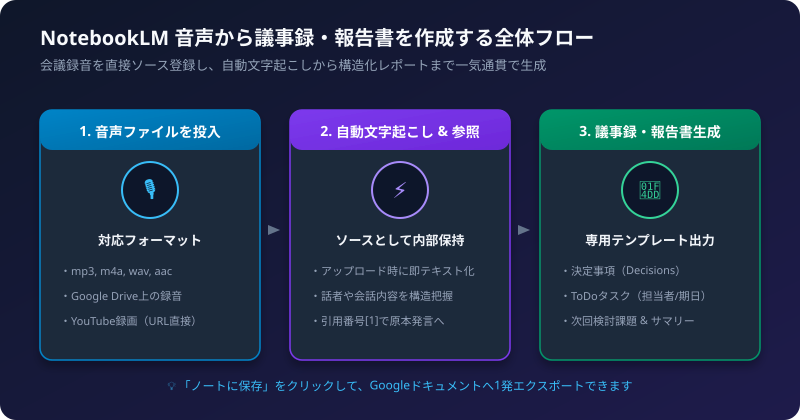
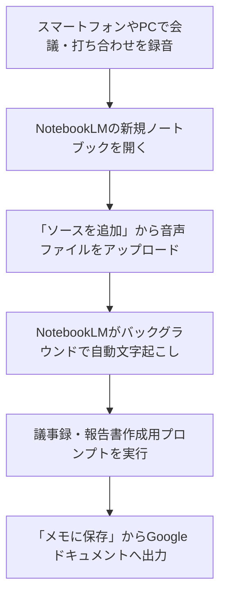

Googleの「NotebookLM（Gemini Notebook）」は、PDFやテキストだけでなく「音声ファイル（m4a、mp3、wavなど）」をそのままソースとして直接アップロードできる強力な機能を備えています。

事前の文字起こしツールを介することなく、録音データをドラッグ＆ドロップするだけで、AIが自動で内容をテキスト解析し、精度の高いビジネス議事録や業務報告書へ変換してくれます。

## 1. 処理の流れ



## 2. 音声ファイルの準備とアップロード手順

### ステップ1: ノートブックを作成する
NotebookLM（notebooklm.google.com）にアクセスし、「新しいノートブック」をクリックします。

### ステップ2: 音声ファイルをソースとして追加
「ソースを追加」画面が開きます。以下のいずれかの方法で音声データを投入します。

- パソコン内のファイルを直接アップロード:
  「ファイルをアップロード」を選び、スマホやICレコーダーで録音した音声ファイル（`.m4a`, `.mp3`, `.wav`, `.aac` など）を選択します。
- Google Driveから選択:
  Google Meetの録音データなどがGoogleドライブにある場合は、「Googleドライブ」から直接ファイルを選びます。
- YouTubeの録画URL:
  社内限定公開やアーカイブ配信のYouTube動画URLを貼り付けることも可能です。

### ステップ3: 読み込み完了を待つ
アップロード後、数十秒〜数分で左パネルのソース一覧に音声ファイルが登録されます。この時点で、NotebookLM内部では自動文字起こしが完了し、質問を受け付ける準備が整っています。

## 3. 議事録・報告書を作成する実践プロンプト

チャット欄に以下のプロンプトを入力して送信します。用途に合わせてコピー＆ペーストしてご利用ください。

### パターンA: 標準的な会議議事録プロンプト
```markdown
この音声記録の内容から、以下のフォーマットで会議の議事録を作成してください。

# 会議概要
- 会議名・テーマ: （推測または記録内容から記載）
- 主な議題: 

# 決定事項（Decisions）
- 今回の会議で決定したことを箇条書きで明確に記載してください。

# アクションプラン（ToDoタスク）
| タスク内容 | 担当者（発言からわかる場合） | 期限・期日 |
| :--- | :--- | :--- |

# 主な議論の経過
- どのような意見が出て、なぜその結論に至ったかの要点を簡潔にまとめてください。

# 次回への持ち越し・検討課題
- 保留になった点や次回の宿題事項を記載してください。
```

### パターンB: 上司・役員向けの業務報告書プロンプト
```markdown
この打ち合わせ内容を踏まえて、多忙な上司が1分で状況を把握できる「業務報告書」を作成してください。

# 結論・要約（エグゼクティブサマリー）
- 最も重要な成果・合意内容を3行でまとめてください。

# 業務の進捗状況
- 現在完了していること
- 発生しているリスクや課題

# 今後のスケジュールとネクストアクション
- 次のアクションとマイルストーン
```

## 4. 完成した議事録を社内共有する手順

1. チャットの回答吹き出しの右上にある「ノートに保存（ピン留めアイコン）」をクリックします。
2. 画面中央の「メモ」欄に議事録が固定されます。
3. 必要に応じて、メモをクリックして手動で体裁や参加者名を微修正します。
4. メモのメニューから「Googleドキュメントにエクスポート」を選択すると、ワンクリックで社内共有用のGoogleドキュメントが生成されます。

## 5. 精度を高めるプロのコツと注意点

- 冒頭にアジェンダを話しておく:
  録音開始直後に「本日の議題は〇〇と××です」と発言しておくと、AIが全体の構造を完璧に捉えることができます。
- ファイルサイズと時間の上限:
  1ファイルあたりの上限容量（通常約200MB）を超える長時間の録音は、無料ツール等で前編・後編に分割してアップロードしてください。
- 引用リンクで発言を確認:
  回答の文末にある `[1]` などのバッジをクリックすると、その発言があった該当箇所を確認できます。金額や納期など重要な数値は必ず原本を照合しましょう。

## 6. チェックリスト

- [ ] 音声ファイル形式（m4a, mp3, wav等）に変換されているか
- [ ] 左のソース一覧に音声が正常に読み込まれているか
- [ ] 決定事項とToDo（担当者・期日）が明確に出力されているか
- [ ] 金額や重要期日に誤りがないか引用番号で確認したか
- [ ] Googleドキュメントへエクスポートして関係者へ送付したか
