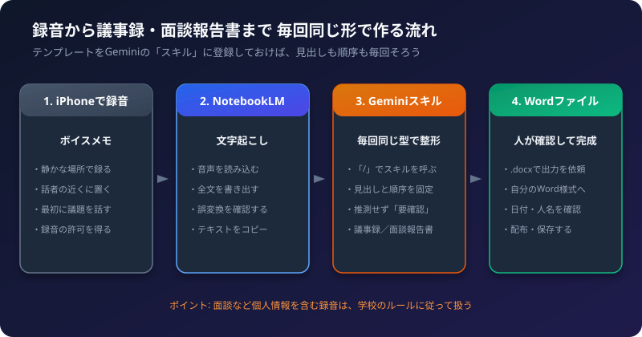
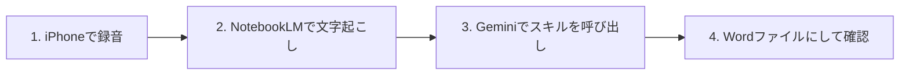

会議や面談のたびに、「録音を聞き返して、決まった様式のWordにまとめる」作業をしていませんか。
この記事では、その流れを **Gemini の「スキル」** に落とし込んで、**毎回同じ見出し・同じ順序で出力できる仕組み**を作る手順を、順番に説明します。

## 1. 全体の流れ



| 手順 | やること | 使うもの |
| :--- | :--- | :--- |
| 1 | 会議・面談を録音する | iPhoneのボイスメモ |
| 2 | 音声を読み込み、文字起こしテキストを取り出す | NotebookLM |
| 3 | スキルを呼び出して、決まった形に整える | Gemini（スキル） |
| 4 | Wordファイルにして、人が確認する | Gemini のファイル作成、またはWord |

この記事の主役は、手順3の **スキル** です。一度作れば、次からは `/` で呼び出すだけで、同じ形に整います。

## 2. 「スキル」とは

スキルは、Geminiに覚えさせておく **「仕事の手順書」** です。
指示文（役割、守るルール、出力の形）をひとまとめにして登録しておくと、チャットで呼び出すだけで、毎回その手順どおりに動きます。

- 毎回、長い指示文を貼り付ける必要がありません。
- 同じスキルを使えば、見出しや順序がそろいます。
- 複数のスキルを、1つのチャットで組み合わせて使えます。
- 中身は、`SKILL.md` という文章のファイルです。

## 3. 先に確認すること（利用条件）

スキルは、次の条件で使えます（Google の公式ヘルプによる）。

- 18歳以上で、Gemini にログインしていること
- 「Keep Activity（アクティビティの保存）」がオンになっていること
- Google AI の有料プランは、不要です
- 学校や職場のアカウントでの提供は、時期や管理者の設定によって異なります。使えない場合は、管理者に確認してください。

画面の名前や場所は、更新で変わることがあります。見つからないときは、公式ヘルプ「[Create & manage skills for Gemini Apps](https://support.google.com/gemini/answer/17094296)」を確認してください。

## 4. 事前準備: Word の様式を「見出しの一覧」にする

スキルには、**Word ファイル（.docx）を参考ファイルとして登録できません**（公式ヘルプでは、.docx と .xlsx は非対応とされています）。
そこで、お手持ちの Word の様式から、**見出しと項目の一覧**を取り出して、スキルの指示文に書き込みます。

### 手順
1. 議事録の Word を開きます。
2. 見出し（項目名）を、上から順に書き出します。
3. 面談報告書も、同じように書き出します。

**議事録の項目の例**

1. 会議名・日時・場所・出席者
2. 議題
3. 決定事項
4. 協議内容
5. ToDo（担当者・期限）
6. 次回の予定
7. 備考

**面談報告書の項目の例**

1. 面談日時・対象者・面談者
2. 面談の目的
3. 本人の状況・発言の要点
4. 確認した事項
5. 課題と対応方針
6. 次回の面談・フォロー
7. 備考

実際の項目名と順序は、お手持ちの様式に合わせて書き換えてください。

## 5. 手順1: iPhone で録音する

1. 「ボイスメモ」アプリを開き、赤い録音ボタンを押します。
2. 録音の前に、**相手に録音の許可を得ます**。
3. 最初に「本日の議題は〇〇です」と話すと、あとで内容を整理しやすくなります。
4. 話者の近くにiPhoneを置き、静かな場所で録ります。
5. 終わったら、赤いボタンを押して停止します。

録音したファイルは、「ファイル」アプリや、Google ドライブなどを経由して、パソコンに移しておくと、次の手順が楽になります。

## 6. 手順2: NotebookLM で文字起こしを取り出す

詳しい手順は、[NotebookLM 音声ファイルから文字起こし＆議事録・報告書を作成する手順](/howto-canvas/ai/notebooklm/audio-transcription/) にまとめています。ここでは、スキルに渡すための流れだけを説明します。

1. NotebookLM で、新しいノートブックを作ります。
2. 「ソースを追加」から、録音ファイルをアップロードします。
3. 読み込みが終わったら、チャット欄に次のように入力します。

```text
この音声の内容を、省略せずに、発言の順に文字起こししてください。
聞き取れない部分は「（聞き取れず）」と書いてください。
```

4. 出力されたテキストを、**誤変換がないか確認**します。人名や専門用語は、特に注意してください。
5. 問題なければ、テキストをコピーします。

:::tip[長い録音のとき]
一度に出力しきれないときは、「前半」「後半」に分けて頼みます。回答の最後にある引用の番号をクリックすると、元の発言の箇所を確認できます。
:::

## 7. 手順3: スキルを作る（いちばん大切な手順）

ここで、議事録用と面談報告書用のスキルを作ります。まず議事録用を作り、同じ手順で面談報告書用も作ります。

### 7-1. スキルのページを開く

1. パソコンのブラウザで、[gemini.google.com](https://gemini.google.com) を開きます。
2. 左のサイドバーで、**「Customize」** をクリックします。見当たらないときは、先に **「More」** をクリックします。
3. 上のほうの **「Skills」** をクリックします。

### 7-2. 作り方を選ぶ

スキルのページの上にある **「Create」** から、次の方法を選べます。

| 方法 | 内容 | 向いている人 |
| :--- | :--- | :--- |
| Create with Gemini | チャットで相談しながら作る | 文章を考えるのが苦手な人 |
| Create manually | 名前・説明・指示を、自分で入力する | **この記事のおすすめ** |
| Upload | `SKILL.md` ファイルをアップロードする | 作ったファイルを使い回したい人 |

この記事では、**「Create manually」** で作ります。

### 7-3. 議事録スキルを入力する

「Create」→「Create manually」を選び、次の3つを入力します。

**1. 名前（Name）**

```text
meeting-minutes
```

名前は、**英小文字とハイフン**で書きます（日本語は使えません）。

**2. 説明（Description）**

```text
会議の文字起こしテキストから、決まった形式の議事録を作成する。「議事録」「会議のまとめ」を頼まれたときに使う。
```

説明は、Gemini が「いつこのスキルを使うか」を判断する手がかりになります。

**3. 指示（Instructions）**

次をコピーして貼り付け、項目名をお手持ちの様式に合わせて書き換えます。

```markdown
# 役割
あなたは、学校の会議の議事録を作成する担当者です。

# 入力
会議の文字起こしテキストが渡されます。

# 守るルール
- 文体は「です・ます」調にする。
- 「えー」「あのー」などの話し言葉は削除する。
- 文字起こしにない内容を、推測で書かない。
- 情報がない項目は「記載なし」と書く。
- 日付・数字・人名など、確実でないものには「（要確認）」を付ける。
- 決定事項と、まだ決まっていないことを区別する。

# 出力の形式
次の見出しと順序を、必ずそのまま使うこと。見出しの名前を変えたり、順序を入れ替えたり、項目を省いたりしない。

## 1. 会議名・日時・場所・出席者
## 2. 議題
## 3. 決定事項
## 4. 協議内容
## 5. ToDo
| 内容 | 担当者 | 期限 |
| :--- | :--- | :--- |
## 6. 次回の予定
## 7. 備考
```

入力できたら、画面上の **「Create」** を押します。

### 7-4. 面談報告書スキルも作る

同じ手順で、もう1つ作ります。

- 名前: `interview-report`
- 説明: `面談の文字起こしテキストから、決まった形式の面談報告書を作成する。「面談報告書」「面談のまとめ」を頼まれたときに使う。`
- 指示:

```markdown
# 役割
あなたは、学生との面談の報告書を作成する担当者です。

# 入力
面談の文字起こしテキストが渡されます。

# 守るルール
- 文体は「です・ます」調にする。
- 学生の氏名は、渡された表記をそのまま使う（勝手に補わない）。
- 文字起こしにない内容を、推測で書かない。
- 評価や診断のような断定はしない。事実と、本人の発言を分けて書く。
- 情報がない項目は「記載なし」と書く。
- 日付・数字・人名など、確実でないものには「（要確認）」を付ける。

# 出力の形式
次の見出しと順序を、必ずそのまま使うこと。見出しの名前を変えたり、順序を入れ替えたり、項目を省いたりしない。

## 1. 面談日時・対象者・面談者
## 2. 面談の目的
## 3. 本人の状況・発言の要点
## 4. 確認した事項
## 5. 課題と対応方針
## 6. 次回の面談・フォロー
## 7. 備考
```

:::caution[面談の内容は個人情報です]
面談の録音や文字起こしには、学生の個人情報が含まれます。外部のAIサービスに入力してよいかは、学校の規程によって異なります。入力する前に、学校のルールを確認してください。迷うときは、氏名を「学生A」のように伏せて使います。
:::

### 7-5. 作ったスキルを確認・修正する

- スキルのページで、作ったスキルをクリックすると、**説明**と**指示**を直接編集できます。
- 右上の **「More」** から、**「Edit with Gemini」** を選ぶと、チャットで相談しながら直せます。
- 一時的に使いたくないときは、「More」→「Deactivate」で、自動の利用を止められます。
- 削除は、スキルのページの「More」→「Delete」です。**削除は元に戻せません。**

### 7-6. 別の方法: ファイルを作ってアップロードする

スキルのファイル（`SKILL.md`）を自分で作って、アップロードすることもできます。複数のパソコンで同じスキルを使いたいときに便利です。

1. 「meeting-minutes」という名前のフォルダを作ります（**フォルダ名とスキル名を同じ**にします）。
2. 中に、次のような `SKILL.md` を、メモ帳などで作ります。

```markdown
---
name: meeting-minutes
description: 会議の文字起こしテキストから、決まった形式の議事録を作成する。
---

（ここに、7-3 の「指示」の内容を書く）
```

3. スキルのページで、「Create」→「Upload」を選び、`SKILL.md` かフォルダ（またはzipファイル）を選びます。
4. 内容を確認して、「Create」を押します。

アップロードは、パソコンのWeb版とMac版で使えます。スマホのアプリでは、「Create with Gemini」とテンプレートからの作成だけです。

## 8. 手順4: スキルを使って、議事録を作る

### 8-1. スキルを呼び出す

1. Gemini の新しいチャットを開きます。
2. 入力欄に `/` を入力し、一覧から `meeting-minutes` を選びます（`@` の場合もあります）。
3. 続けて、手順2でコピーした文字起こしテキストを貼り付けます。

```text
/meeting-minutes
以下の文字起こしから議事録を作成してください。

（ここに文字起こしテキストを貼り付ける）
```

4. 送信すると、スキルの形式で議事録が出力されます。

### 8-2. 出力を確認する

- 見出しの名前と順序が、決めたとおりか
- 日付・人名・数字・期限が、録音と合っているか
- 「（要確認）」の部分を、確認して直したか
- 決定事項に、決まっていないことが混ざっていないか

## 9. 手順5: Word ファイルにする

### 方法A: Gemini に Word で出してもらう

出力された議事録の下で、続けて頼みます。

```text
この議事録を、Wordファイル（.docx）で出力してください。
```

Gemini には、`.docx` などのファイルを作ってダウンロードできる機能があります。ダウンロードしたファイルを開いて、見た目を確認してください。

### 方法B: 自分の Word 様式に貼り付ける（確実）

Gemini が作る Word は、お手持ちの様式を開いて埋めるのではなく、**新しく作る**ものです。そのため、フォント、罫線、ロゴなど、様式の見た目まで同じになるとは限りません。

見た目をそろえたいときは、次のようにします。

1. Gemini の出力（見出しつきの文章）を、コピーします。
2. お手持ちの Word の様式を開きます。
3. 見出しごとに、内容を貼り付けます。

見出しの順序が固定されているので、貼り付けの作業は、短時間で終わります。

:::tip[スキルで Word まで自動にするには]
スキルが、ファイル作成の機能と組み合わせて使えるかは、公式ヘルプに記載がありません。まず、方法Aで、実際に試してください。うまくいかなければ、方法Bで運用するのが確実です。
:::

## 10. 「毎回同じ出力」にするコツ

| コツ | 理由 |
| :--- | :--- |
| 見出しの名前と順序を、指示に**はっきり書く** | 「必ずそのまま使う」と書くと、ぶれにくくなります |
| 「推測しない」「情報がなければ『記載なし』」と書く | 作り話を防げます |
| 迷う項目は「（要確認）」と書かせる | 人が確認すべき箇所が分かります |
| 同じ文字起こしで、何度か試す | 出力がそろうかを確認できます |
| うまくいかない点は、指示に1行ずつ足す | 少しずつ、精度が上がります |

## 11. うまくいかないときの対処

| 症状 | 確認すること |
| :--- | :--- |
| `/` でスキルが出てこない | スキルが有効か（Deactivate されていないか）、スキルのページで確認する。ログインしたアカウントが合っているか |
| 見出しが毎回違う | 指示に「見出しの名前と順序を変えない」と書いたか。見出しを具体的に書いたか |
| 作り話が混ざる | 「文字起こしにない内容を推測で書かない」を、指示に入れたか |
| アップロードに失敗する | 名前が英小文字とハイフンか、フォルダ名とスキル名が同じか。不要な隠しファイル（`.DS_Store` など）が入っていないか |
| 作成画面が見つからない | 画面の表記は変わることがあります。公式ヘルプを確認する |
| 学校のアカウントで使えない | 提供の時期や、管理者の設定によります。管理者に確認する |

## 12. チェックリスト

- [ ] 録音の許可を得たか
- [ ] NotebookLM の文字起こしの誤変換を、確認したか
- [ ] Word の様式から、見出しの一覧を作ったか
- [ ] スキルの名前が、英小文字とハイフンか
- [ ] 指示に「見出しと順序を変えない」と書いたか
- [ ] 出力の日付・人名・数字を、録音と照らして確認したか
- [ ] 個人情報の扱いは、学校のルールに従ったか

関連記事: [NotebookLM 音声ファイルから文字起こし＆議事録・報告書を作成する手順](/howto-canvas/ai/notebooklm/audio-transcription/)、[NotebookLM プロの裏技・実践活用術](/howto-canvas/ai/notebooklm/pro-tips/)
