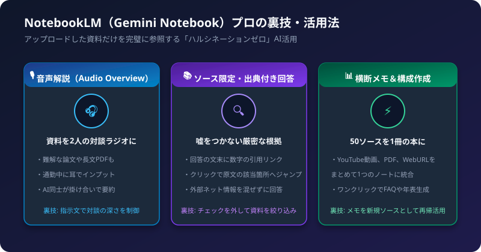
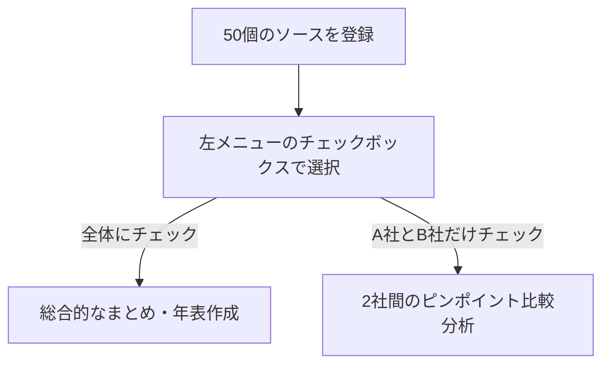

Googleが提供する「NotebookLM（旧Project Tailwind / Gemini Notebook）」は、一般的な生成AIと異なり「自分がアップロードした資料だけを元に考える」ノート型AIアシスタントです。

嘘をつかない（ハルシネーションを起こさない）特性を最大限に活かし、業務や学習の効率を劇的に高めるプロの裏技を紹介します。

## 1. 裏技1: 「音声解説（Audio Overview）」の指示文ハック

NotebookLM最大の人気機能が、アップロードした資料を英語（および多言語）の2人のホストが雑談形式で解説してくれる「音声対談（Deep Dive Podcast）」です。

### 活用テクニック
ただ生成ボタンを押すだけでなく、「Customize（カスタマイズ）」設定に以下の指示文を入れると対話の質が劇的に変わります。

```text
初心者向けに専門用語を小学生でもわかる例え話で解説してください。
重要な結論を冒頭2分で話し、残りで背景と具体例を深掘りしてください。
```

通勤中や散歩中に、30ページの難解な企画書や論文を10分のラジオ感覚で完全にインプットできます。

## 2. 裏技2: ソースの「個別チェック外し」による比較調査

ノートブックには最大50個のソース（PDF、Googleドキュメント、WebサイトURL、YouTube動画など）を登録できます。



### 活用テクニック
左パネルのソース一覧で、質問したい資料だけにチェックを入れて質問すると、ノイズが混ざらず正確な比較表が作れます。

- 例: 競合A社の資料と自社の資料だけにチェックを入れ、「価格体系と機能の違いを表形式で比較して」と質問する。

## 3. 裏技3: 回答の「引用番号リンク」で原本検証

NotebookLMの回答文末には、必ず `[1]` や `[2]` といった数字の引用バッジが付きます。

### 活用テクニック
このバッジをクリックすると、画面右側のソースビューアが自動で開き、原本PDFの「どのページのどの文章を根拠にして回答したか」がハイライト表示されます。

- 契約書の条項チェック
- 社内規程の適用確認
- 論文のデータ出典確認

AIの回答をそのまま信じず、1クリックで一次情報（原本）をダブルチェックできるため、ミスの許されないビジネス現場で絶大な信頼性を発揮します。

## 4. 裏技4: チャット回答を「新しいメモ」として再登録する

AIとチャットして得られた秀逸なまとめや分析結果は、吹き出し右上にある「ノートに保存（Save to note）」ボタンを押すことで、中央のメモ欄にストックできます。

### 活用テクニック
保存したメモは、なんと「新しい情報源（ソース）」としてAIの参照対象に組み込むことができます。
段階的に思考を深め、最終的に一冊の電子書籍や長文レポートを共同執筆するループが完成します。

## 5. NotebookLM 活用チェックリスト

- [ ] PDFだけでなく、関連するYouTube動画（文字起こし付き）やWebサイトURLも一緒に投入したか
- [ ] 音声解説のカスタマイズ機能で、好みの話し方や焦点を指定したか
- [ ] 比較分析時は、対象以外のソースのチェックを外したか
- [ ] 重要な決定を下す前に、引用番号をクリックして原本の文脈を確認したか
