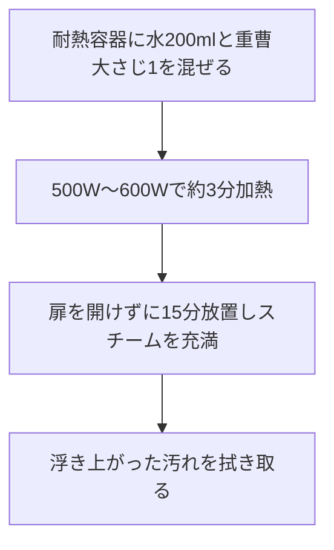

## 1. 準備チェックリスト
- [ ] 耐熱容器（マグカップまたは深めの小鉢）
- [ ] 重曹（大さじ1）
- [ ] 水（200ml）
- [ ] ふきん（またはキッチンペーパー）

## 2. 清掃フロー

## 3. トラブルシューティング
- **汚れが落ちにくい場合**: 加熱時間を1分延ばすか、放置時間を長めにとって蒸気を十分に行き渡らせてください。
- **焦げ付きがある場合**: クエン酸（大さじ1）を使った同様のスチーム清掃をお試しください。

:::caution[火傷に注意]
加熱直後の容器は非常に高温です。必ず冷めるまで待ってから取り出してください。
:::

<!-- NanoBanana Prompt: Clean home-appliance maintenance infographic illustration, microwave interior with rising steam, pastel tone, simple and educational -->
