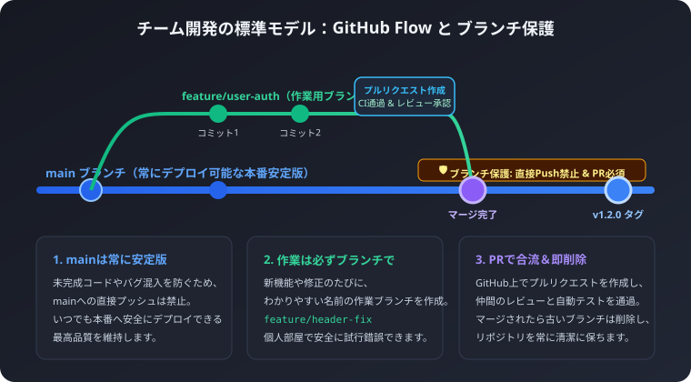
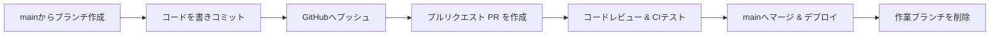

個人開発では何気なく行っていた `git push origin main` ですが、複数人でチーム開発を始めると「mainへの直接プッシュは原則禁止」と言われるようになります。

なぜmainを守らなければならないのか、世界中で最も広く採用されている軽量ブランチ運用モデル「GitHub Flow」のルールと、GitHubのブランチ保護設定について解説します。

## 1. なぜ「main直接プッシュ」が危険なのか？

mainブランチは、本番環境（ユーザーが見ている画面）にそのまま公開されるコードの基準点です。

もし誰かが書きかけのコードや、テストしていないバグ入りのコードを直接mainにプッシュしてしまうと、以下のトラブルが発生します:
- 本番サイトが突然エラーで動かなくなる
- 他のメンバーが `git pull` した瞬間、全員のPC環境でビルドエラーが多発し開発がストップする
- どのコミットが原因で不具合が起きたのか追跡が極めて困難になる

これを防ぐため、チーム開発では「mainには、レビューとテストに合格した完成品だけを合流させる」というルールを徹底します。

## 2. GitHub Flow の6つの実践ルール

GitHub社が提唱し、現代のWebサービス・アプリ開発で圧倒的なデファクトスタンダードとなっているのが「GitHub Flow」です。ルールは非常にシンプルで誰でもすぐに実践できます。



### ルール1: mainブランチのものは常にデプロイ可能であること
mainブランチにあるコードは、いつ何時本番環境にリリースしても安全に動作する状態を保ちます。

### ルール2: 新しい作業をするときは、必ずmainから説明的な名前のブランチを作成する
何をするための作業かが一目でわかるプレフィックス（接頭辞）を付けます:
- 新機能の追加: `feature/user-login`
- バグ修正: `fix/header-overflow`
- ドキュメント整備: `docs/readme-update`
- パフォーマンス改善・リファクタリング: `refactor/api-cache`

### ルール3: 定期的にリモート（GitHub）の同じ名前のブランチへプッシュする
自分のPCのハードディスクがクラッシュしても作業が消えないよう、また仲間に進捗を見てもらえるよう、作業中であってもリモートへこまめにプッシュします。

### ルール4: レビューやフィードバックがほしいときは、プルリクエストを作成する
作業の途中であっても「Draft（下書き）Pull Request」として作成し、方針が合っているか仲間に見てもらうことができます。

### ルール5: レビュー承認とテスト通過後にのみ、mainへマージする
仲間の「LGTM（Looks Good To Me: 承認）」をもらい、自動テスト（GitHub Actionsなど）がすべて緑色（成功）になったらマージします。

### ルール6: mainへマージされたら、直ちにデプロイし、ブランチを削除する
マージが完了したら、役割を終えたブランチはGitHub上でもローカルでも削除して整理します。

## 3. GitHub上で「ブランチ保護ルール」を設定する手順

人間がどんなに気をつけていても、「うっかり間違えてmainブランチのままpushしてしまった」というミスは起こり得ます。
GitHubの設定機能を使えば、物理的に直接プッシュを禁止できます。

### 設定ステップ
1. GitHubのリポジトリページを開き、「Settings（設定）」タブをクリック
2. 左メニューの「Code and automation」内にある「Branches」をクリック
3. 「Add branch protection rule（保護ルールを追加）」ボタンを押す
4. 「Branch name pattern」に `main` と入力
5. 以下の重要チェックボックスをONにする:
   - Require a pull request before merging（マージ前にPRを必須にする）
   - Require approvals（最低1人以上の承認レビューを必須にする）
   - Require status checks to pass before merging（テスト通過を必須にする）
   - Do not allow bypassing the above settings（管理者であっても例外ルールを認めない）
6. 「Save changes」をクリック

これで、どんなメンバーであってもPRを経由しない限りmainを変更できなくなり、チームのコードベースが完全に守られます。

## 4. バージョン管理とリリースタグ（git tag）

アプリやライブラリのリリース時には、「このコミットがバージョン1.0.0である」という目印（タグ）を打ちます。

```bash
# 1. 最新のmainに切り替え
git checkout main
git pull origin main

# 2. 注釈付きタグを作成（バージョン番号とコメント）
git tag -a v1.0.0 -m "Release version 1.0.0: 初期リリース"

# 3. タグをGitHubに送信
git push origin v1.0.0
```

GitHub上で「Releases」ページを開くと、タグに紐づいたリリースノートを作成し、配布用ファイルを添付してユーザーに届けることができます。
