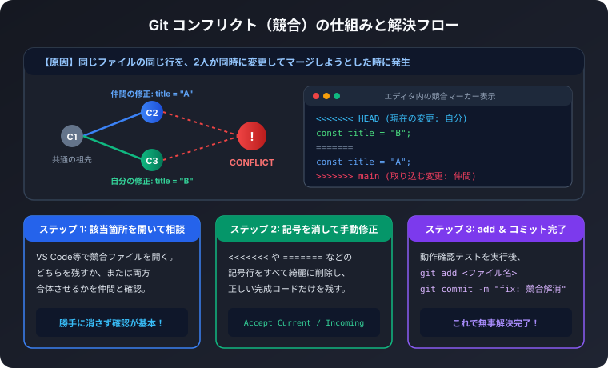
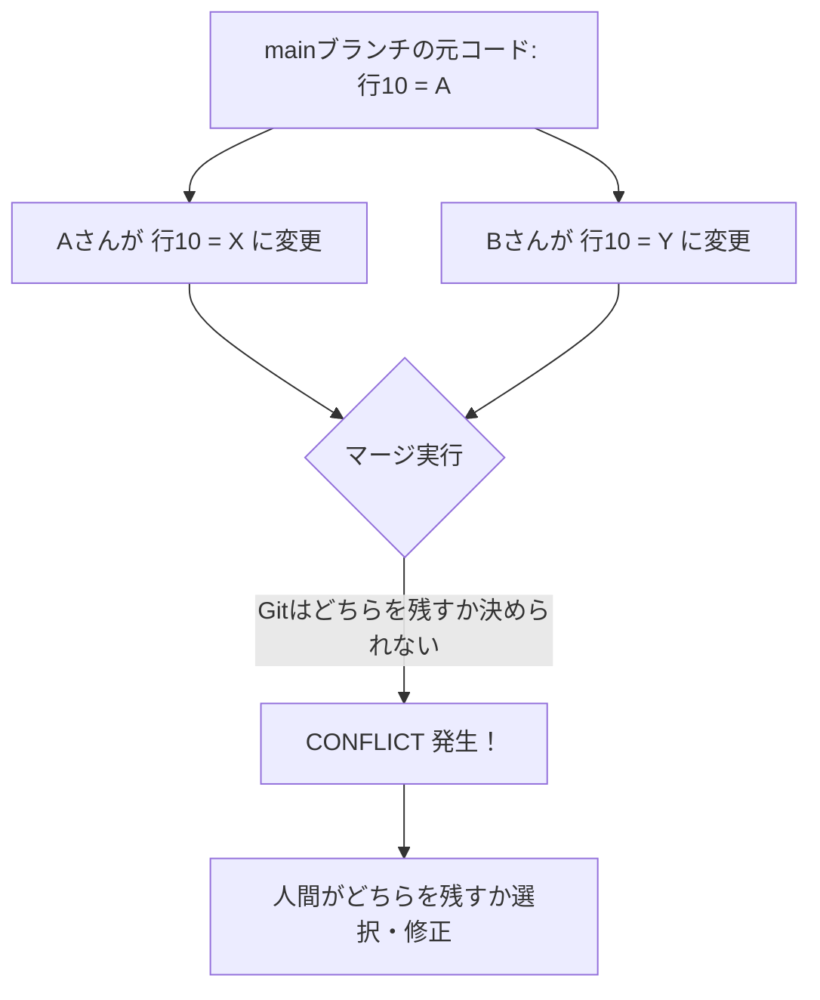

複数人でチーム開発を進めていると、誰しも必ず一度は遭遇するのが「CONFLICT（競合）」です。
「エラーが出てマージできない」「画面が記号だらけになって壊れた」と慌てがちですが、Gitの仕組みを理解していれば怖くありません。

この記事では、競合が起こる理由、安全な解消ステップ、そして日頃から競合を減らす予防策を解説します。

## 1. なぜコンフリクト（競合）が起きるのか？

Gitは通常、別々のファイルや、同じファイルでも異なる行の変更であれば、自動的に賢く合体（マージ）してくれます。

しかし、以下のようなケースではGitは自動判断ができません:
- 開発者AさんとBさんが、同じファイルの全く同じ行を別の内容に書き換えた
- 開発者Aさんが編集したファイルを、Bさんが削除した

「どちらの変更を正とするべきか」はプログラムには判断できないため、Gitはマージ処理を一時停止し、人間に判断を委ねます。これがコンフリクトの正体です。



## 2. 競合マーカーの見方

競合が発生したファイルを開くと、以下のような特殊な記号（コンフリクトマーカー）が自動挿入されています。

```text
<<<<<<< HEAD (現在のブランチの変更: 自分)
const apiEndpoint = "https://api.v2.example.com";
=======
const apiEndpoint = "https://api-stage.v2.example.com";
>>>>>>> feature/auth (取り込もうとした変更: 仲間)
```

記号の意味:
- `<<<<<<< HEAD` から `=======` まで:
  あなたが今いるブランチ（手元の作業内容）
- `=======` から `>>>>>>> ブランチ名` まで:
  マージやプルによって合流しようとしている相手側の変更内容

## 3. 実践！コンフリクト解決の3ステップ

### ステップ1: 該当ファイルを開いて方針を決める

VS Codeなどのモダンエディタを使っている場合、競合箇所の真上に以下の便利なワンクリック選択ボタンが表示されます。

- Accept Current Change: 自分の変更（HEAD側）を残す
- Accept Incoming Change: 相手の変更を取り込む
- Accept Both Changes: 両方の変更を両方とも残す

どちらか一方を消す場合は、必ずコードを書いた担当者やチームメンバーに一声かけて「どちらを優先すべきか」「合体させるべきか」を確認してから決めましょう。

### ステップ2: コードを整え、マーカーを消す

エディタの支援機能を使うか、手動で不要な行と `<<<<<<<`, `=======`, `>>>>>>>` をすべて消去します。
消し忘れが残っていると構文エラー（Syntax Error）になるため、エディタのエラー表示がないか確認します。

修正後の例（合体させて整えた状態）:
```typescript
// 両方の設定を反映できるように整理
const apiEndpoint = process.env.USE_STAGE 
  ? "https://api-stage.v2.example.com" 
  : "https://api.v2.example.com";
```

### ステップ3: テスト実行・ステージング・コミット

コードが正しく動くかビルドやテストを実行し、問題がなければGitに「解決した」と伝えます。

```bash
# 1. 修正したファイルをステージに追加
git add src/config/api.ts

# 2. ステータスを確認（Changes to be committed になっていればOK）
git status

# 3. マージコミットを作成
git commit -m "fix: api.ts のエンドポイント競合を解消"

# 4. リモートへプッシュ
git push origin feature/my-branch
```

## 4. コンフリクトを未然に防ぐ5つの鉄則

競合は発生してから直すよりも、日頃の習慣で「発生させない」ことが最善です。

1. 毎朝・作業前には必ず `git pull origin main` を行う
   仲間の最新成果をこまめに取り込んでおくことで、差分が巨大化するのを防げます。
2. ブランチの寿命を短くする（短期間でPRを出す）
   1つのブランチで何日も何週間も作業を溜め込まず、機能ごとに1〜2日で小さくマージします。
3. 同じファイルを複数人で同時に触らないようタスク分担する
   Issueや朝会で「誰がどのファイルを編集するか」を事前に共有します。
4. コミットは小さく小分けにする
   大きな変更を1つのコミットにまとめず、意味のある単位で小まめに記録します。
5. フォーマッター（PrettierやBiome）の設定をチームで統一する
   インデントや改行コードの違いだけでファイル全行が競合する事故を防止できます。
