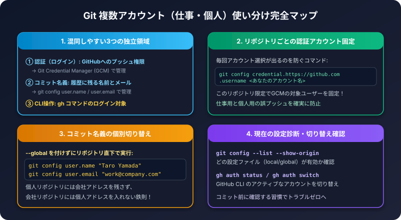

仕事用と個人用など、GitHubのアカウントを複数持っていると、「違うアカウントでプッシュしようとしてエラーになる」「コミットの名前が意図と違う」といったトラブルが起きがちです。
この記事は、アカウントの使い分けで押さえておきたい3点の備忘録です。

## 1. 3つの「アカウント」を分けて考える

| 何の設定か | 役割 | 設定する場所 |
| :--- | :--- | :--- |
| 認証（ログイン） | GitHubへ送る権限 | Git Credential Manager、`gh` |
| コミットの名義 | 履歴に残る名前とメール | `git config user.name` / `user.email` |
| GitHub CLI の操作 | `gh` コマンドのアカウント | `gh auth` |

この3つは別々の設定です。1つを直しても、他は変わりません。

## 2. 認証: リポジトリごとにユーザー名を固定する

プッシュのたびに、アカウント選択の画面が出る場合は、リポジトリごとに使うユーザー名を固定できます。

```bash
git config credential.https://github.com.username アカウント名
```

- 設定は、そのリポジトリの中だけに効きます。
- 別のPCで作業するときは、そのPCでも同じコマンドを実行します。

## 3. コミットの名義: リポジトリごとに設定する

`--global` を付けないと、そのリポジトリだけの設定になります。

```bash
git config user.name "表示したい名前"
git config user.email "使うメールアドレス"

# 設定の確認
git config user.name
git config user.email
```

- 仕事用のリポジトリでは仕事用、個人用では個人用のメールアドレスを設定します。
- すでにコミットした履歴の名義は、あとから簡単には直せません。作業を始める前に確認してください。

## 4. GitHub CLI（gh）: アカウントを切り替える

`gh` は、複数のアカウントでログインできます。

```bash
# 現在のログイン状況を確認
gh auth status

# 別のアカウントを追加でログイン
gh auth login

# 使うアカウントを切り替え
gh auth switch
```

## 5. トラブル別の確認ポイント

| 症状 | 確認すること |
| :--- | :--- |
| 権限エラー（403）でプッシュできない | 認証されているアカウントが、リポジトリに書き込み権限を持っているか |
| 毎回アカウント選択が出る | `credential.https://github.com.username` を設定したか |
| コミットの名前が違う | リポジトリの `user.name` / `user.email` |
| `gh pr create` が別アカウントで動く | `gh auth status` で、有効なアカウント（Active account）を確認 |

:::caution[秘密情報は書かない]
URLにトークンを埋め込む方法は、設定ファイルに平文で残るため避けてください。詳しくは [.gitignore と機密情報の備忘録](/howto-canvas/dev/git/secrets-and-gitignore/) を参照してください。
:::

## 6. チェックリスト

- [ ] リポジトリの認証ユーザー名を固定したか
- [ ] リポジトリの `user.name` / `user.email` を確認したか
- [ ] `gh auth status` で、意図したアカウントが有効か

関連記事: [GitHub CLI（gh）の備忘録](/howto-canvas/dev/github/gh-cli-memo/)
