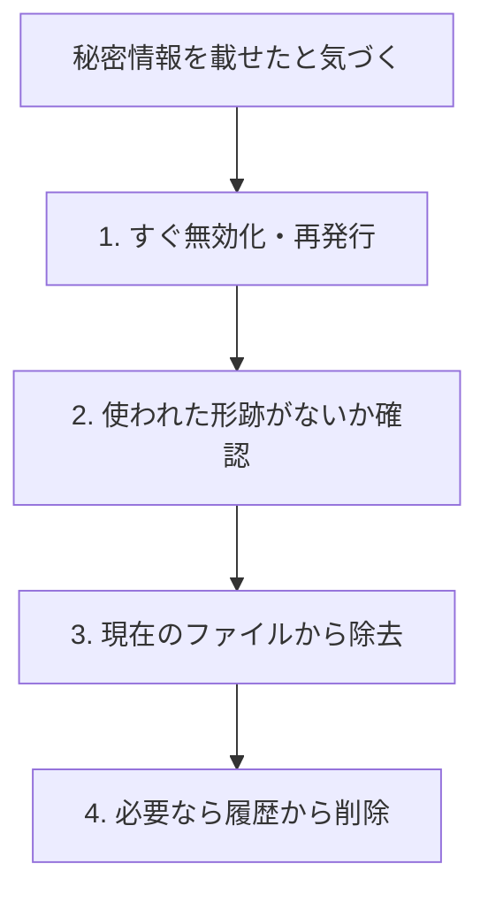

トークンやパスワードをGitに載せてしまう事故は、初心者から経験者まで起こり得ます。
この記事は、「載せない仕組み」と「載せてしまったときの対処」を、手元で見返せる備忘録としてまとめたものです。

## 1. 載せてはいけないものの例

- APIキー、アクセストークン（GitHubなら `ghp_` や `gho_` で始まる文字列）
- パスワード、秘密鍵（`.pem`、`id_rsa` など）
- `.env` などの環境変数ファイル
- 個人情報を含むデータ

:::caution[リモートURLにも注意]
`https://トークン@github.com/ユーザー/リポジトリ.git` のように、トークンをリモートURLに直接書くと、`.git/config` に平文で残ります。画面共有やログに映ると漏れる原因になります。認証は、後述の認証ヘルパー（Git Credential Manager など）に任せるのが安全です。
:::

## 2. 載せない仕組み: .gitignore

リポジトリの直下に `.gitignore` というファイルを置くと、書かれたファイルはGitの管理対象から外れます。

```text
# 環境変数・秘密情報
.env
.env.*
*.pem

# ビルド成果物・依存パッケージ
dist/
node_modules/
```

ポイントは次のとおりです。

- `.gitignore` が効くのは、**まだGitが追跡していないファイル**だけです。
- すでにコミット済みのファイルは、`.gitignore` に書いても追跡され続けます。

### すでに追跡されているファイルを管理から外す

```bash
# ファイルは手元に残したまま、Gitの管理だけ外す
git rm --cached .env

# 状態を確認してからコミット
git status
git commit -m "fix: .env をGit管理から除外"
```

自分のPCだけで無視したいファイル（個人用の設定など）は、リポジトリを汚さない `.git/info/exclude` に書く方法もあります。

## 3. 載せてしまったときの対処（優先順位が大事）

最優先は「そのキーを無効にすること」です。履歴からの削除は、その次です。



### ステップ1: すぐに無効化・再発行する
- GitHubのトークンなら、GitHubの Settings → Developer settings → Personal access tokens から該当トークンを削除します。
- 他のサービスのキーも、各サービスの管理画面で無効化し、新しいものを発行します。

履歴から消す前に、無効化を先にしてください。公開リポジトリでは、プッシュ直後に自動で収集される場合があります。

### ステップ2: 使われた形跡がないか確認する
サービス側の利用履歴やログを確認します。身に覚えのない操作があれば、管理者に連絡します。

### ステップ3: 現在のファイルから取り除く
- ファイルから秘密情報を消し、環境変数や設定ファイル（`.gitignore` 済み）から読むように直します。
- リモートURLにトークンを入れていた場合は、次のようにURLを直します。

```bash
git remote set-url origin https://github.com/ユーザー名/リポジトリ名.git
```

### ステップ4: 必要なら履歴から削除する
過去のコミットにも秘密情報が残っている場合、履歴の書き換えツール（`git filter-repo` など）で消せます。ただし次の点に注意してください。

- 履歴の書き換えは、チーム全員に影響する大きな操作です。実行前に必ず相談してください。
- 強制プッシュが必要になります。
- 一度でも公開された情報は、履歴を消しても安全とは言えません。**無効化が本質的な対処**です。

## 4. 予防のコツ

- 新しいリポジトリを作ったら、最初に `.gitignore` を整える
- コミット前に `git status` と `git diff --staged` で中身を確認する
- 認証情報は、Git Credential Manager やGitHub CLIの認証に任せる
- GitHubのシークレットスキャン機能（検出・プッシュ保護）を有効にする

## 5. チェックリスト

- [ ] `.env` や秘密鍵は `.gitignore` に入っているか
- [ ] リモートURLにトークンを直接書いていないか
- [ ] 載せてしまったら、まずキーを無効化したか
- [ ] 履歴の書き換えは、チームに相談してから行ったか

関連記事: [作業取り消し＆一時退避（stash）レスキューガイド](/howto-canvas/dev/git/undo-and-stash/)
