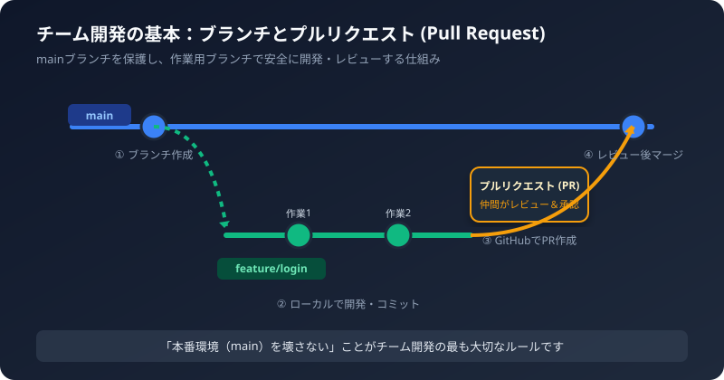
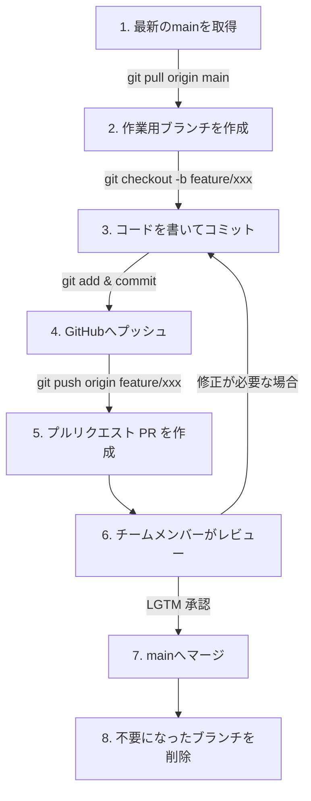

1人で開発するときは `main` ブランチに直接コミットしてプッシュしても問題ありませんが、2人以上のチーム開発では「全員が同時に同じファイルを編集して壊してしまう」トラブルが起きやすくなります。

この記事では、チームで安全・快適にコードを共有するための基本ワークフローをわかりやすく解説します。

## 1. チーム開発の最重要ルール

チーム開発における一番の約束事は「mainブランチには直接コミット・プッシュしない」ことです。

- mainブランチ: 常にテストが通り、誰でも動かせる「完成版」を保つ場所
- 作業用ブランチ（featureブランチ）: 自分の担当機能を開発するための「個人の作業部屋」

自分の作業部屋で安全に機能を作り、チームメンバーの確認（レビュー）を受けてから完成版（main）に合流（マージ）させます。

## 2. チーム開発の全体フロー



## 3. 実践！チーム開発の基本ステップ

### ステップ1: mainブランチを最新の状態にする
作業を始める前に、仲間が更新した最新のコードを手元にダウンロードします。

```bash
git checkout main
git pull origin main
```

### ステップ2: 新しい作業用ブランチを作る
ブランチ名には「作業内容」がひと目でわかる名前を付けます。

```bash
# feature/ヘッダー修正 というブランチを作成して切り替え
git checkout -b feature/header-design
```

### ステップ3: 変更を加えてコミットする
普段通りにファイルを編集し、コミットします。

```bash
git add -A
git commit -m "feat: ヘッダーのロゴとナビゲーションを追加"
```

### ステップ4: GitHubに自分のブランチをプッシュする
自分のブランチだけをGitHubに送信します。mainブランチには影響を与えません。

```bash
git push -u origin feature/header-design
```

### ステップ5: GitHubでプルリクエスト（PR）を作る
1. GitHubのリポジトリページを開きます。
2. 画面上部に表示される「Compare & pull request」ボタンをクリックします。
3. タイトルと変更内容（何を変更したか、動作確認方法）を記入して「Create pull request」を押します。

### ステップ6: レビューを受けてマージする
- 仲間にPRを見てもらい、コメントや修正依頼があれば対応します。
- 問題がなければ「Merge pull request」ボタンを押してmainブランチへ合流させます。

## 4. よくある初心者の疑問とトラブル対処法

### Q1. コンフリクト（競合）が起きたときは？
同じファイルの同じ行を自分と仲間が同時に編集した場合に発生します。
エディタ（VS Codeなど）上に両方の変更箇所が表示されるので、仲間と相談してどちらを残すか選択し、再度コミットしてプッシュします。

### Q2. 間違えてmainブランチで作業してしまったら？
まだコミットしていなければ、そのまま新しいブランチを作成すれば作業内容を引き継げます。

```bash
# 作業内容を保持したまま新規ブランチへ移動
git checkout -b feature/my-work
```

## 5. チーム開発チェックリスト

作業を終えてプルリクエストを出す前に、以下を確認しましょう。

- [ ] 作業開始前に `git pull origin main` で最新状態にしたか
- [ ] mainブランチではなく、専用の作業ブランチ上で作業しているか
- [ ] 不要な一時ファイルやテストコードが含まれていないか
- [ ] プルリクエストに「何を直したか」「確認方法」を書いたか
- [ ] 仲間のレビューをもらってからマージしているか

:::tip[コミュニケーションのコツ]
プルリクエストには画面のスクリーンショットを添付したり、迷ったポイントをコメントとして残しておくと、レビューする仲間がとても確認しやすくなります。
:::
