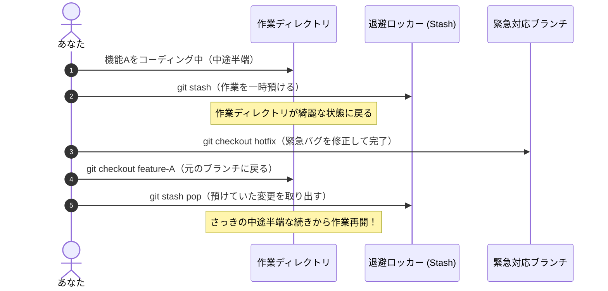

Gitを使っていると、「コミットメッセージの誤字に後から気づいた」「別のブランチで急ぎのバグ修正を頼まれたが手元のコードが中途半端」「間違えてgit addしてしまった」といったシチュエーションが日常茶飯事です。

Gitは過去の作業を極めて安全に保護・復元できるツールです。
この記事では、実務で本当によく使う「取り消し・退避・巻き戻し」の手法を用途別に解説します。

## 1. 作業中の中途半端な変更を一時退避する（git stash）

### どんな場面で使うか？
機能Aを開発中に、突然リーダーから「本番で至急直してほしい不具合があるから、別ブランチですぐ直して！」と頼まれたとき。
コミットしたくない書きかけのコードがある状態では、別のブランチへの切り替え（checkout / switch）が失敗します。



### 実行コマンド

```bash
# 1. 現在の書きかけ作業をロッカーに一時退避する
git stash

# 2. 退避したリストを確認する
git stash list

# 3. 別作業を終えて元のブランチに戻った後、退避した作業を復元して再開する
git stash pop
```

新規作成した未追跡ファイル（Untracked files）も含めて丸ごと退避したいときは、`-u` オプションを付けます:
```bash
git stash -u
```

## 2. 直前のコミットを修正・合体する（git commit --amend）

### コミットメッセージのタイプミスを直したいとき
コミットした直後に「feat: 検索昨日を追加」のように誤字を見つけた場合、直前のコミットを上書き修正できます。

```bash
git commit --amend -m "feat: 検索機能を追加"
```

### ファイルを1つコミットし忘れたとき
「あ、設定ファイルを一緒にコミットするのを忘れてた！」という場合、新しくコミットを作らずに直前のコミットに合体させることができます。

```bash
# 1. 忘れ物をステージングに追加
git add src/config.json

# 2. メッセージは変えずに直前のコミットに含める
git commit --amend --no-edit
```

注意点: すでにGitHubなどのリモートリポジトリへ `git push` してしまったコミットに対しては、チームの履歴が壊れるため amend を実行してはいけません。ローカルにある自分だけのコミット限定の技です。

## 3. ステージングや未コミットの変更を取り消す（git restore）

### 誤って git add したファイルを元に戻したい（アンステージ）
ファイルを編集した内容はそのまま保ちつつ、ステージ（インデックス）から外したいときに使います。

```bash
# 特定のファイルをステージから降ろす
git restore --staged src/secret.env

# 全ファイルを一括でステージから降ろす
git restore --staged .
```

### 未コミットの変更をすべて捨てて、前回のコミット状態に戻したい
「いろいろ書き換えて試してみたけれど、やっぱり全部やり直したい」という場合に使います。

```bash
# 特定のファイルの変更を破棄して元通りに戻す
git restore src/App.tsx

# カレントディレクトリ配下の全変更を破棄する（注意: 復元不可）
git restore .
```

## 4. すでにプッシュしたコミットを安全に取り消す（git revert）

### なぜ push 済みのコミットに git reset を使ってはいけないのか？
ローカルだけであれば `git reset` でコミット履歴を過去に消し去ることができます。
しかし、一度GitHubへプッシュしてチームメンバーが共有しているコミットを消去（強制プッシュ `git push -f`）すると、仲間のPC上の履歴と矛盾が生じ、重大なリポジトリ破壊トラブルにつながります。

そこでチーム開発では `git revert` を使います。
過去のコミットを「消す」のではなく、「その変更を打ち消す新しいコミット」を作成して履歴を進めます。

```bash
# 打ち消したいコミットのハッシュIDを指定
git revert abc1234
```

自動的に「Revert "feat: バグのあった機能"」というコミットが作られるため、これを通常通りプッシュすれば、誰の作業も壊さずに安全にコードを取り消せます。

## 5. 間違えてブランチやコミットを削除したときの最終奥義（git reflog）

「間違えて大事な作業ブランチを削除してしまった！」「git reset --hard を実行してコードが消えた！」と絶望したときに役立つのが、ローカルGitの行動全履歴を記録している `git reflog` です。

```bash
# 1. 過去のすべての操作履歴を表示する
git reflog
```

ターミナルに以下のような操作ログが表示されます:
```text
a1b2c3d HEAD@{0}: reset: moving to HEAD~1
e4f5g6h HEAD@{1}: commit: feat: 大切な新機能
7i8j9k0 HEAD@{2}: checkout: moving from main to feature
```

消えてしまったコミットのハッシュ（上記例なら `e4f5g6h`）を見つけたら、そこから新しいブランチを生やすことで完全に復元できます:

```bash
# 救出した地点から新ブランチを作成
git checkout -b rescue-branch e4f5g6h
```
これで、削除してしまったはずのコードが手元に奇跡のように蘇ります。
