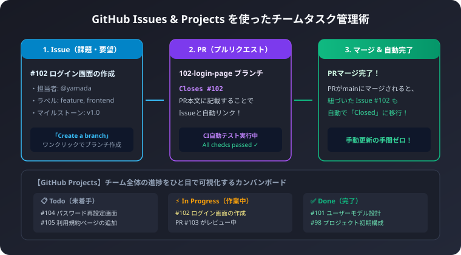
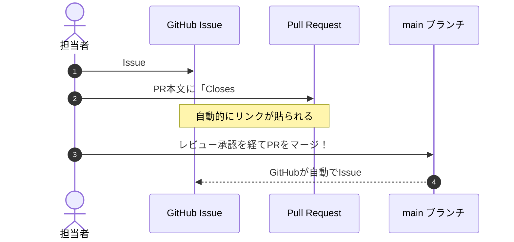

チームで開発を進めるとき、「今、誰がどの作業をしているのか分からない」「口頭やチャットで頼まれたタスクがどこかへ消えてしまった」といった問題が頻発します。

GitHubに標準搭載されている「Issues」と「Projects」を活用すると、外部の有料タスク管理ツールを使わずに、コードやプルリクエストと完全に連携したスムーズな開発プロセスを構築できます。

## 1. 良いIssue（課題）の作り方

Issueは、バグ報告や新機能の要望、改善提案などをチケット形式で管理する機能です。
誰が見てもすぐに作業に着手できるよう、以下の情報を明記します。

### 記載すべき基本項目
1. 目的・背景: なぜこの作業が必要なのか
2. ゴール（完了条件）: どこまで達成できたら完了とするか（チェックボックス形式）
3. 参考資料・画面モック: 関連するURLやデザイン画像

### Issueテンプレートの記載例
```markdown
## 概要
ユーザーがログイン状態を維持できるように「ログイン状態を保存する」チェックボックスを追加する。

## 完了条件
- [ ] ログイン画面に「ログイン状態を保持する」のチェックボックスを配置
- [ ] チェックONの場合、JWTトークンの有効期限を30日に設定
- [ ] ログアウトボタン押下でトークンを破棄
- [ ] ユニットテストおよびE2Eテストの追加

## 関連画面
Figmaデザイン: https://figma.example.com/login-design
```

### 右側サイドバーで設定する重要項目
- Assignees（担当者）: この作業を主に進めるメンバーを割り当てます
- Labels（ラベル）: `bug`（不具合）、`enhancement`（新機能）、`documentation`（ドキュメント）などの分類を付与します
- Milestone（マイルストーン）: `v1.0.0 リリース` などの目標期限と紐づけます

## 2. Issueからワンクリックで作業ブランチを作る

Issueを作成したら、GitHubのIssue詳細画面の右側にある「Development」セクションから「Create a branch」をクリックします。

- 自動的に `102-login-page` のようなIssue番号付きのブランチ名が提案されます
- 「Create branch」を押すと、GitHub上にブランチが作成され、ターミナルで実行すべき以下のコマンドが表示されます:

```bash
# 手元のPCに最新ブランチを取得して切り替え
git fetch origin
git checkout 102-login-page
```

ブランチ名にIssue番号が入ることで、「このブランチがどのタスクのものか」がチーム全員に一目瞭然になります。

## 3. プルリクエスト（PR）とIssueを自動連携させる魔法のキーワード

作業が完了してプルリクエストを作成する際、PRの本文に以下のキーワードとIssue番号を記載します:

```markdown
Closes #102
```

他にも `Fixes #102` や `Resolves #102` も使えます。
この記載をしておくと、プルリクエストがレビューされてmainブランチにマージされた瞬間、紐づいたIssue #102 が自動的に「Closed（完了）」へ切り替わります。
わざわざIssueページに戻って手動で閉じる必要がなくなり、チケットの閉じ忘れが一切なくなります。



## 4. GitHub Projects（カンバンボード）での進捗可視化

GitHubリポジトリの「Projects」タブ、または組織（Organization）の「Projects」から、TrelloやJiraのようなカンバンボードを作成できます。

### おすすめの列（カラム）構成
1. Backlog（アイデア・将来のタスク）: いつかやる予定のIssue
2. Ready / Todo（着手可能）: 仕様が決まり、すぐに作業できるIssue
3. In Progress（作業中）: 現在ブランチを切って開発中のIssue
4. In Review（レビュー中）: プルリクエストが出され、仲間の確認待ちのIssue
5. Done（完了）: マージされて解決済みのIssue

### 自動化（Workflows）の設定
GitHub Projectsの標準ワークフロー設定を使えば、以下の自動化がノーコードで可能です:
- Issueが作成されたら、自動で「Todo」列に追加
- プルリクエストが作成されたら、紐づくIssueを「In Review」列に自動移動
- プルリクエストがマージされたら、自動で「Done」列に移動

朝会やミーティングでこのボードを画面共有するだけで、「誰が今何で困っているか」「どこにレビューが滞留しているか」がひと目で把握でき、チームの開発スピードが格段に向上します。
