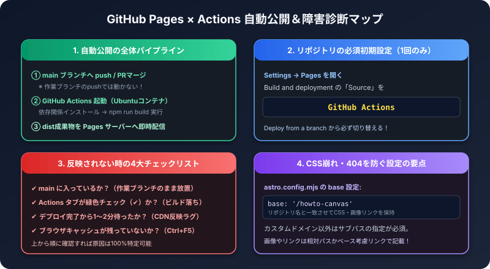

GitHub Pagesは、リポジトリの内容をそのままWebサイトとして公開できるサービスです。
このサイトのように、ビルドが必要な静的サイトは、GitHub Actionsでビルドして公開する構成がよく使われます。

## 1. 公開までの流れ

- トリガーは、`main` ブランチへのプッシュ（またはPRのマージ）です。
- 作業ブランチにプッシュしただけでは、公開されません。
- 公開までの時間は、通常は数分です。

## 2. 最初の設定（1回だけ）

1. リポジトリの **Settings** → **Pages** を開きます。
2. **Source**（公開元）を **GitHub Actions** に設定します。
3. ワークフローのファイル（`.github/workflows/` 内）が、リポジトリに入っていることを確認します。

## 3. 反映されないときの確認手順

順番に確認すると、原因を切り分けやすくなります。

### ステップ1: 変更が main に入っているか
PRを作っただけでは、公開されません。**マージ済み**かを確認します。

### ステップ2: Actions が成功しているか
リポジトリの **Actions** タブを開きます。

- 黄色い丸: 実行中。待ちます。
- 緑のチェック: 成功。
- 赤い×: 失敗。実行をクリックして、エラーの行を確認します。

### ステップ3: ブラウザのキャッシュ
成功しているのに古く見える場合は、`Ctrl + F5` で強制的に再読み込みします。

### ステップ4: URLとbaseの設定
Pagesの公開URLは、`https://ユーザー名またはOrganization名.github.io/リポジトリ名/` の形です。
サイト側の設定にある `base`（リポジトリ名のパス）が合っていないと、CSSや画像が読み込まれず、表示が崩れます。

## 4. よくあるトラブル

| 症状 | 確認すること |
| :--- | :--- |
| 変更が反映されない | main にマージ済みか／Actionsが成功しているか／キャッシュ |
| 赤い×でビルドが失敗する | Actionsのログ。ローカルで `npm run build` を試す |
| CSSや画像が表示されない | `base` の設定、リンクのパス |
| 404が出る | URLの綴り、Pagesの設定（Sourceが GitHub Actions か） |
| 記事がサイドバーに出ない | frontmatterの書式、配置フォルダ |

:::tip[公開前の確認]
マージ前に、ローカルで `npm run build` が通ることを確認しておくと、公開後の失敗を防げます。
:::

## 5. チェックリスト

- [ ] Pagesの Source が GitHub Actions になっているか
- [ ] 変更が main にマージされているか
- [ ] Actions が緑のチェックになっているか
- [ ] 古い表示は Ctrl + F5 で更新したか

関連記事: [チーム開発のブランチ戦略（GitHub Flow）とブランチ保護](/howto-canvas/dev/git/branch-strategies/)
