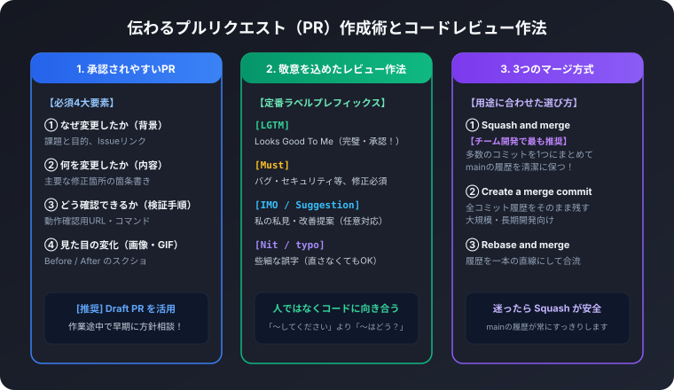
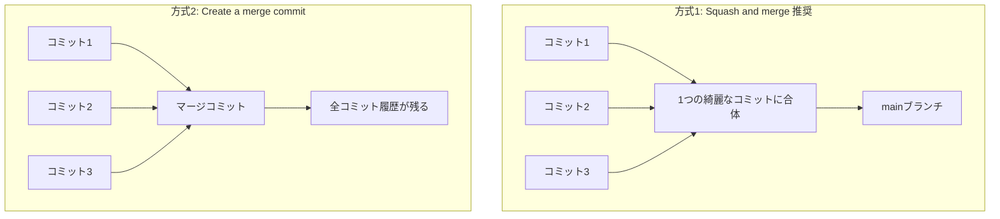

チーム開発において、最も頻繁に行われるコミュニケーションの場が「プルリクエスト（Pull Request: PR）」と「コードレビュー」です。

「PRを出したけれど誰にも見てもらえない」「レビューコメントの言い回しがキツくてチームの空気がギスギスしてしまう」「どんなマージ方法を選べばいいか分からない」といった悩みは、書き方の型とちょっとした気配りの作法を知るだけで劇的に解消します。

この記事では、レビュアーに喜ばれるPR作成術と、建設的で気持ちのよいコードレビューの作法を解説します。

## 1. 承認（Approve）されやすい良いPRの4大要素

忙しいレビュアーが「何を見ればいいのか」を瞬時に把握できるよう、以下のテンプレート構成に沿って記述します。

```markdown
## 概要
Closes #102
ヘッダーにユーザーのアバターアイコンとドロップダウンメニューを追加しました。

## 変更内容
- components/Header.tsx: ログイン状態に応じたアバター描画ロジックの追加
- styles/header.css: ドロップダウンのアニメーション定義
- utils/auth.ts: ログイン中ユーザー情報の取得ヘルパー関数を追加

## 動作確認手順
1. `npm run dev` でローカルサーバーを起動
2. 右上の「ログイン」ボタンからテストアカウントでログイン
3. アバターアイコンをクリックし、ドロップダウンメニューが正常に開閉することを確認

## スクリーンショット / キャプチャ
| 変更前（Before） | 変更後（After） |
| --- | --- |
|  |  |
```

特にUIの変更を伴う場合は、画像や短いGIF動画を貼るだけで、レビュアーがローカル環境で動かさなくても変更の意図を即座に理解できます。

## 2. 作業途中で気軽に相談できる「Draft PR」

「まだ完成していないけれど、設計や実装方針が合っているか先輩に確認してほしい」というときは、PR作成画面の緑色のボタンの横にある矢印から「Create Draft Pull Request」を選択します。

- タイトルの先頭に `Draft:` と付き、誤ってmainへマージされるのを物理的に防ぎます
- 「現在60%完成しています。API通信部分のインターフェース設計を見てアドバイスがほしいです」のように相談できます
- 完成したら「Ready for review」ボタンを押すだけで、通常のPRに昇格できます

手戻りを防ぐ最大のコツは、100%完成してから出すのではなく、30%〜50%の段階でDraft PRを出して早期に方針をすり合わせることです。

## 3. 建設的で気持ちのよいコードレビューコメント作法

コードレビューの目的は「間違いを指摘して問い詰めること」ではなく、「コードの品質を高め、チーム全員で学び合うこと」です。

コメントの意図が誤解されないよう、コメントの冒頭にラベル（プレフィックス）を付ける文化が多くの開発現場で推奨されています。

### 定番のコメントラベル一覧
- `[Must]` 必須対応:
  「バグの可能性があるため修正をお願いします」
  例: `[Must] ここでnullチェックをしないと、未ログイン時にアプリがクラッシュする可能性があります。`
- `[IMO]` 私の私見（In My Opinion）/ `[Suggestion]` 提案:
  「私はこう書く方が読みやすいと思いますが、担当者の判断に任せます」
  例: `[Suggestion] Array.filter と map を繋げる代わりに reduce を使うとループが1回で済みます。`
- `[Q]` 質問（Question）:
  「意図を教えてください」
  例: `[Q] ここで setTimeout(..., 500) を挟んでいる理由を教えていただけますか？`
- `[Nit]` 細かな指摘（Nitpick: 些細なこと）:
  「誤字脱字など。直さなくても承認します」
  例: `[Nit] 関数名のスペルが recieve ではなく receive になっています。`
- `[LGTM]` 承認（Looks Good To Me）:
  「完璧です！素晴らしい実装をありがとうございます！」

### レビューの心得
- 人ではなくコードに向き合う:
  「あなたのコードは読みにくい」ではなく、「この関数を分割すると、誰が見ても処理の流れが追いやすくなりそうです」と表現します。
- 疑問形や提案型で伝える:
  「〜に書き直してください」より「〜のように書くのはいかがでしょうか？」と投げかけることで、対等で前向きな議論が生まれます。
- 良い点も積極的に褒める:
  「この共通化はすごく綺麗ですね！勉強になります」といった称賛の言葉を1言添えるだけで、チームの心理的安全性が高まります。

## 4. 3大マージ方式の違いと使い分け

GitHubでPRをmainへマージする際、緑色の「Merge pull request」ボタンのドロップダウンには3つの選択肢があります。



### 1. Squash and merge（チーム開発で最も推奨）
作業ブランチにあった「誤字修正」「WIP（作業中）」「テスト修正」といった細かなコミットをすべて1つのコミットに圧縮合体してmainにマージします。
- メリット: mainブランチのコミット履歴が「PR単位」で1行ずつ並ぶため、履歴が圧倒的に美しく、過去の機能追加を追いやすくなります。

### 2. Create a merge commit
ブランチ内のすべてのコミット履歴をそのまま残し、合流地点に「マージコミット」を作成します。
- メリット: 作業の過程を1コミット単位まで完全に再現できます。
- デメリット: 無意味な試行錯誤コミットまでmainの履歴に残るため、ログが複雑になります。

### 3. Rebase and merge
作業ブランチのコミットをmainの先端に直線状に付け替えます。マージコミットは作られません。

迷ったときは、mainブランチの履歴を最も清潔に保てる「Squash and merge」を選択するのがベストプラクティスです。
