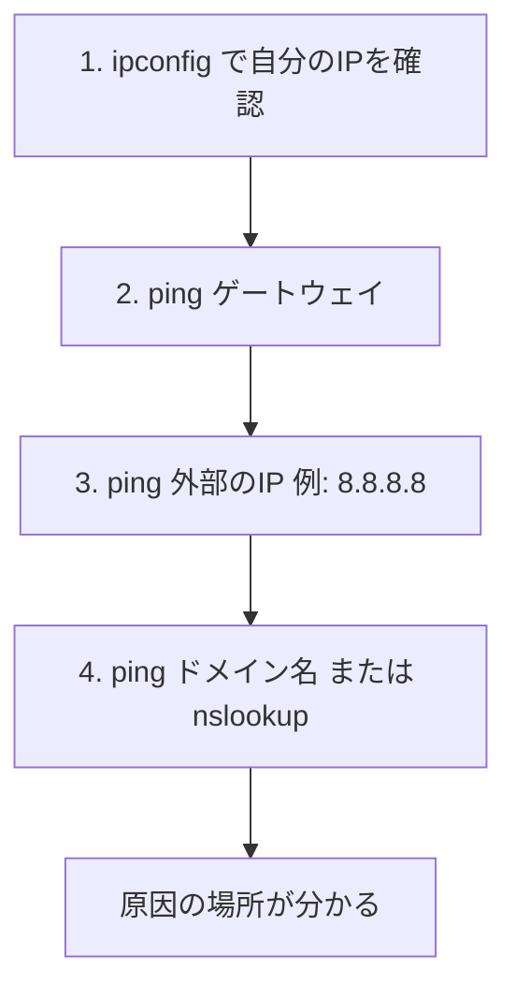

Windowsには、ネットワークの状態を調べたり、設定を確認したりするコマンドが標準で入っています。
この記事は、よく使うコマンドを用途別にまとめた早見表と、「つながらない」ときの切り分け手順の備忘録です。

## 1. コマンドを実行する場所

- **コマンドプロンプト** または **PowerShell** を開きます。
- スタートボタンを右クリック（または Windows キー + X）→「ターミナル」でも開けます。
- 設定を変更するコマンドや、一部の表示（`netstat -b` など）には、**管理者として実行**が必要です。

## 2. 用途別の早見表

### 自分の設定を確認する

| コマンド | できること |
| :--- | :--- |
| `ipconfig` | IPアドレス、サブネットマスク、デフォルトゲートウェイを表示 |
| `ipconfig /all` | MACアドレス、DNSサーバー、DHCPの情報まで詳しく表示 |
| `ipconfig /release` | DHCPで取得したIPアドレスを解放 |
| `ipconfig /renew` | IPアドレスを再取得 |
| `ipconfig /flushdns` | DNSキャッシュを消去 |
| `ipconfig /displaydns` | DNSキャッシュの内容を表示 |
| `hostname` | このPCのコンピューター名を表示 |
| `getmac` | MACアドレスを表示 |

### つながるか確認する（疎通確認）

| コマンド | できること |
| :--- | :--- |
| `ping 相手のIPまたは名前` | 相手まで届くか、応答時間を確認 |
| `ping -t 相手` | 止めるまで連続で ping（止めるときは Ctrl + C） |
| `ping -n 10 相手` | 10回だけ ping |
| `tracert 相手` | 相手までに通る経路（ルーター）を順に表示 |
| `tracert -d 相手` | 名前解決をしないので、表示が速い |
| `pathping 相手` | 経路上の各ルーターの損失率を測る（時間がかかる） |

### 名前解決（DNS）を確認する

| コマンド | できること |
| :--- | :--- |
| `nslookup 名前` | 名前からIPアドレスを調べる |
| `nslookup 名前 DNSサーバー` | 指定したDNSサーバーに問い合わせる |
| `Resolve-DnsName 名前` | PowerShell版の名前解決（レコードの種類も指定できる） |

### 接続状況・経路を確認する

| コマンド | できること |
| :--- | :--- |
| `netstat -an` | 開いているポートと接続の一覧を数字で表示 |
| `netstat -ano` | 上に加えて、プロセスID（PID）を表示 |
| `netstat -b` | 接続しているプログラム名を表示（管理者が必要） |
| `arp -a` | 同じネットワーク内の、IPアドレスとMACアドレスの対応を表示 |
| `route print` | ルーティングテーブル（経路表）を表示 |
| `nbtstat -n` | NetBIOSの名前を表示 |

### 設定・診断（netsh）

`netsh` は、ネットワーク設定を扱うコマンドです。

| コマンド | できること |
| :--- | :--- |
| `netsh interface show interface` | ネットワークアダプターの一覧と状態を表示 |
| `netsh wlan show interfaces` | 接続中のWi-Fiの情報（SSID、電波強度など）を表示 |
| `netsh wlan show profiles` | 保存されているWi-Fiの一覧を表示 |
| `netsh winsock reset` | ネットワークの通信設定をリセット（再起動が必要） |

:::caution[設定を変えるコマンドに注意]
`ipconfig /release`、`netsh winsock reset` などは、通信を一時的に切ったり、設定を変えたりします。リモート接続中のPCや、仕事で使っているPCでは、実行する前に影響を確認してください。
:::

### PowerShell のネットワークコマンド

| コマンド | できること |
| :--- | :--- |
| `Test-NetConnection 相手` | ping に近い疎通確認 |
| `Test-NetConnection 相手 -Port 443` | 相手の特定のポートに、つながるかを確認 |
| `Get-NetIPAddress` | IPアドレスの一覧を表示 |
| `Get-NetAdapter` | ネットワークアダプターの一覧と状態を表示 |
| `Get-NetRoute` | 経路表を表示 |
| `Get-DnsClientServerAddress` | 使用中のDNSサーバーを表示 |

ポートの疎通確認は、`telnet` を使う方法もありますが、標準では入っていません。`Test-NetConnection` なら、追加なしで使えます。

## 3. 「つながらない」ときの切り分け手順

近いところから順に確認すると、原因の場所を絞り込めます。



| 手順 | コマンド | 結果の読み方 |
| :--- | :--- | :--- |
| 1 | `ipconfig` | `169.254.x.x` が出ていたら、DHCPからIPを取得できていない |
| 2 | `ping ゲートウェイのIP` | 失敗なら、手元のPC〜ルーター間の問題（ケーブル、Wi-Fi、ルーター） |
| 3 | `ping 8.8.8.8` | ゲートウェイは成功、ここで失敗なら、ルーターから先（回線、プロバイダー）の問題 |
| 4 | `ping example.com` | 3は成功、ここで失敗なら、DNSの問題 |
| 5 | `nslookup example.com` | 名前が引けなければ、DNSサーバーの設定を確認 |

ping は、相手の設定によって、わざと応答しないことがあります。ping が失敗しても、通信そのものができないとは限りません。ポートの確認には、`Test-NetConnection 相手 -Port 番号` が使えます。

## 4. よく使う組み合わせ（例）

```bash
# 自分のIP設定を詳しく確認
ipconfig /all

# DNSの不調を疑うとき: キャッシュを消してから名前解決
ipconfig /flushdns
nslookup example.com

# ある通信がどのプログラムか調べたい（PIDを確認）
netstat -ano
```

特定のポートを使っているプロセスを探すときは、`netstat -ano` で PID を調べ、タスクマネージャーの「詳細」タブで、その PID を探します。

## 5. チェックリスト

- [ ] まず `ipconfig` で、IPアドレスとゲートウェイを確認したか
- [ ] ping は、近い順（ゲートウェイ → 外部IP → 名前）に試したか
- [ ] 名前だけ失敗するときは、DNS を疑ったか
- [ ] 設定を変えるコマンドは、影響を確認してから実行したか
- [ ] ping が通らなくても、`Test-NetConnection -Port` で確認したか

参考: [Microsoft Learn の Windows コマンドリファレンス](https://learn.microsoft.com/ja-jp/windows-server/administration/windows-commands/windows-commands)
