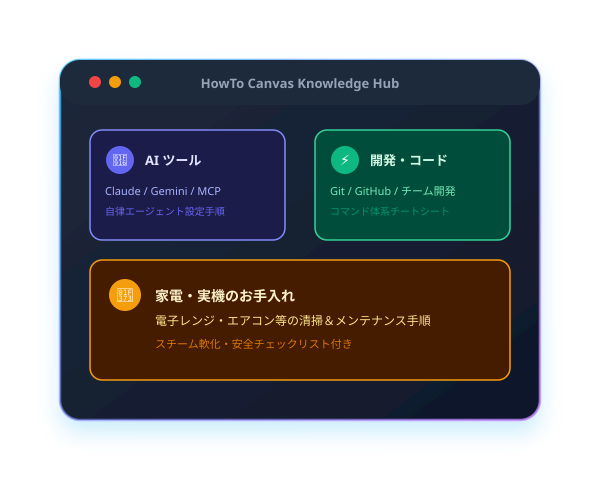

import { Card, CardGrid } from '@astrojs/starlight/components';

最先端AIモデルと開発ツールの実践活用法を、直感的な図解とステップで整理したナレッジベースです。
左側のサイドバーメニュー、または下記のカテゴリカードから各ガイドへ直接アクセスできます。

## 主要カテゴリから探す

  <a href="/howto-canvas/ai/claude/tips-and-tricks/" class="quick-nav-card">
    

      🟧 1. Claude
    

    

      裏技大全、Claude Code、独自スキル定義、Artifactsアプリ開発、議事録自動整形
    

  </a>

  <a href="/howto-canvas/ai/gemini/tips-and-tricks/" class="quick-nav-card">
    

      🟦 2. Gemini
    

    

      裏技大全、Deep Research、Canvas推敲、カスタムGem、スプレッドシート=AI()関数
    

  </a>

  <a href="/howto-canvas/ai/notebooklm/audio-transcription/" class="quick-nav-card">
    

      🟩 3. Gemini Notebook
    

    

      音声からの文字起こし＆議事録作成、ソース限定回答、音声解説ポッドキャスト生成
    

  </a>

  <a href="/howto-canvas/dev/git/basic-flow/" class="quick-nav-card">
    

      🟪 4. 開発・エンジニアリング
    

    

      Git基本データフロー4領域、GitHubチーム開発・PR運用、コマンド早見チートシート
    

  </a>

## カテゴリ別ナレッジ一覧

<CardGrid stagger>
  <Card icon="laptop" title="1. Claude 活用ガイド">
    Claudeの強みである長文理解、コード生成、アーキテクチャ設計を最大化するナレッジ。
    - [最新・便利な使い方＆裏技大全](/howto-canvas/ai/claude/tips-and-tricks/)
    - [自律型AIエージェント Claude Code 入門](/howto-canvas/ai/claude/claude-code/)
    - [初心者向け Claude スキル（Tool Use）設定手順](/howto-canvas/ai/claude/skills/)
    - [音声文字起こしからの高品質議事録・報告書整形](/howto-canvas/ai/claude/meeting-minutes/)
    - [プロの裏技・活用テクニック集（Artifacts・XMLタグ）](/howto-canvas/ai/claude/pro-tips/)
    - [Claude Code の備忘録（設定・権限・よく使う操作）](/howto-canvas/ai/claude/claude-code-memo/)
    - [プロンプトひな形集（コピペして使える備忘録）](/howto-canvas/ai/claude/prompt-templates/)
    - [Claude Duet の機能と使い方（自分から動くAIエージェント）](/howto-canvas/ai/claude/claude-duet/)
  </Card>

  <Card icon="star" title="2. Gemini 活用ガイド">
    Googleエコシステム連携、マルチモーダル、超長文処理を駆使した実践ノウハウ。
    - [最新・便利な使い方＆裏技大全（Deep Research・Canvas・Gem）](/howto-canvas/ai/gemini/tips-and-tricks/)
    - [プロの裏技集（200万トークン動画解析・Workspace連携・二重チェック）](/howto-canvas/ai/gemini/pro-tips/)
  </Card>

  <Card icon="document" title="3. Gemini Notebook (NotebookLM)">
    手持ちの資料や録音データだけを正確に参照し、嘘のない回答を導き出す専用ノートブック。
    - [音声ファイルから自動文字起こし＆議事録・報告書作成](/howto-canvas/ai/notebooklm/audio-transcription/)
    - [プロの裏技・実践活用術（音声解説ポッドキャスト・原本引用リンク）](/howto-canvas/ai/notebooklm/pro-tips/)
    - [議事録・面談報告書を Gemini のスキルで毎回同じ形式で作る手順](/howto-canvas/ai/notebooklm/minutes-gemini-skill-workflow/)
  </Card>

  <Card icon="setting" title="4. 開発・エンジニアリング">
    チーム開発の標準となるGitバージョン管理とGitHub運用の実践プラクティス。
    - [Git 基本データフロー（カメラで理解する4つの領域）](/howto-canvas/dev/git/basic-flow/)
    - [初心者向け Git & GitHub チーム開発の基本ガイド](/howto-canvas/dev/git/team-collaboration/)
    - [日常Gitコマンド早見表・チートシート](/howto-canvas/dev/git/commands-list/)
    - [コンフリクト（競合）の予防と解決マスターガイド](/howto-canvas/dev/git/conflict-resolution/)
    - [作業取り消し＆一時退避（stash）レスキューガイド](/howto-canvas/dev/git/undo-and-stash/)
    - [チーム開発のブランチ戦略（GitHub Flow）とブランチ保護](/howto-canvas/dev/git/branch-strategies/)
    - [GitHub Issues & Projects を使ったチームタスク管理術](/howto-canvas/dev/github/issues-and-projects/)
    - [伝わるプルリクエスト（PR）作成術とコードレビュー作法](/howto-canvas/dev/github/pull-request-review/)
    - [Windows ネットワークコマンド一覧（早見表・備忘録）](/howto-canvas/dev/network/windows-network-commands/)
    - [GitHub CLI（gh）の備忘録（ログインからPR作成まで）](/howto-canvas/dev/github/gh-cli-memo/)
    - [GitHub Pages 公開の仕組みと反映されないときの確認手順](/howto-canvas/dev/github/pages-deploy-memo/)
    - [.gitignore と機密情報（トークン・パスワード）の備忘録](/howto-canvas/dev/git/secrets-and-gitignore/)
    - [複数の GitHub アカウントを使い分けるときの備忘録](/howto-canvas/dev/git/multi-account-memo/)
  </Card>
</CardGrid>

## 共通規格・クロスプラットフォーム連携

<CardGrid>
  <Card icon="random" title="Gemini & Claude スキル共有">
    Claude向けに作成したプロンプトやシステム指示を、Gemini向けに素早く変換してコピー・再利用する手順。
    - [プロンプト・カスタム指示の移行手順](/howto-canvas/ai/gemini-claude-sharing/)
  </Card>

  <Card icon="puzzle" title="MCP（Model Context Protocol）">
    ClaudeやGeminiに外部ツールやデータベースを接続するオープン規格の基礎知識。
    - [MCP 概要と初期セットアップ完全ガイド](/howto-canvas/ai/mcp/guide/)
  </Card>

  <Card icon="rocket" title="AIエージェント">
    校務の定型業務をAIに任せるための考え方と、すぐ試せる作成アイデア。
    - [校務で使えるAIエージェントの作り方 ― 作成のアイデア3選](/howto-canvas/ai/agents/school-ai-agent-ideas/)
  </Card>
</CardGrid>

## サイト運用・設計仕様

<CardGrid>
  <Card icon="open-book" title="取扱説明書（マニュアル）">
    HowTo Canvasの閲覧方法、検索、テーマ切替から、記事の新規作成・SVG図解追加・Gitコミット・公開フローまで網羅。
    - [HowTo Canvas 取扱説明書](/howto-canvas/meta/manual/)
  </Card>

  <Card icon="document" title="サイト設計書（仕様・構成）">
    本サイトのシステムアーキテクチャ、技術選定理由、情報構造設計、目に優しいデザインシステム仕様書。
    - [HowTo Canvas サイト設計書](/howto-canvas/meta/design-spec/)
  </Card>
</CardGrid>

