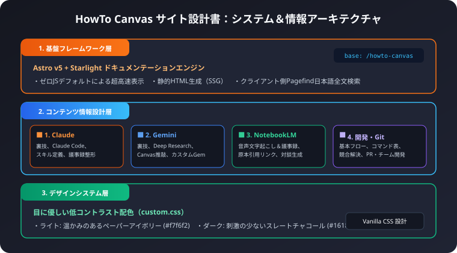
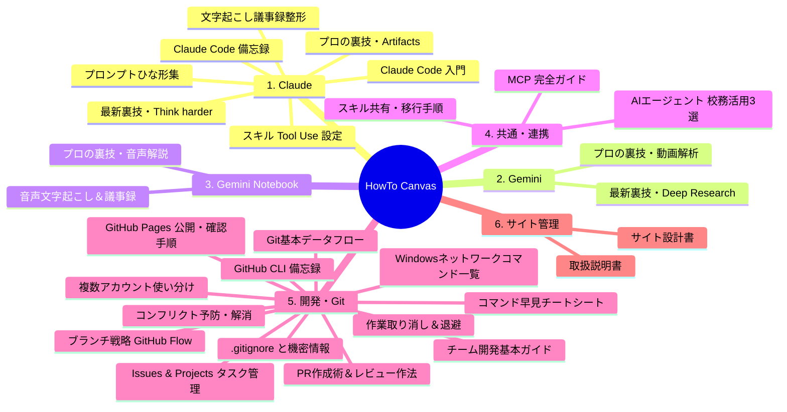

本書は、ナレッジベースサイト「HowTo Canvas」のシステム構成、技術スタック、情報アーキテクチャ、デザインシステム、および運用保守に関する基本設計書です。

## 1. システム概要と基本コンセプト

### 1-1. システム目的
生成AI（Claude、Gemini、Gemini Notebook/NotebookLM）と開発ツール（Git/GitHub）の実践ノウハウを、初心者からエンジニアまで誰でも迷わず活用できるように体系化・図解化して提供する静的ドキュメンテーションハブです。

### 1-2. 設計方針
1. 初心者ファーストの視覚的解説:
   文字情報だけでなく、すべての主要記事に専用のSVG図解とMermaidフローチャートを配備し、直感的な理解を促します。
2. 圧倒的な表示速度と軽量性:
   クライアント側JavaScriptを極限まで排除した静的サイトジェネレーター（SSG）を採用し、瞬時のページ読み込みを実現します。
3. 目に優しいUI/UX:
   過度なコントラストや眩しい白を排除し、長時間の閲覧・学習でも疲労の少ないカラーパレットを適用します。
4. 自律的でメンテナンス性の高い構成:
   ファイル配置とディレクトリ構造に基づき、サイドバーメニューや目次が自動生成される堅牢なアーキテクチャを構築します。

---

## 2. 技術スタック・アーキテクチャ設計

```mermaid
graph TD
    subgraph ソースコード / コンテンツ層
        A[Markdown / MDX 記事群]
        B[SVG ベクター図解]
        C[カスタムCSSスタイル custom.css]
    end

    subgraph ビルドエンジン層
        D[Astro v7 コア]
        E[@astrojs/starlight ドキュメントエンジン]
        F[Pagefind 日本語全文検索インデクサ]
    end

    subgraph デプロイ・配信層
        G[GitHub Actions CI/CD]
        H[GitHub Pages 静的ホスティング]
        I[ユーザーブラウザ表示]
    end

    A --> D
    B --> D
    C --> D
    D --> E
    E --> F
    F --> G
    G --> H
    H --> I
```

### 2-1. 採用技術一覧
- 静的サイトジェネレーター: Astro v7
  - 選定理由: コンテンツ駆動型サイトに最適化されており、ゼロJSアーキテクチャによる極めて高速なパフォーマンスを発揮するため。
- ドキュメンテーションフレームワーク: @astrojs/starlight
  - 選定理由: 左サイドバーの自動生成、右サイドバーのページ内目次（TOC）、多言語対応、アクセシビリティ対応が標準完備されているため。
- スタイリング: Vanilla CSS（カスタムCSSプロパティ）
  - 選定理由: Tailwind CSS等の重量フレームワークに依存せず、StarlightのCSSカスタムプロパティを直接上書きすることで、軽量性と精密なカラー制御を両立。
- ダイアグラムエンジン: Mermaid.js + ネイティブSVG
  - 選定理由: 拡大縮小しても劣化しないベクター画像（SVG）と、Markdown内で直接コード管理できるMermaidフロー図を併用。
- 全文検索: Pagefind（Starlight内蔵）
  - 選定理由: 外部検索APIを契約することなく、ビルド時に静的インデックスを生成し、オフラインでも超高速な日本語全文検索が可能。
- ホスティング環境: GitHub Pages
  - 選定理由: Gitリポジトリとの完全一体運用、自動SSL証明書発行、無料かつ高い可用性。

---

## 3. ディレクトリ構成とファイル設計

リポジトリ内のディレクトリ構造は、役割ごとに明確に分離されています。

```text
howto-canvas/
├── .github/workflows/          # GitHub Actions 自動デプロイ設定
├── public/                     # ファビコン等の静的静止ファイル
├── src/
│   ├── assets/                 # 各カテゴリの専用SVG図解
│   │   ├── ai/                 # Claude、Gemini、NotebookLM、MCP用図解
│   │   ├── dev/                # Git、GitHub、チーム開発用図解
│   │   └── meta/               # 取扱説明書・設計書用図解
│   ├── content/
│   │   └── docs/               # 記事コンテンツ（Markdown / MDX）
│   │       ├── ai/             # AI実践ナレッジ
│   │       │   ├── claude/     # Claude関連記事（個別原則）
│   │       │   ├── gemini/     # Gemini関連記事（個別原則）
│   │       │   ├── notebooklm/ # NotebookLM関連記事
│   │       │   ├── mcp/        # MCP共通ツール規格
│   │       │   └── agents/     # AIエージェント
│   │       ├── dev/            # 開発・Git・GitHub関連記事
│   │       │   ├── git/        # Gitバージョン管理
│   │       │   ├── network/    # ネットワークコマンド
│   │       │   └── github/     # GitHub＆チーム開発
│   │       ├── meta/           # 取扱説明書・設計書
│   │       └── index.mdx       # トップページ
│   └── styles/
│       └── custom.css          # 目に優しいカスタムカラーパレット定義
├── astro.config.mjs            # AstroおよびStarlightの設定ファイル
├── package.json                # プロジェクト依存関係定義
└── tsconfig.json               # TypeScript設定
```

---

## 4. 情報アーキテクチャ（IA）と導線設計

ユーザーが迷わず目的の情報にアクセスできるよう、体系的な情報分類を行っています。



### 4-1. トップページ（index.mdx）のレイアウト設計
- 左メニュー常時表示型:
  従来のLP専用全幅レイアウト（`template: splash`）を廃止し、アクセス直後から全カテゴリのサイドバーメニューを表示。
- 4大カテゴリ均等ナビゲーション:
  上部に「1. Claude」「2. Gemini」「3. Gemini Notebook」「4. 開発・エンジニアリング」のクイックナビカードを均等グリッドで配置。
- 全体ナレッジマップ:
  サイト全体の包含関係を一目で俯瞰できるキービジュアル図解を中央に配置。

---

## 5. デザインシステム設計（目に優しい低刺激パレット）

長時間の学習や開発現場での参照を想定し、光の刺激を和らげるカラー設計を `src/styles/custom.css` に定義しています。

### 5-1. カラーパレット定義値

| 要素 | ライトモード（Light） | ダークモード（Dark） | 意図・設計意図 |
| :--- | :--- | :--- | :--- |
| メイン背景 | `#f7f6f2`（ウォームペーパー） | `#16181d`（スレートチャコール） | 純白（#fff）と漆黒（#000）を避け、コントラストを緩和 |
| ナビ・サイドバー背景 | `#eeebe3`（ソフトグレー） | `#1c2026`（ディープスレート） | コンテンツ領域との自然な境界を演出 |
| 本文テキスト | `#2f2d2a`（ソフトチャコール） | `#c8d0dc`（ソフトライトグレー） | まぶしさを抑えつつ高い可読性を維持 |
| 見出しテキスト | `#242220` | `#e2e7ef` | 視線誘導のための適度な重み付け |
| アクセントカラー | `#2e6297`（スレートインディゴ） | `#5294e2`（セルリアンブルー） | 刺激の強いビビッドブルーを避け、落ち着いた知性を表現 |
| 境界線（ボーダー） | `#dedad0` | `#2a303c` | 主張しすぎない淡いライン |

### 5-2. レスポンシブ設計ブレークポイント
- デスクトップ（幅 1150px 以上）:
  左サイドバー（300px）＋ メインコンテンツ（最大800px）＋ 右TOC目次（250px）の3カラム構成。
- タブレット（幅 768px 〜 1149px）:
  右TOC目次を上部ドロップダウンに格納し、2カラム構成。
- スマートフォン（幅 767px 以下）:
  左サイドバーをスライド式ハンバーガードロワーに格納し、1カラム全幅構成。

---

## 6. 運用・保守・セキュリティ設計

### 6-1. Gitブランチ運用（GitHub Flow）
- `main` ブランチ: 常にデプロイ可能な本番安定版。直接のコミット・プッシュは避け、PRによるマージを推奨。
- `feature/<機能名>` ブランチ: 記事追加や機能改修を行う作業部屋。

### 6-2. 認証情報の安全管理
- リポジトリ固有の認証設定:
  特定のリポジトリに対してGit Credential Managerの認証ユーザー（`nakamotohiroshi-biz`）を固定することで、複数アカウント環境下でも認証衝突を起こさない運用を実現。
- APIキー等の非コミット:
  シークレット情報やAPIトークンはコードベース内に含めず、すべて環境変数やGitHub Secretsで管理。

### 6-3. ナレッジの鮮度管理ルール
- AIモデルのバージョンアップ（Gemini 2.xやClaude 4等）に伴い、四半期ごとの見直しを行い、古いUI説明や非推奨コマンドを定期更新。
