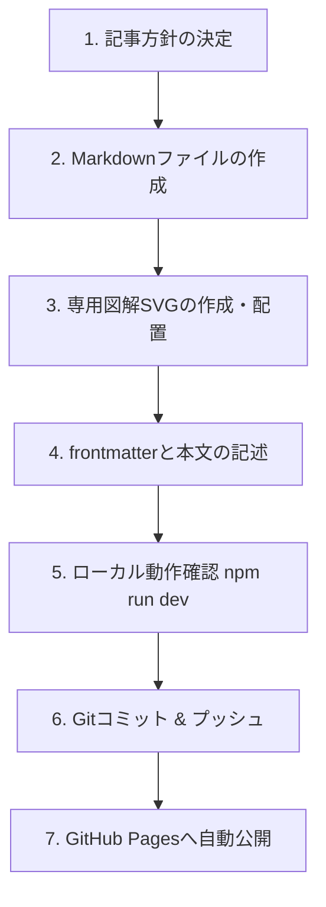
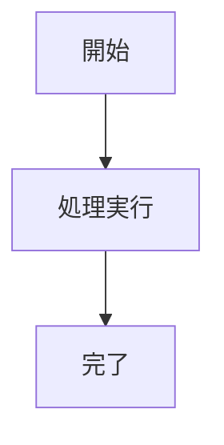

HowTo Canvas（ハウツー・キャンバス）へようこそ。
本サイトは、最先端の生成AI（Claude、Gemini、Gemini Notebook/NotebookLM）と、モダンな開発ツール（Git/GitHub）の実践活用ナレッジを、初心者にも分かりやすい図解と具体的なステップで整理したナレッジベースです。

この取扱説明書では、「サイトを閲覧・学習するユーザー向けの使い方」と、「新しい記事を作成・編集して公開する運用者向けの手順」を詳しく解説します。

## 1. サイト閲覧者向けマニュアル

### 1-1. 画面の基本レイアウト
画面は誰でも直感的に情報へ辿り着ける3カラム（PC表示時）の構造になっています。

- 左サイドバー（ナビゲーション）:
  Claude、Gemini、Gemini Notebook、共通規格（MCP）、開発・エンジニアリングのカテゴリごとに、体系化された記事一覧が常時並んでいます。
- 中央エリア（メインコンテンツ）:
  記事本文、概念図解（SVG画像）、Mermaidフローチャート、実践プロンプト、コマンド例が表示されます。
- 右サイドバー（目次・ページ内リンク）:
  現在読んでいる記事の見出し一覧が表示されます。クリックすると読みたいセクションへ瞬時にジャンプできます。

### 1-2. キーワード検索（全文検索）の使い方
ヘッダー右上の検索バーをクリックするか、キーボードのショートカットキーを押すと検索ウィンドウが開きます。

- ショートカットキー: `Ctrl + K`（Windows）または `Cmd + K`（Mac）
- 機能:
  日本語の単語（例: 「議事録」「コンフリクト」「Deep Research」）を入力すると、記事タイトルだけでなく本文全体から高速に一致する箇所を抽出して候補を表示します。

### 1-3. 目に優しいカラーテーマ（ライト / ダーク）の切り替え
長時間の読書や開発作業でも目が疲れにくいよう、本サイトは低コントラストの専用パレットを採用しています。

- 切り替え方法:
  ヘッダー右端にある「太陽 / 月」アイコンをクリックすると、以下の2つのモードを自由に切り替えられます。
  - ライトモード: 刺すような真っ白を避けた、温かみのあるソフトペーパー調アイボリー（#f7f6f2）と落ち着いたチャコールの文字色。
  - ダークモード: 漆黒を避けた、深いダークスレートグレー（#16181d）と眩しくないソフトグレーの文字色。

### 1-4. コードブロックのワンクリックコピー
記事内に登場するターミナルコマンドやプロンプトテンプレートは、枠の右上に表示される「コピー用アイコン」をクリックするだけで、クリップボードに瞬時にコピーできます。そのまま手元の環境に貼り付けて利用できます。

---

## 2. 記事執筆・コンテンツ運用マニュアル

新しいHowTo記事を追加する際の標準ルールと手順です。



### 2-1. ファイルの作成場所と命名規則
記事ファイルは `src/content/docs/` 配下の適切なカテゴリフォルダに配置します。

- Claude関連記事: `src/content/docs/ai/claude/<slug>.md`
- Gemini関連記事: `src/content/docs/ai/gemini/<slug>.md`
- NotebookLM関連記事: `src/content/docs/ai/notebooklm/<slug>.md`
- 共通・MCP記事: `src/content/docs/ai/mcp/<slug>.md`
- Git関連記事: `src/content/docs/dev/git/<slug>.md`
- GitHub関連記事: `src/content/docs/dev/github/<slug>.md`

ファイル名は英小文字とハイフンを使用します（例: `team-pr-flow.md`）。

### 2-2. frontmatter（ヘッダーメタ情報）の書き方
ファイルの先頭に必ず `---` で囲まれたメタ情報を記述します。

```yaml
---
title: 記事のタイトル（日本語で分かりやすく）
description: 記事の概要説明（検索結果や一覧に表示される1〜2行）
sidebar:
  order: 1  # カテゴリ内での表示順序（数字が小さいほど上）
---
```

### 2-3. 図解画像（SVG）の配置と埋め込み
初心者にも直感的に理解できるよう、各記事には概念を整理した図解を配置します。

1. SVGファイルの保存場所: `src/assets/<カテゴリ名>/<ファイル名>.svg`
2. 本文への埋め込み記法:
```markdown

```

### 2-4. Mermaid.js によるフローチャート作成
手順や状態遷移、シーケンスを表現する際は、Mermaid記法を活用します。

```markdown

```

### 2-5. コールアウト（補足枠）の活用
重要な注意点やプロのコツを強調したいときは、Starlight標準のアラート記法を使用します。

```markdown
:::tip[プロのコツ]
ここに役立つヒントや裏技を記述します。
:::

:::caution[注意点]
ここに操作時の注意やリスクを記述します。
:::
```

---

## 3. 公開・デプロイ手順（Git運用）

作成した記事をサイトに反映して公開する手順です。

### ステップ1: ローカルでの表示確認
ターミナルで開発サーバーを起動し、崩れがないか確認します。

```bash
npm run dev
```
ブラウザで `http://localhost:4321/howto-canvas/` を開き、新しく追加した記事や目次が正しく表示されているかチェックします。

### ステップ2: 変更のコミット
Gitで変更を記録します。

```bash
# 全変更をステージング
git add -A

# コミットメッセージを付けて記録
git commit -m "feat: 〇〇の使い方ガイドと専用図解を追加"
```

### ステップ3: GitHubへプッシュ
リモートリポジトリへ送信します。

```bash
git push origin main
```
プッシュが完了すると、GitHub Actionsが自動的に起動し、最新の静的ページがビルドされてGitHub Pagesへ自動デプロイされます。

---

## 4. トラブルシューティング（よくある質問）

### Q1. 新しい記事を作ったのにサイドバーに表示されない
- 既存のカテゴリフォルダ（ai/claude, dev/gitなど）に配置している場合、`astro.config.mjs` の `autogenerate` 機能により自動的にメニューに現れます。
- 反映されない場合は、frontmatterの構文エラー（インデントミスやコロンの後の半角スペース抜け）がないか確認してください。

### Q2. 画像が表示されずリンク切れアイコンになる
- Markdownファイルから画像ファイルへの「相対パス」が合っているか確認してください。階層の深さ（`../../../../assets/...`）に注意してください。

### Q3. `git push` を実行したときにアカウント選択ダイアログが毎回出る
- 本リポジトリでは認証先アカウントが `nakamotohiroshi-biz` に固定設定されています。
- もし別のPCで作業する際は、以下のコマンドを実行して認証ユーザーを固定してください:
```bash
git config credential.https://github.com.username nakamotohiroshi-biz
```
