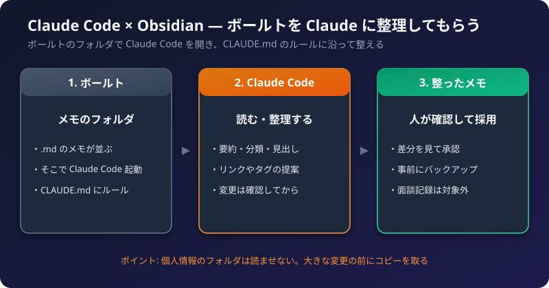

Obsidian のメモは、ただの Markdown ファイルです。そのため、**Claude Code** で、そのフォルダを開くだけで、Claude にメモを読ませたり、整理させたりできます。

この記事では、いちばんかんたんな方法と、**個人情報（面談記録など）を守る設定**を説明します。

:::caution[先に確認してください]
Claude Code は、ファイルを**直接読み書きします**。面談記録のような個人情報を含むメモを、外部の AI サービスに渡してよいかは、学校のルールによります。迷うときは、そのフォルダを対象から外してください（第5章）。
:::

## 1. なぜ Obsidian と Claude は相性がよいのか

- メモが、**ただの文字ファイル**だから、AI が読み書きしやすい。
- フォルダと見出し、リンクという、**はっきりした構造**があるから、整理を頼みやすい。
- 同じ型（テンプレート）で書いてあれば、**要約や分類**が、ぶれにくい。

## 2. いちばんかんたんな方法: ボールトのフォルダで Claude Code を開く

Obsidian の公式な連携機能（MCP サーバー）は、ありません。**フォルダで開くだけ**で、使い始められます。

### 手順

1. ターミナル（PowerShell など）を開きます。
2. ボールトのフォルダに移動します。

```bash
cd "C:\Users\<ユーザー名>\...\Obsidian\Vault"
```

パスにスペースが含まれるときは、全体を `"` で囲みます。

3. Claude Code を起動します。

```bash
claude
```

4. 頼みたいことを、日本語で入力します。

```text
10_会議 フォルダの、今月の会議メモを読んで、決定事項と未完了のToDoを、1つの一覧にまとめて。
```

Claude Code の基本は、[Claude Code の基本と使い方](/howto-canvas/ai/claude/claude-code/) を参照してください。

## 3. CLAUDE.md に、ボールトのルールを書く

ボールトの**一番上のフォルダ**に、`CLAUDE.md` というファイルを置くと、Claude Code が起動時に読み込みます。
ボールトの決まりごとを書いておくと、毎回説明しなくて済みます。

```markdown
# このボールトのルール

## 構成
- 00_受信箱: 未整理のメモ
- 10_会議 / 20_授業 / 30_個人: 内容別のノート
- 99_テンプレート: テンプレート（編集しない）
- 40_面談: 面談記録（**読まない・編集しない**）

## 書き方のルール
- 文章は、です・ます調で書く。
- ノートの先頭に、プロパティ（日付・種類）を入れる。
- 関連するノートは、[[ノート名]] でリンクする。

## 作業のルール
- ファイルを変更する前に、変更するファイルの一覧を見せて、確認を取る。
- ファイルの削除や、名前の変更は、必ず確認する。
- メモの内容を、推測で書き足さない。
```

## 4. Claude に頼めること（例）

| 頼み方の例 | できること |
| :--- | :--- |
| 「今週のデイリーノートを、箇条書きで要約して」 | 週のふり返りの下書き |
| 「`00_受信箱` のメモを、種類ごとに、フォルダ案を出して」 | 整理の提案（実行は確認してから） |
| 「このノートに、関連しそうな `[[リンク]]` の候補を出して」 | リンクの提案 |
| 「会議メモの ToDo を、集めて一覧にして」 | ToDo の集約 |
| 「プロパティが抜けているノートを、探して」 | 書式のチェック |

**おすすめの頼み方:** 最初は、「変更せずに、提案だけ出して」と頼みます。内容を確認してから、「その案で、変更して」と頼む流れが、安全です。

## 5. 面談記録を守る設定

個人情報を含むフォルダは、Claude に読ませないようにします。

### 方法A: 別のボールトに分ける（いちばん確実）
面談記録は、**別のボールト（別のフォルダ）**に保存します。Claude Code は、メインのボールトでだけ開くので、面談記録には、届きません。

### 方法B: 権限の設定で、読み取りを禁止する
ボールトのフォルダに、`.claude/settings.json` を作り、読ませないフォルダを指定します。

```json
{
  "permissions": {
    "deny": [
      "Read(./40_面談/**)",
      "Edit(./40_面談/**)"
    ]
  }
}
```

- 書き方は、Claude Code のバージョンで変わることがあります。公式ドキュメントで、確認してください。
- 設定が効いているかは、「`40_面談` の中のメモを読んで」と頼んで、**拒否されるか**で確認できます。
- 設定だけに頼らず、方法A（別のボールト）と、あわせて使うと安心です。

詳しい設定の考え方は、[Claude Code の備忘録](/howto-canvas/ai/claude/claude-code-memo/) の「権限」の章を参照してください。

## 6. 安全に使うための準備

1. **バックアップを取る。** 大きな整理の前に、ボールトのフォルダを、コピーしておきます。
2. **Obsidian の「ファイルの復元」を有効にする。** コアプラグインの「ファイルの復元」をオンにすると、メモの過去の状態を、戻せます。
3. **OneDrive の「バージョン履歴」も使える。** OneDrive 内のボールトなら、ファイルの過去のバージョンを、戻せる場合があります。
4. **変更は、確認してから。** `CLAUDE.md` に、「変更前に確認する」と書いておきます。

## 7. MCP でつなぐ方法（応用）

「MCP」を使うと、Claude Desktop など、他の Claude のアプリからも、Obsidian のメモを扱えます。
MCP の基本は、[MCP 完全ガイド](/howto-canvas/ai/mcp/guide/) を参照してください。

- Obsidian の**公式の MCP サーバーは、ありません。**
- 有志が作った、**コミュニティ製**のサーバーや、Obsidian のコマンドライン（CLI）を使う仕組みがあります。
- 導入前に、次を確認してください。

| 確認すること | 理由 |
| :--- | :--- |
| 提供元は誰か、更新が続いているか | 古いものや、メンテされていないものは、避ける |
| 何を読み書きできるか（権限） | 必要以上の権限を持つものは、避ける |
| 面談記録のフォルダを、対象から外せるか | 個人情報を守るため |
| 学校のルールで、使ってよいか | 外部ツールの導入が、制限されていることがある |

最初は、**フォルダで Claude Code を開く方法（第2章）**で十分です。

## 8. うまくいかないときの対処

| 症状 | 確認すること |
| :--- | :--- |
| Claude が、ルールを守らない | `CLAUDE.md` が、ボールトの一番上にあるか。ルールを具体的に書いたか |
| 面談記録を読まれた | 権限の設定を確認。別のボールトに分ける |
| 意図しない変更があった | バックアップや、ファイルの復元で戻す。次から「提案だけ」と頼む |
| パスで、起動できない | パスをダブルクォートで囲む。スペースや日本語に注意 |
| OneDrive で、競合ファイルができた | 同時編集を避ける。[最初の1週間の使い方](/howto-canvas/obsidian/first-week/) の OneDrive の注意を参照 |

## 9. チェックリスト

- [ ] 面談記録など、個人情報のフォルダを、対象から外したか（別のボールト、または権限の設定）
- [ ] 学校のルールで、AI にメモを読ませてよいか確認したか
- [ ] `CLAUDE.md` に、ボールトのルールと「変更前に確認」を書いたか
- [ ] 作業の前に、バックアップを取ったか
- [ ] 最初は「提案だけ」頼んで、結果を確認してから、変更を頼んでいるか

関連記事: [Obsidian とは？ 何が便利？](/howto-canvas/obsidian/what-is-obsidian/)、[校務で使える Obsidian 活用例](/howto-canvas/obsidian/school-use-ideas/)
