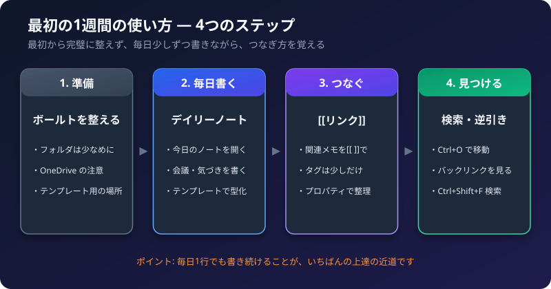

Obsidian を入れたあと、「何から始めればいいか分からない」という人のための、**最初の1週間のガイド**です。
最初から完璧に整える必要はありません。毎日少しずつ使いながら、慣れていきましょう。

画面の名前や場所は、Obsidian のバージョンで変わることがあります。見つからないときは、Obsidian の公式ヘルプ（help.obsidian.md）を確認してください。

## 1. 最初の1週間の流れ

| 日 | やること |
| :--- | :--- |
| 1日目 | ボールトを整える（フォルダは少なめに） |
| 2日目 | デイリーノートを使ってみる |
| 3日目 | テンプレートを1つ作る（会議メモなど） |
| 4日目 | `[[リンク]]` でメモをつなぐ |
| 5日目 | 検索とバックリンクで、メモを探してみる |
| 6日目 | プロパティ（タグなど）を少しだけ使う |
| 7日目 | 1週間を振り返り、使いにくい点を直す |

## 2. 1日目: ボールトを整える

すでにボールトがあれば、新しく作る必要はありません。**フォルダの数を少なく**しておくのが、続けるコツです。

**フォルダ構成の例**

```text
Vault/
├── 00_受信箱      ← とりあえず書いたメモを入れる
├── 10_会議        ← 会議メモ
├── 20_授業        ← 授業の準備・振り返り
├── 30_個人        ← 勉強・アイデア
└── 99_テンプレート ← テンプレートの置き場所
```

- 迷ったら、まず「受信箱」に書いて、あとで整理します。
- フォルダ分けに悩むより、**リンクとタグでつなぐ**ほうが、あとで探しやすくなります。

## 3. 基本の操作

| 操作 | ショートカット（Windows） |
| :--- | :--- |
| 新しいノートを作る | `Ctrl + N` |
| ノートを検索して開く（クイックスイッチャー） | `Ctrl + O` |
| コマンドを呼び出す（コマンドパレット） | `Ctrl + P` |
| 編集と閲覧の切り替え | `Ctrl + E` |
| ボールト全体を検索する | `Ctrl + Shift + F` |
| 設定を開く | `Ctrl + ,` |

ショートカットは、設定の「ホットキー」で、確認・変更できます。

**よく使う書き方（Markdown）**

```markdown
# 大見出し
## 中見出し
- 箇条書き
- [ ] チェックボックス
**太字**
```

## 4. 2日目: デイリーノート

デイリーノートは、**その日の日付のノートを、ワンタッチで作る・開く**機能です。

### 使えるようにする
1. 設定（`Ctrl + ,`）を開きます。
2. 「コアプラグイン」を開き、**「デイリーノート」** をオンにします（標準では、オフの場合があります）。
3. 画面の左端のバーに、カレンダーのアイコンが出ます。クリックすると、今日のノートが開きます。

### 使い方の例
- 今日あった会議、気づき、やることを、**1つのノートにまとめて書く**。
- 気になることは、`[[リンク]]` にして、あとで詳しく書く。

## 5. 3日目: テンプレート

テンプレートは、**よく書くメモの「型」**を呼び出す機能です。

### 使えるようにする
1. 設定の「コアプラグイン」で、**「テンプレート」** をオンにします。
2. テンプレート設定で、「テンプレートフォルダ」に、`99_テンプレート` を指定します。
3. そのフォルダの中に、テンプレートのノートを作ります。

### 会議メモのテンプレート（例）

`99_テンプレート` に、「会議メモ」というノートを作り、次を書きます。

```markdown
---
日付: {{date}}
種類: 会議
---

# {{title}}

## 出席者

## 議題

## 決定事項

## ToDo
- [ ]

## 次回
```

### 呼び出し方
1. 新しいノートを作ります。
2. `Ctrl + P` でコマンドパレットを開き、「テンプレート: テンプレートを挿入」を選びます。
3. 「会議メモ」を選ぶと、型が入ります。

`{{date}}` `{{title}}` などは、挿入するときに、日付やノート名に置き換わります。

## 6. 4日目: リンクでメモをつなぐ

1. メモの中で、`[[` と入力します。
2. 候補が出るので、つなぎたいメモを選びます。
3. メモがまだなければ、新しい名前を入力して `]]` で閉じると、あとで作れます。

```markdown
今日の会議で出た [[授業の改善案]] を、来週の [[情報Aの授業]] に反映する。
```

**リンクした先のノートには、「バックリンク」が出ます。** 右側のパネルから、「このノートを参照しているノート」を確認できます（コアプラグインの「バックリンク」）。

## 7. 5日目: 見つける

- `Ctrl + O`: ノートの名前を打って、すぐ開く
- `Ctrl + Shift + F`: ボールト全体から、言葉で探す
- バックリンク: 「このメモに関係するメモ」をたどる

## 8. 6日目: プロパティ（メモの情報）

メモの先頭に、次のような情報を書けます（プロパティ）。

```markdown
---
日付: 2026-11-03
種類: 会議
---
```

- 「種類: 会議」のように、**同じ名前の項目をそろえる**と、あとで探しやすくなります。
- 項目を増やしすぎないのが、続けるコツです。最初は、「日付」「種類」くらいで十分です。

## 9. OneDrive の中にボールトを置くときの注意

ボールトを OneDrive のフォルダの中に置くのは、よくある使い方です。パソコンが1台なら、問題なく使えることが多いです。
ただし、次の点に気をつけてください（Obsidian の公式フォーラムや、利用者の報告に基づく内容です）。

| 注意すること | 理由と対処 |
| :--- | :--- |
| **「ファイル オンデマンド」** | OneDrive が、ファイルを「クラウドだけ」にすると、Obsidian が読めないことがあります。ボールトのフォルダは、「**常にこのデバイスに保持する**」に設定します。OneDrive の更新で、設定が戻ることがあるので、ときどき確認します |
| **複数のパソコンで同時に開く** | 設定ファイル（`.obsidian` の中）の複製ファイルができて、競合することがあります。同時に開かないようにします |
| **同期サービスを2つ使わない** | OneDrive と Obsidian Sync を、同じボールトで併用すると、ファイルが重複・破損することがあります。どちらか1つにします |
| **バックアップ** | 大事なメモは、別の場所にもコピーを取ります |

`.obsidian` フォルダの中の `workspace.json` などは、画面の配置を覚えるファイルで、メモの中身ではありません。複製ファイルができても、メモは無事なことが多いですが、削除する前に、バックアップを取ってください。

## 10. つまずきやすい点

| 症状 | 確認すること |
| :--- | :--- |
| デイリーノートのアイコンが出ない | コアプラグインで、「デイリーノート」をオンにしたか |
| テンプレートが呼び出せない | テンプレートフォルダを、指定したか |
| `[[` で候補が出ない | 設定で、ウィキリンクが有効か（標準は有効） |
| 文字が崩れる | 編集と閲覧のモードを、切り替える（`Ctrl + E`） |

## 11. チェックリスト

- [ ] フォルダは、数個に抑えたか
- [ ] デイリーノートを使ってみたか
- [ ] 会議メモのテンプレートを作ったか
- [ ] `[[リンク]]` で、メモをつないだか
- [ ] OneDrive の「常にこのデバイスに保持する」を設定したか
- [ ] バックアップの方法を、決めたか

関連記事: [Obsidian とは？ 何が便利？](/howto-canvas/obsidian/what-is-obsidian/)、[校務で使える Obsidian 活用例](/howto-canvas/obsidian/school-use-ideas/)
