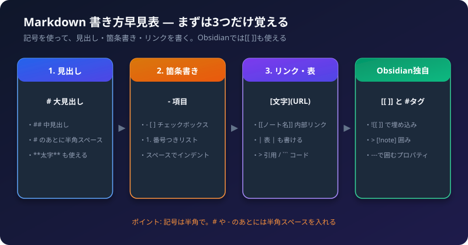

Markdown（マークダウン）は、**記号を使って、文字に見出しや箇条書きなどの意味をつける書き方**です。Obsidian のメモ、GitHub、このサイトの記事も、Markdown で書かれています。

覚えるのは、最初は**見出し・箇条書き・リンク**の3つだけで十分です。残りは、必要になったときに、この早見表を見てください。

## 1. 基本の書き方

| 見た目 | 書き方 | 例 |
| :--- | :--- | :--- |
| 大見出し | `# ` を行頭につける | `# 会議メモ` |
| 中見出し | `## ` | `## 決定事項` |
| 小見出し | `### ` | `### 担当` |
| 太字 | `**` で囲む | `**重要**` |
| 斜体 | `*` で囲む | `*補足*` |
| 取り消し線 | `~~` で囲む | `~~中止~~` |
| 区切り線 | `---` だけの行 | `---` |

**ポイント:** `#` のあとには、**半角スペース**を入れます。`#会議メモ` のようにスペースがないと、見出しになりません。

## 2. 箇条書きとチェックボックス

```markdown
- 箇条書き
- もう一つの項目
  - 先頭にスペース2つ（または Tab）でインデント

1. 番号つきの箇条書き
2. 2番目

- [ ] 未完了のタスク
- [x] 完了したタスク
```

- 行頭の `-` のあとに、**半角スペース**を入れます。
- チェックボックス `- [ ]` は、Obsidian の閲覧画面でクリックすると、`[x]` に切り替わります。

## 3. リンク

| 種類 | 書き方 |
| :--- | :--- |
| Webページへのリンク | `[表示する文字](https://example.com)` |
| 画像 | `` |

```markdown
[Obsidian 公式ヘルプ](https://help.obsidian.md/)
```

## 4. 表

```markdown
| 項目 | 内容 |
| :--- | :--- |
| 日付 | 11月3日 |
| 場所 | 会議室 |
```

- 1行目が見出し行、2行目の `:---` が区切り行です。
- 縦棒 `|` の位置をそろえなくても、表示は崩れません。
- 表の作り方に慣れるまでは、Excel などの表を貼り付けて、直す方法も使えます。

## 5. 引用とコード

````markdown
> 引用したい文章は、行頭に > をつける

`短いコードやコマンド` は、バッククォート（`）で囲む

```text
複数行のコードや、
そのまま見せたい文章は、
バッククォート3つで囲む
```
````

バッククォートは、キーボードで `Shift + @`（日本語配列）を押すと入力できることが多いです。

## 6. Obsidian だけで使える書き方

Obsidian では、標準の Markdown に加えて、次の書き方が使えます。GitHub など、ほかの場所では、正しく表示されないことがあります。

| 書き方 | できること |
| :--- | :--- |
| `[[ノート名]]` | 別のノートへの**内部リンク** |
| `[[ノート名\|表示名]]` | 表示する文字を変えたリンク |
| `[[ノート名#見出し]]` | ノートの特定の見出しへのリンク |
| `![[ノート名]]` | 別のノートの中身を**埋め込む** |
| `#タグ` | タグをつける |
| `==強調==` | 蛍光ペンのような強調 |
| `%%コメント%%` | 閲覧画面に表示されないコメント |

### コールアウト（目立つ囲み）

```markdown
> [!note] メモ
> ここに書いた内容が、囲みで表示されます。

> [!warning] 注意
> 個人情報は書かない。
```

`note`、`warning`、`tip` など、種類によって、色とアイコンが変わります。

### プロパティ（メモの情報）

ノートの**一番上**に、`---` で囲んで書きます。

```markdown
---
日付: 2026-11-03
種類: 会議
---
```

## 7. よくある間違い

| 症状 | 原因と対処 |
| :--- | :--- |
| 見出しにならない | `#` のあとに、半角スペースがない |
| 箇条書きにならない | `-` のあとに、半角スペースがない |
| 改行したのに、つながって表示される | 行末にスペース2つを入れるか、1行空ける |
| 表が表示されない | 2行目の区切り行（`:---`）がない。表の前に空行がない |
| リンクが開かない | `[ ]` と `( )` の順序が逆。全角の括弧を使っている |
| 全角スペースでインデントがずれる | インデントは、半角スペースか Tab を使う |

記号は、**半角**で書くのが基本です。日本語入力のままだと、全角の記号になりやすいので、注意してください。

## 8. チェックリスト

- [ ] 見出し（`#`）と箇条書き（`-`）を、半角スペース付きで書けるか
- [ ] Web ページへのリンクを書けるか
- [ ] 表を、1つ作ってみたか
- [ ] `[[ ]]` で、Obsidian の内部リンクを作れるか
- [ ] 書き方を忘れたら、この早見表に戻ると決めたか

関連記事: [最初の1週間の使い方](/howto-canvas/obsidian/first-week/)、[校務のメモの取り方](/howto-canvas/obsidian/note-taking-tips/)
