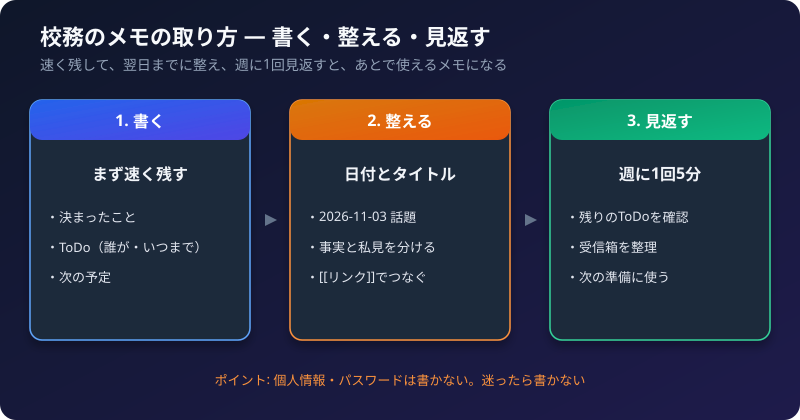
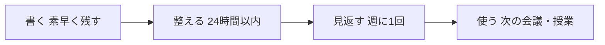

メモは、書くだけでは役に立ちません。**あとで見つけられて、そのまま使える**ことが大切です。
この記事では、会議・授業・面談などの校務メモを、役立つ形にするためのコツを紹介します。

ツールは、Obsidian を例にしていますが、考え方は、ほかのメモアプリや紙のノートでも使えます。

## 1. メモの全体の流れ



| 段階 | やること | 目安 |
| :--- | :--- | :--- |
| 書く | きれいさより、**速さ**を優先して残す | その場 |
| 整える | タイトル・日付・ToDo をそろえる | 当日〜翌日 |
| 見返す | 残っている ToDo と、次にやることを確認する | 週に1回 |
| 使う | 次の会議や授業の準備に使う | 必要なとき |

## 2. 何を書くか

すべてを書き写す必要はありません。**あとで困らないこと**を優先します。

| 優先して残すもの | 例 |
| :--- | :--- |
| **決まったこと** | 「文化祭の日程は、11月20日に決定」 |
| **やること（ToDo）** | 「資料を作る（担当: 自分、期限: 11/10）」 |
| **理由** | 「予算の都合で、今年は見送り」 |
| **次の予定** | 「次回は12月5日、議題は成績処理」 |
| **気づき・疑問** | 「この手順は、来年見直したほうがよさそう」 |

**書かなくてよいもの:** 雑談、すでに資料に載っている内容（資料へのリンクだけ残す）、後で確認できない推測。

## 3. 書き方のコツ

### コツ1: 1つのメモには、1つの話題

会議が3つの話題なら、メモは1つでも、**見出しを話題ごとに分けます**。1つの話題が長くなったら、別のメモに分けて、リンクでつなぎます。

### コツ2: タイトルで、中身が分かるようにする

| 悪い例 | よい例 |
| :--- | :--- |
| メモ | 2026-11-03 学科会議 |
| 会議 | 2026-11-03 学科会議 文化祭の担当 |
| 授業のこと | 情報A 第5回 授業の振り返り |

- 日付は、**年-月-日（2026-11-03）**の形にそろえると、並べたときに、順番になります。
- 「いつ・何の・何について」が分かると、検索で見つけやすくなります。

### コツ3: 事実と自分の考えを分ける

| 種類 | 書き方の例 |
| :--- | :--- |
| 事実 | 「Aさんが、提出が遅れると話した」 |
| 自分の考え | 「（私見）提出方法の案内が、分かりにくかったかもしれない」 |

「（私見）」「→」などの目印をつけると、あとで読み返したときに、区別できます。

### コツ4: ToDo は、「誰が・何を・いつまで」

```markdown
- [ ] 文化祭の担当表を作る（自分・11/10まで）
- [ ] 予算案を確認してもらう（教務・11/15まで）
```

- 担当と期限がない ToDo は、忘れられやすくなります。
- 完了したら、`[x]` にします。残ったものは、週の見返しで、次の週に移します。

### コツ5: 専門用語・略語は、最初に書き下す

自分だけが分かる略語は、数か月後の自分に通じないことがあります。最初の1回は、正式な名前を書いてください。

## 4. あとで探しやすくするには

1. **タイトルに、日付と話題を入れる。**
2. **プロパティを、そろえる。** 「日付」「種類」（会議・授業・面談など）を、毎回同じ書き方で入れます。
3. **関連するメモを、`[[リンク]]` でつなぐ。** 会議メモから、授業のメモや資料へ。
4. **キーワードを、本文に残す。** 検索は、メモの中の言葉に当たります。「あとで検索しそうな言葉」を、1回は書いておきます。

書き方の記号は、[Markdown 書き方早見表](/howto-canvas/obsidian/markdown-cheatsheet/) を参照してください。

## 5. 書いてはいけない情報（個人情報の扱い）

校務のメモには、扱いに注意が必要な情報が混ざります。

| 書かない・分けて管理する | 理由 |
| :--- | :--- |
| パスワード・認証コード | 流出すると、被害が大きい |
| 学生の氏名と、成績・健康・家庭の事情を、組み合わせた記述 | 個人が特定される |
| 学校の規程で、持ち出しが禁止されている情報 | 規程違反になる |

- 学生の話は、「学生A」のように**匿名**で書き、対応表は、別の安全な場所に置きます。
- 迷うときは、**書かない**ほうを選びます。
- 外部のクラウドや AI サービスに渡してよいかは、学校のルールを確認してください。
- 面談記録の扱いは、[校務で使える Obsidian 活用例](/howto-canvas/obsidian/school-use-ideas/) の「面談記録は個人情報です」を参照してください。

## 6. 見返す習慣

メモは、見返して初めて、役に立ちます。

| タイミング | やること（5〜10分） |
| :--- | :--- |
| **その日の終わり** | 今日のメモの ToDo を確認。書き足りないところを足す |
| **週の終わり** | 未完了の ToDo を、来週に移す。受信箱のメモを整理する |
| **学期の終わり** | 授業の振り返りを読み、次の学期の改善点を書き出す |

最初から全部やろうとせず、**週の終わりの見返し**だけ、続けてみてください。

## 7. 続けるコツ

- **完璧を目指さない。** 空欄があっても、短くても、書いたほうがよいです。
- **決まった場所に書く。** 「とりあえず受信箱」と決めておくと、迷いません。
- **テンプレートを使う。** 毎回の書き始めの手間が減ります。
- **使いにくい決まりは、やめる。** 続かないルールは、減らしてください。

## 8. チェックリスト

- [ ] メモのタイトルに、日付と話題が入っているか
- [ ] 決まったこと・ToDo・次の予定が、残っているか
- [ ] ToDo に、担当と期限があるか
- [ ] 事実と、自分の考えを、分けて書いているか
- [ ] 個人情報や、パスワードを書いていないか
- [ ] 週に1回、見返す時間を決めたか

関連記事: [Markdown 書き方早見表](/howto-canvas/obsidian/markdown-cheatsheet/)、[校務で使える Obsidian 活用例](/howto-canvas/obsidian/school-use-ideas/)、[最初の1週間の使い方](/howto-canvas/obsidian/first-week/)
