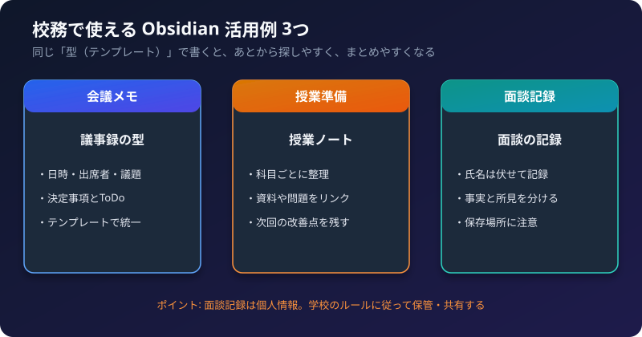

会議、授業、面談 ― 校務のメモには、「毎回ほぼ同じ形」のものがたくさんあります。
Obsidian の**テンプレート**と**リンク**を使うと、書く手間が減り、あとから探しやすくなります。

この記事では、3つの活用例を、コピーして使えるひな形つきで紹介します。基本の操作は、[最初の1週間の使い方](/howto-canvas/obsidian/first-week/) を参照してください。

## 1. 基本の考え方

1. **同じ型（テンプレート）で書く。** 項目がそろうと、探しやすく、AIにも読ませやすくなります。
2. **プロパティで、ノートの種類をそろえる。** 「種類: 会議」などを入れておくと、あとでまとめて探せます。
3. **リンクでつなぐ。** 会議→授業→学生、のように、関連するメモをつなぎます。

## 2. 活用例1: 会議メモ

**使い方:** 会議のたびに、テンプレートから新しいノートを作ります。決定事項と ToDo を、毎回同じ場所に書きます。

```markdown
---
日付: {{date}}
種類: 会議
---

# {{title}}

## 出席者

## 議題

## 決定事項

## ToDo
- [ ] 内容（担当・期限）

## 次回
```

**便利な使い方**
- 決定事項の中に、`[[授業の改善案]]` のように、関連するノートへのリンクを書く。
- 「種類: 会議」で検索して、過去の会議を、まとめて見る。
- 録音から議事録を作る流れは、[議事録・面談報告書を Gemini のスキルで毎回同じ形式で作る手順](/howto-canvas/ai/notebooklm/minutes-gemini-skill-workflow/) を参照してください。出力した Markdown を、そのままノートにできます。

## 3. 活用例2: 授業準備・振り返り

**使い方:** 科目ごとに、授業のノートを作ります。授業が終わったら、振り返りを残します。

```markdown
---
日付: {{date}}
種類: 授業
科目:
---

# {{title}}

## ねらい

## 内容・流れ

## 使った資料
- [[資料名]]

## 振り返り（うまくいったこと・改善点）

## 次回に向けて
```

**便利な使い方**
- 「改善点」を残しておくと、次の年の準備のときに、検索で見つけられます。
- 試験問題のメモは、`[[]]` で授業ノートにリンクする。
- 「科目」のプロパティをそろえて、科目ごとに、まとめて見られるようにする。

## 4. 活用例3: 面談記録

**使い方:** 学生との面談を、**同じ項目**で記録します。あとで経過を追いやすくなります。

```markdown
---
日付: {{date}}
種類: 面談
対象: 学生A
---

# {{title}}

## 面談の目的

## 本人の発言（事実）

## 気づき・所見（面談者の見立て）

## 確認した事項

## 今後の対応・次回の予定
```

**記録のコツ**
- **事実と所見を分けて書く。** 「本人がこう言った」と、「私はこう思った」を、別の見出しにします。
- 断定的な評価や、診断のような書き方は、避けます。
- 次回の面談の日と、確認することを、必ず残します。

### 面談記録は個人情報です

:::caution[個人情報の取り扱い]
面談記録には、学生の個人情報や、センシティブな内容が含まれます。次の点を、必ず確認してください。

- **学校の規程を確認する。** 面談記録を、パソコンのファイルや、クラウド（OneDrive など）に保存してよいか、確認してください。
- **氏名は伏せる。** 「学生A」のような表記や、学籍番号の一部だけで記録し、対応表は、別の安全な場所に置きます。
- **保存場所を分ける。** 面談記録は、他のメモとは別のフォルダ（または別のボールト）に置くと、扱いやすくなります。
- **他の人に見られない。** 画面共有や、同期する端末にも、注意します。
- **AI に渡す前に確認する。** Claude などの外部サービスに、面談記録を渡してよいかは、学校のルールによります。迷うときは、渡しません。
:::

## 5. 毎週のふり返り

週の終わりに、次を見直すと、メモが「生きた記録」になります。

1. その週のデイリーノートを、見返す。
2. 残っている ToDo を、次の週に移す。
3. 授業の改善点を、授業ノートに書き足す。

## 6. 続けるコツ

- 最初は、**テンプレートを1つ**だけ（会議メモがおすすめ）。
- 毎回きれいに書こうとしない。**空欄があってもよい**。
- 使いにくい項目は、テンプレートから、どんどん削る。

## 7. チェックリスト

- [ ] 会議メモのテンプレートを作ったか
- [ ] 授業ノートに「振り返り」の項目があるか
- [ ] 面談記録は、氏名を伏せて、別のフォルダに置いたか
- [ ] 面談記録の保存場所は、学校のルールに合っているか
- [ ] 外部のAIに渡してよい情報かを、確認してから使っているか

関連記事: [Obsidian とは？ 何が便利？](/howto-canvas/obsidian/what-is-obsidian/)、[校務で使えるAIエージェントの作り方](/howto-canvas/ai/agents/school-ai-agent-ideas/)
