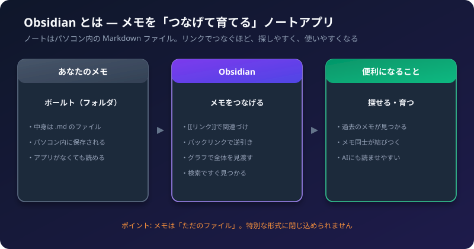
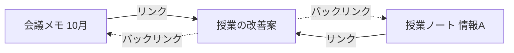

Obsidian（オブシディアン）を入れてみたけれど、「ふつうのメモ帳と何が違うの？」「何が便利なのか分からない」と感じていませんか。
この記事では、Obsidian の**便利なところ**を、ふつうのメモアプリとの違いから説明します。

## 1. Obsidian とは

Obsidian は、**メモを書いて、メモ同士をつなげて、育てていく**ためのアプリです。

ポイントは3つです。

1. **メモは、パソコン内の「ただのファイル」として残ります。** 形式は Markdown（`.md`）という、文字だけのファイルです。
2. **メモ同士を、リンクでつなげられます。** つなぐほど、探しやすく、まとめやすくなります。
3. **機能を足して、自分好みに育てられます。** 標準の機能や、プラグインで広げられます。

## 2. ふつうのメモアプリとの違い

| 比べるところ | ふつうのメモアプリ | Obsidian |
| :--- | :--- | :--- |
| 保存の形 | アプリの中に保存（アプリ独自の形式） | **パソコン内のファイル（.md）** |
| メモ同士の関係 | 新しい順・フォルダ分けが中心 | **リンクでつなぐ**（逆引きもできる） |
| 探し方 | 検索が中心 | 検索 ＋ **リンクをたどる** ＋ 逆引き |
| アプリをやめたとき | データを取り出すのが大変なことがある | ファイルが残るので、**そのまま読める** |
| 機能の追加 | ほぼ固定 | プラグインや設定で**広げられる** |

## 3. 何が便利なのか（3つの理由）

### 理由1: メモが長く残り、他のツールでも使える
メモは、ただの文字ファイルです。Obsidian をやめても、他のエディタや、AI（Claude など）で読めます。
特定のアプリに、メモを閉じ込められる心配がありません。

### 理由2: リンクで「つながるメモ」になる
メモの中で `[[` と入力して、別のメモの名前を書くと、**リンク**になります。

たとえば、「会議メモ」の中に `[[田中先生の依頼]]` と書くと、そのメモへ飛べます。
逆に、「田中先生の依頼」のメモには、**「このメモを参照しているメモの一覧」**（バックリンク）が出ます。

「あの話、どこに書いたっけ」が、リンクをたどるだけで、見つかるようになります。

### 理由3: 自分の使い方に合わせて育てられる
標準の機能だけでも、次のようなことができます。

| 機能 | できること |
| :--- | :--- |
| デイリーノート | 毎日のメモを、日付つきで自動で作る |
| テンプレート | 会議メモなどの「型」を呼び出す |
| グラフビュー | メモのつながりを、図で見渡す |
| Bases | メモを、表やカンバンのように並べて見る |
| Canvas | メモや図を、自由に並べて整理する |
| Web Clipper | Webページを、メモとして取り込む |

最初から、全部を使う必要はありません。まずは、**書く・リンクする・探す**の3つで十分です。

## 4. 「ボールト」とは

Obsidian では、メモを入れるフォルダを**ボールト（Vault）**と呼びます。

- ボールトは、パソコン内の普通のフォルダです。
- 中に、メモ（`.md`）や、画像などが入ります。
- ボールトごとに、設定やプラグインが別になります。
- 仕事用と個人用など、複数のボールトを作ることもできます。

## 5. 向いている人・向いていない人

**向いている人**
- メモが増えてきて、探すのが大変になってきた人
- 会議・授業・面談など、**同じ型のメモを、たくさん書く人**
- メモを、AI に読ませたり、整理させたりしたい人
- 自分のデータを、自分で持っておきたい人

**向いていないかもしれない場面**
- 手書きのメモや、写真が中心の人（アプリの得意分野ではありません）
- 設定や使い方を覚える時間を、まったく取れない人（最初は、少し慣れが必要です）

## 6. 料金について

- Obsidian 本体は、無料で使えます（料金は変わることがあるので、公式サイトで確認してください）。
- 複数の端末で同期する「Obsidian Sync」や、メモをWebで公開する「Obsidian Publish」は、有料のオプションです。
- パソコンだけで使う場合は、有料のものは、必要ありません。

## 7. 次に読む記事

- [最初の1週間の使い方](/howto-canvas/obsidian/first-week/)
- [Markdown 書き方早見表](/howto-canvas/obsidian/markdown-cheatsheet/)
- [校務のメモの取り方](/howto-canvas/obsidian/note-taking-tips/)
- [校務で使える Obsidian 活用例](/howto-canvas/obsidian/school-use-ideas/)
- [Claude Code × Obsidian：ボールトを Claude に整理してもらう](/howto-canvas/obsidian/claude-code-with-obsidian/)

## 8. チェックリスト

- [ ] Obsidian が、「ただのファイル」でメモを保存していることを理解したか
- [ ] `[[` でリンクを作れるか
- [ ] ボールト（フォルダ）の場所を、確認したか
- [ ] まず「書く・リンクする・探す」の3つから始めると決めたか
